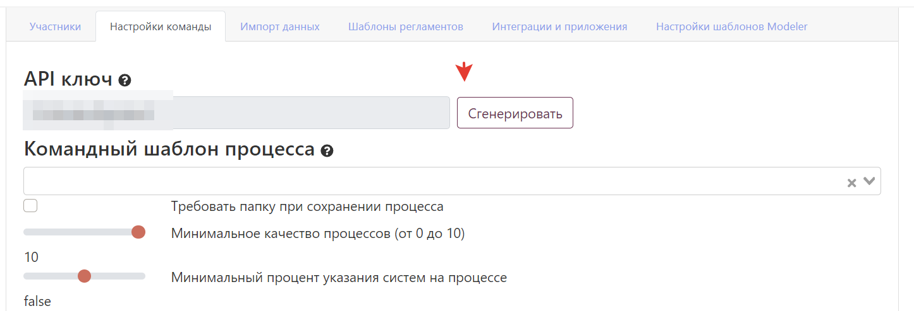

---
dir:
    order: 7
    link: true
    text: 7. REST API
    collapsible: true
index: true
order: 7
---

[[toc]]

# REST API

Система предоставляет REST API для автоматизации основных задач - получения и изменения диаграмм, управления элементами архитектуры. API работает по протоколу HTTP с сериализацией JSON.

::: warning Ограничения облачной версии
В облачной версии действуют ограничения на использование API по скорости и размеру запросов.
:::

---

## Авторизация

### Получение ключа API

Для получения ключа API выполните следующие шаги:

1. Перейдите в раздел **"Команда"**
2. Откройте вкладку **"Настройки команды"**
3. Нажмите **"Сгенерировать ключ"**



### Использование ключа

| Параметр         | Значение              | Описание                                     |
| ---------------- | --------------------- | -------------------------------------------- |
| **Заголовок**    | `X-Api-Key`           | Добавляйте ко всем API запросам              |
| **Права**        | Администратор команды | Действия выполняются от имени администратора |
| **Безопасность** | Конфиденциально       | Не передавайте ключ третьим лицам            |

---

## Ограничения облачной версии

### Лимиты по умолчанию

| Параметр               | Значение          | Описание                                      |
| ---------------------- | ----------------- | --------------------------------------------- |
| **Скорость запросов**  | 5 запросов/минуту | Проверяйте заголовок `X-Rate-Limit-Remaining` |
| **Размер запроса**     | 10 МБ             | Максимальный размер одного запроса            |
| **Диаграмм за запрос** | 20 штук           | Для методов загрузки диаграмм                 |

### Превышение лимитов

**При достижении квоты:**

```json
{
    "timestamp": "2022-06-28T12:03:03.438+00:00",
    "status": 429,
    "error": "Too Many Requests",
    "message": "You have exhausted your API Request Quota",
    "path": "/public-api/v1/upload-diagrams"
}
```

**Заголовки ответа:**

-   `X-Rate-Limit-Remaining` - оставшиеся запросы
-   `X-Rate-Limit-Retry-After-Seconds` - время ожидания до следующей попытки

::: danger Блокировка аккаунта
При превышении лимита более 3 раз за 24 часа учетная запись будет заблокирована. Обратитесь в поддержку для разблокировки.
:::

---

## Разделы справочника

- **[Диаграммы и элементы архитектуры](./diagrams.md)** — загрузка диаграмм, элементы архитектуры, получение списка/по ID, описания, согласования.
- **[Метрики процессов](./metrics.md)** — управление метриками процессов.
- **[Организационная структура](./org-structure.md)** — оргюниты, должности, сотрудники, связи.

::: warning Изменение типов элементов архитектуры
Встроенные типы элементов архитектуры (кроме **Документ** и **Система**) теперь классифицируются как **Пользовательские типы**. Это влияет на формат запросов к API и правила импорта данных.
:::

### Новые эндпоинты

#### Перенос связей между нодами

`POST /api/v1/graph/edges/migrate`

Переносит все живые связи исходной ноды на целевую ноду в рамках одной транзакции. Дублирующиеся связи у цели и связь с самой целью гасятся и учитываются в итоговом счетчике `merged`.

**Параметры запроса:**

| Параметр | Тип | Обязательный | Описание |
| --- | --- | --- | --- |
| `from` | Объект | Да | Ссылка на исходную ноду. Нода может не существовать. |
| `to` | Объект | Да | Ссылка на целевую ноду. Нода должна существовать и быть доступна. |

**Требования к доступу:**

- Права: `UPDATE_GRAPH_EDGE`
- Существующая исходная нода и корень ACL-типа должны быть доступны.
- Целевая нода должна существовать и быть доступна.

**Коды ошибок:**

| Код | Ошибка | Описание |
| --- | --- | --- |
| 400 | `GRAPH_SELF_LINK` | Попытка переноса на саму себя |
| 400 | `GRAPH_NODE_NOT_FOUND` | Нода не найдена (см. `meta.ref`) |
| 400 | `GRAPH_NODE_REF_INVALID` | Неверная ссылка на ноду |
| 400 | `GRAPH_NODE_TYPE_UNSUPPORTED` | Неподдерживаемый тип ноды |
| 400 | `GRAPH_LIMIT_EXCEEDED` | Превышен лимит (макс. 5000 связей) |
| 409 | `GRAPH_EDGE_EXISTS` | Конфликт существующей связи |

::: warning Лимит миграции
Максимальное количество связей, обрабатываемых за один запрос, составляет 5000. При превышении возвращается ошибка `GRAPH_LIMIT_EXCEEDED`.
:::

#### Использование лимитов команды

`GET /api/v1/team/{teamId}/plan-usage`

Возвращает все лимиты команды и текущее их использование в одном ответе.

**Параметры пути:**

| Параметр | Тип | Описание |
| --- | --- | --- |
| `teamId` | UUID | Идентификатор команды |

**Требования к доступу:**

- Пользователь должен быть авторизован.
- Пользователь должен быть активным членом указанной команды (статус `INVITED` не учитывается).

**Коды ошибок:**

| Код | Ошибка | Описание |
| --- | --- | --- |
| 403 | `FORBIDDEN` | Нет доступа к команде или пользователь не является её членом |

::: tip Кэширование
Ответ кэшируется на стороне сервера. Значения могут отставать от фактических до истечения TTL кэша, однако проверка лимитов при выполнении операций выполняется в реальном времени.
:::

---

## Лучшие практики

### Оптимизация запросов

| Рекомендация           | Описание                               |
| ---------------------- | -------------------------------------- |
| **Пакетная обработка** | Отправляйте до 20 диаграмм за раз      |
| **Соблюдение лимитов** | Мониторьте заголовки rate limit        |
| **Retry логика**       | Реализуйте повторные попытки с backoff |
| **Логирование**        | Сохраняйте ID запросов для отладки     |

### Безопасность

| Аспект            | Рекомендация                             |
| ----------------- | ---------------------------------------- |
| **API ключи**     | Храните в переменных окружения           |
| **HTTPS**         | Используйте только защищенные соединения |
| **Права доступа** | Ограничивайте права API ключей           |
| **Ротация**       | Регулярно обновляйте ключи               |

### Формат ошибок

В ответах с кодами 400 и 409 может присутствовать поле `meta` с дополнительными деталями ошибки:

```json
{
    "timestamp": "2022-06-28T12:03:03.438+00:00",
    "status": 400,
    "error": "Bad Request",
    "code": "GRAPH_NODE_NOT_FOUND",
    "message": "Нода не найдена",
    "meta": {
        "ref": "uuid-здесь"
    },
    "path": "/api/v1/graph/edges/migrate"
}
```

Поле `meta` содержит пары ключ-значение, которые помогают идентифицировать объект, вызвавший ошибку (например, `ref` — идентификатор ноды).

### Мониторинг

-   **Отслеживайте лимиты** через заголовки ответов
-   **Логируйте ошибки** для анализа проблем
-   **Мониторьте время ответа** API
-   **Анализируйте использование** квот

::: tip Интеграция с CI/CD
Интегрируйте API в пайплайны развертывания для автоматического обновления диаграмм после изменений в коде.
:::

---

## Связанные разделы

-   **[Конфигурация](/configure/README.md)** - настройка системы
-   **[Безопасность](/configure/security/)** - настройки безопасности
-   **[Поддержка](/support/README.md)** - помощь при проблемах с API
