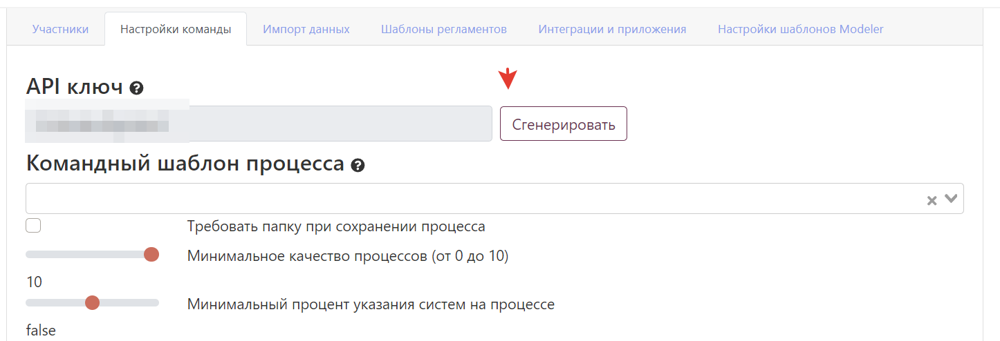

---
dir:
    order: 7
    link: true
    text: 7. REST API
    collapsible: true
index: true
order: 7
---

[[toc]]

# REST API

Система предоставляет REST API для автоматизации основных задач - получения и изменения диаграмм, управления элементами архитектуры. API работает по протоколу HTTP с сериализацией JSON.

::: warning Ограничения по тарифам
В облаке stormbpmn.com API доступен на тарифах «Команда» и «Бизнес» и ограничен по частоте запросов. В Enterprise (на ваших серверах) ограничений частоты нет. Подробности — в разделе [Ограничения по тарифам](#ограничения-по-тарифам).
:::

Адрес методов: все пути начинаются с `/public-api/v1`.

-   в облаке: `https://stormbpmn.com/public-api/v1/...`
-   в Enterprise: `https://<адрес вашего Stormbpmn>/public-api/v1/...`

---

## Авторизация

### Получение ключа API

Ключ API принадлежит команде, а не отдельному человеку. Создать его может только администратор команды.

1. Откройте **«Настройки команды»** → **«Общие настройки»**.
2. В карточке **«API ключ»** нажмите **«Сгенерировать»**.
3. Скопируйте ключ и сохраните его, например в переменной окружения интеграции.



У команды один ключ. Если сгенерировать ключ заново, старый сразу перестанет работать: замените ключ во всех интеграциях. Так же поступайте, если ключ утёк.

::: warning Ключ API и MCP-ключ — разные ключи
MCP-ключ создаётся в профиле (**«MCP-ключи»**) и начинается с `sk_storm_`. Для REST API он не подходит.
:::

### Использование ключа

| Параметр         | Значение              | Описание                                                                 |
| ---------------- | --------------------- | ------------------------------------------------------------------------ |
| **Заголовок**    | `X-Api-Key`           | Передавайте в каждом запросе                                             |
| **Права**        | Администратор команды | Действия выполняются от имени администратора команды                     |
| **Безопасность** | Конфиденциально       | Не передавайте ключ третьим лицам                                        |

```bash
curl -H "X-Api-Key: ВАШ_КЛЮЧ" "https://stormbpmn.com/public-api/v1/get-diagram-list?page=0"
```

Запросы выполняются от имени администратора команды: создателя команды, если он всё ещё администратор, иначе всегда одного и того же другого администратора. Через API видны модели, к которым есть доступ у этого администратора, а автором изменений в истории версий будет он.

---

## Ограничения по тарифам

| Тариф                          | Доступ к API | Частота запросов              |
| ------------------------------ | ------------ | ----------------------------- |
| Персональный                   | нет          | —                             |
| Пробный период                 | нет          | —                             |
| Команда                        | есть         | 1 запрос в секунду на команду |
| Бизнес                         | есть         | 5 запросов в секунду на команду |
| Enterprise (на ваших серверах) | есть         | без ограничения               |

Частота считается на всю команду: все интеграции с ключом одной команды делят общий лимит, счёт идёт по секундам. Остальные лимиты тарифа действуют и для API: например, если новые модели из пакета не помещаются в лимит моделей, пакет не загружается целиком. Аккаунт за превышение частоты не блокируется, достаточно повторить запрос.

### Ответы с ошибкой

| Код | Когда | Что делать |
| --- | ----- | ---------- |
| `400`, `Missing Header: X-Api-Key` | в запросе нет заголовка `X-Api-Key` | добавить заголовок |
| `400`, `"details": "Invalid team API key"` | ключ неверный или заменён новым | взять актуальный ключ в настройках команды |
| `403`, `"code": "PLAN_LIMIT"` | тариф Персональный или пробный период, либо исчерпан лимит тарифа (моделей, элементов архитектуры) | перейти на подходящий тариф или освободить место |
| `404` | модель или запись не найдена в команде ключа либо нет доступа | проверить идентификатор |
| `429 Too Many Requests` | превышена частота запросов | подождать, сколько указано в заголовке `Retry-After`, и повторить |

Пример ответа `429`:

```json
{
    "time": "2026-11-24T10:15:03.438+00:00",
    "message": "Too Many Requests",
    "details": "Превышена частота запросов к API: не больше 1 в секунду на вашем тарифе. Повторите позже или перейдите на Business",
    "code": "PLAN_LIMIT",
    "meta": null
}
```

---

## Разделы справочника

- **[Диаграммы и элементы архитектуры](./diagrams.md)** — загрузка диаграмм, элементы архитектуры, получение списка/по ID, описания, согласования.
- **[Метрики процессов](./metrics.md)** — управление метриками процессов.
- **[Организационная структура](./org-structure.md)** — оргюниты, должности, сотрудники, связи.

::: warning Изменение типов элементов архитектуры
Встроенные типы элементов архитектуры (кроме **Документ** и **Система**) теперь классифицируются как **Пользовательские типы**. Это влияет на формат запросов к API и правила импорта данных.
:::

- **[История версий объектов](./graph-history.md)** — история изменений, состояние на дату и дифф по адресу графа.

---

## Лучшие практики

-   **Ключ** храните в переменной окружения или хранилище секретов, не в коде и не в публичном репозитории.
-   **Пакеты:** отправляйте до 20 моделей за запрос и делайте паузу не меньше секунды между запросами на тарифе «Команда».
-   **Повторы:** на `429` повторяйте запрос после паузы из заголовка `Retry-After`; на остальные ошибки не повторяйте вслепую, сначала проверьте ответ.
-   **Ответы:** читайте только нужные поля и не падайте, если появилось новое: ответы со временем дополняются.
-   **Ротация:** при утечке сгенерируйте новый ключ, старый перестанет работать.

::: tip Интеграция с CI/CD
Интегрируйте API в пайплайны развертывания для автоматического обновления диаграмм после изменений в коде.
:::

---

## Связанные разделы

-   **[Конфигурация](/configure/README.md)** - настройка системы
-   **[Безопасность](/configure/security/)** - настройки безопасности
-   **[Поддержка](/support/README.md)** - помощь при проблемах с API
