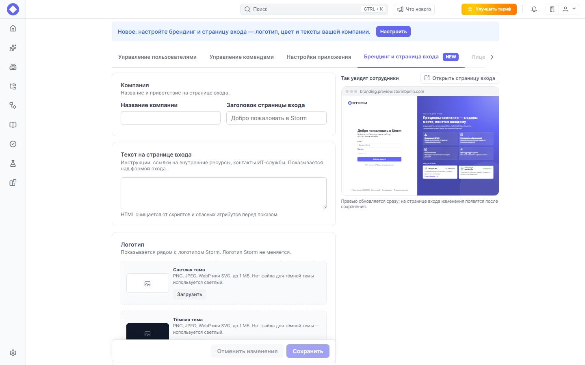
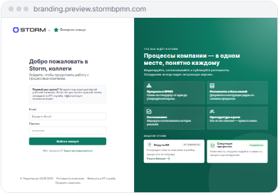
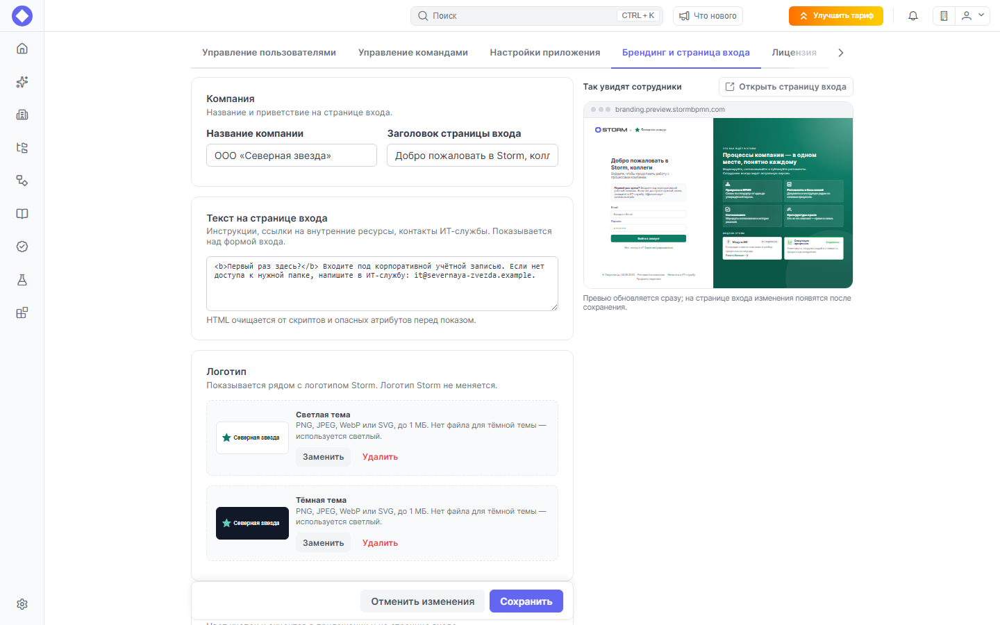
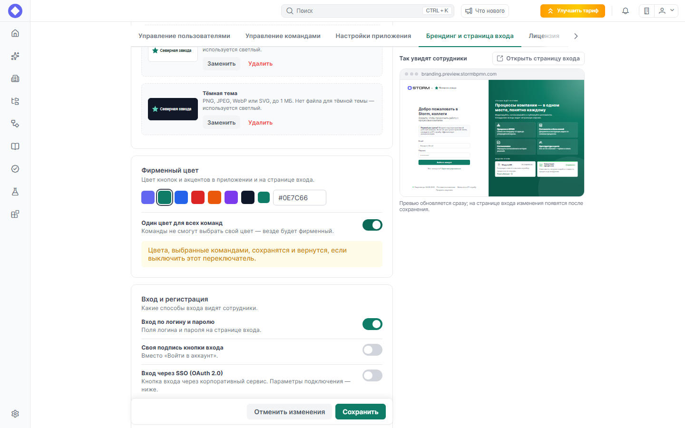
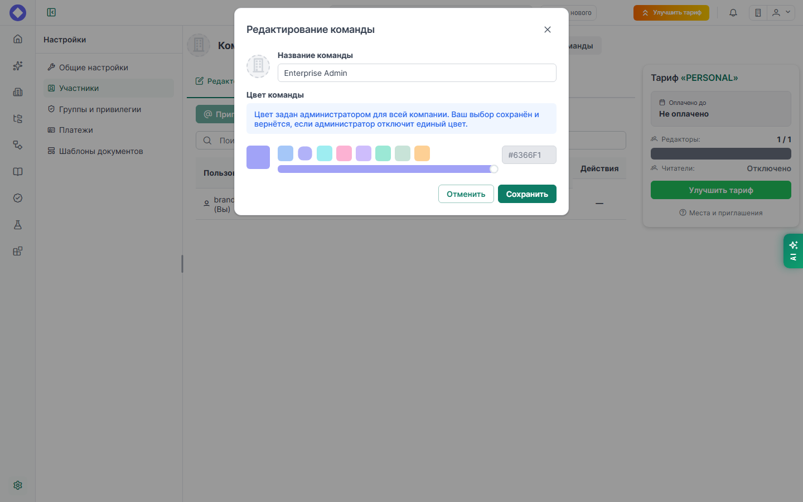
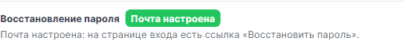
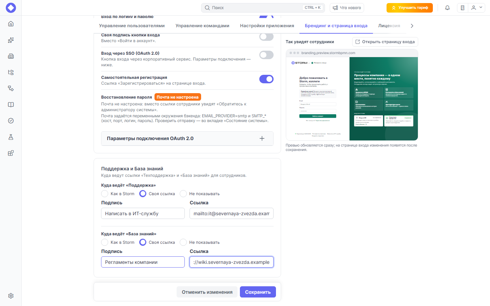
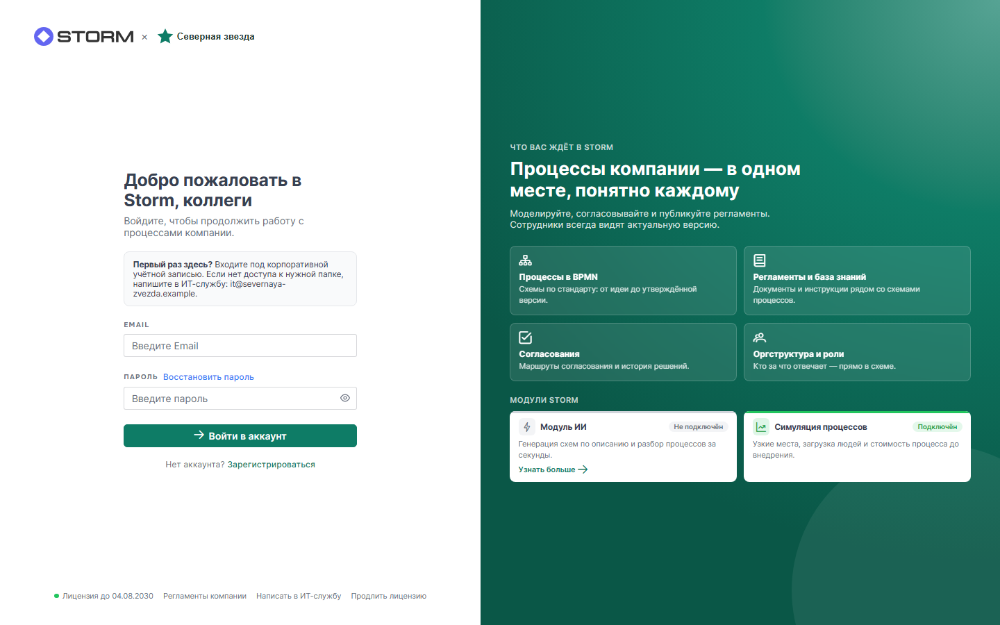
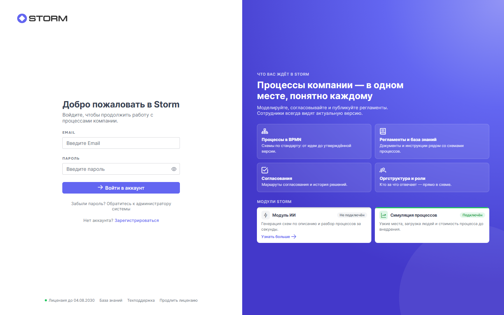
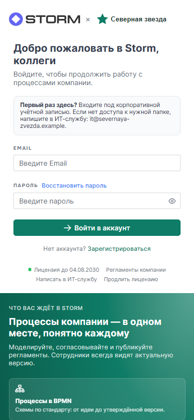

[[toc]]

# Брендинг и страница входа

На установке Enterprise у Stormbpmn нет публичного сайта: всё, что находится вне приложения, ведёт на **страницу входа**. Это первое, что видит сотрудник. Её можно оформить под вашу компанию: показать название и логотип, написать своё приветствие и подсказки, задать фирменный цвет и решить, какие ссылки поддержки увидят сотрудники.

::: tip Для кого эта страница
Для администратора установки. Настройка нужна один раз и занимает несколько минут. Сотрудники видят результат сразу после сохранения.
:::

## Что можно настроить

| Что | Где видно сотруднику |
| --- | --- |
| Название компании и логотип (светлый и тёмный) | Вверху страницы входа, рядом с логотипом Storm. Сам логотип Storm не меняется |
| Заголовок страницы входа | Над формой. Если не задан, показывается «Добро пожаловать в Storm» |
| Свой текст | Над формой входа: инструкции, контакты ИТ-службы, ссылки на внутренние ресурсы |
| Фирменный цвет | Кнопки и акценты на странице входа и в самом приложении |
| Способы входа | Вход по логину и паролю, вход через SSO, регистрация, восстановление пароля |
| Ссылки «Техподдержка» и «База знаний» | Внизу страницы входа |

Ещё на странице входа автоматически показываются срок действия лицензии («Лицензия до …») и модули, подключённые к вашей установке: ИИ и симуляция процессов.

::: warning Нужна действующая лицензия
Брендинг настраивается только при действующей лицензии Enterprise. Без неё сервер отклонит сохранение с сообщением «Брендинг настраивается только при активной enterprise-лицензии». Загружать логотипы может только администратор.
:::

## Где это настраивается

Есть два места, настройки в них одни и те же.

1. **Мастер первой настройки.** Шаг **«Брендинг»** (третий из семи) называется «Брендинг и страница входа». Он необязательный: кнопка **«Пропустить»** ведёт дальше, кнопка **«Продолжить»** сохраняет введённое и тоже ведёт дальше. Вернуться к настройке можно позже.

   

2. **Администрирование → вкладка «Брендинг и страница входа».** Пока вы её не открывали, рядом с названием вкладки стоит отметка **NEW**, а вверху страницы показывается подсказка с кнопкой **«Настроить»**.

   

   Справа от формы находится блок **«Так увидят сотрудники»**: это уменьшенная копия страницы входа. Она обновляется сразу, пока вы вводите данные. Кнопка **«Открыть страницу входа»** открывает настоящую страницу.

   

На вкладке изменения копятся и уходят на сервер кнопкой **«Сохранить»**; кнопка **«Отменить изменения»** возвращает сохранённые значения. На настоящей странице входа изменения появятся после сохранения. Исключение составляют логотипы: они загружаются сразу, без кнопки «Сохранить».



## Шаг 1. Название компании и заголовок

В блоке **«Компания»** два поля:

- **«Название компании»**: например, `ООО «Северная звезда»`. Показывается рядом с логотипом Storm. Если задать название, но не задавать заголовок, приветствие станет таким: «Добро пожаловать в Storm, ООО «Северная звезда»».
- **«Заголовок страницы входа»**: своё приветствие вместо стандартного. Пустое поле означает стандартный заголовок.

## Шаг 2. Свой текст на странице входа

Блок **«Текст на странице входа»** показывается над формой входа. Сюда можно написать:

- как войти в первый раз;
- кому писать, если нет доступа;
- ссылки на внутренние ресурсы компании.

Текст пишется как простая разметка HTML: абзацы, выделение (`<b>`), ссылки (`<a href="…">`). Перед показом посетителю разметка автоматически очищается от скриптов и опасных атрибутов, а картинки подгоняются по ширине. Пишите статичный текст, без сложной вёрстки.

::: tip Это та же настройка, что и раньше
Блок хранится в настройке `licensePageHtml`, которую раньше правили во вкладке «Настройки приложения». Заполненное значение сохраняется и появится в новой форме. Подробности о странице статуса лицензии: [«Как работают лицензии»](/operation/License.md#страница-статуса-лицензии-license-active).
:::

## Шаг 3. Логотип

В блоке **«Логотип»** два места под файлы:

- **«Светлая тема»**: основной логотип;
- **«Тёмная тема»**: необязательный. Если его нет, в тёмной теме используется светлый логотип.

Нажмите **«Загрузить»**, выберите файл. Когда логотип загружен, кнопки меняются на **«Заменить»** и **«Удалить»**.

Требования к файлу:

| Параметр | Значение |
| --- | --- |
| Формат | PNG, JPEG, WebP или SVG |
| Размер | не более 1 МБ |
| Форма | горизонтальный логотип с прозрачным фоном; он показывается рядом с логотипом Storm небольшой высоты, поэтому мелкие детали не читаются |

SVG-файл проверяется строго. Сервер **не принимает** SVG, если в нём есть что-либо из списка ниже, и показывает конкретную причину:

- скрипт (`<script>`);
- встроенный HTML (`<foreignObject>`);
- вложенные картинки и объекты (`<image>`, `<a>`, `<object>`, `<iframe>`, `<embed>`);
- обработчики событий (`onload`, `onclick` и другие);
- ссылки `javascript:`;
- `<!DOCTYPE>` и `<!ENTITY>`;
- `@import` в стилях;
- внешние ссылки в `href`, `src` и `url(…)` (допускаются только внутренние ссылки вида `#id`).

Если файл не принят, экспортируйте логотип из графического редактора заново, без этих элементов, либо загрузите PNG.

## Шаг 4. Фирменный цвет

Блок **«Фирменный цвет»** задаёт цвет кнопок и акцентов в приложении и на странице входа. Выберите один из готовых цветов (первый — стандартный цвет Storm), воспользуйтесь палитрой или введите код в формате `#RRGGBB`, например `#0E7C66`. Если код записан в другом формате, форма подскажет об ошибке и не даст сохранить.

Если цвет не задан, действует цвет команды или стандартный цвет Storm.

### Один цвет для всех команд

Обычно каждая команда выбирает свой цвет в настройках команды. Переключатель **«Один цвет для всех команд»** отменяет это: везде будет фирменный цвет.



- Цвета, которые команды выбрали раньше, **не удаляются**. Они вернутся, если выключить переключатель.
- Переключатель действует, только когда задан фирменный цвет.
- Когда переключатель включён, при редактировании команды сотрудник видит сообщение «Цвет задан администратором для всей компании. Ваш выбор сохранён и вернётся, если администратор отключит единый цвет», а выбор цвета недоступен.



## Шаг 5. Способы входа и регистрация

Блок **«Вход и регистрация»** определяет, что увидят сотрудники в форме входа.

| Параметр | Что делает |
| --- | --- |
| **«Вход по логину и паролю»** | Показывает поля логина и пароля |
| **«Своя подпись кнопки входа»** | Заменяет надпись «Войти в аккаунт» вашей, например «Войти по паролю». Поле для надписи появляется после включения |
| **«Вход через SSO (OAuth 2.0)»** | Показывает кнопку входа через корпоративный сервис. Надпись на кнопке задаётся в поле ниже, например «Войти через ИС Компании». Параметры подключения находятся в раскрывающемся блоке **«Параметры подключения OAuth 2.0»** |
| **«Самостоятельная регистрация»** | Показывает ссылку «Зарегистрироваться» |

Параметры подключения OAuth 2.0 подробно описаны в разделе [«Система авторизации»](/configure/security/authorization.md).

::: warning Нельзя отключить все способы входа
Хотя бы один из двух способов, вход по логину и паролю или вход через SSO, должен быть включён. Иначе никто не смог бы войти, и форма не даст сохранить такие настройки.
:::

### Восстановление пароля

Ссылка **«Восстановить пароль»** появляется на странице входа, только когда сервер умеет отправлять письма. Рядом с пунктом **«Восстановление пароля»** на вкладке стоит отметка **«Почта настроена»** или **«Почта не настроена»**.



Если почта не настроена, вместо ссылки сотрудники увидят надпись «Обратитесь к администратору системы». Это сделано намеренно, чтобы никто не ждал письма, которое не придёт.

Чтобы включить восстановление пароля, настройте отправку писем через простой SMTP. Эти параметры задаются переменными окружения сервера, в интерфейсе их изменить нельзя:

```bash
EMAIL_PROVIDER=smtp
SMTP_HOST=
SMTP_PORT=
SMTP_USERNAME=
SMTP_PASSWORD=
SMTP_FROM=
```

После изменения переменных перезапустите приложение. Проверить отправку можно во вкладке **«Состояние системы»**. Подробнее: [«Простой SMTP»](/install/production/components.md#вариант-2-простой-smtp).

## Шаг 6. Поддержка и База знаний

Блок **«Поддержка и База знаний»** управляет двумя ссылками внизу страницы входа. Для каждой выберите режим:

| Режим | Что произойдёт |
| --- | --- |
| **«Как в Storm»** | Ссылка ведёт на стандартный адрес: техподдержку и документацию Storm |
| **«Своя ссылка»** | Ссылка ведёт на ваш ресурс. Нужно указать **«Подпись»** (текст ссылки) и **«Ссылку»** |
| **«Не показывать»** | Ссылки на странице нет |



Ссылка должна начинаться с `http://`, `https://`, `mailto:` или `tg://`. Например, `mailto:it@company.ru` откроет письмо в почтовой программе сотрудника, а `https://wiki.company.ru` откроет внутреннюю вики. Если адрес написан иначе или не указана подпись, форма не даст сохранить настройки.

## Что увидят сотрудники

Так выглядит страница входа с настройками из примера: название и логотип рядом с логотипом Storm, свой заголовок, текст над формой, фирменный цвет, ссылка «Восстановить пароль», две своих ссылки и срок лицензии внизу.



Для сравнения: так страница выглядит, пока ничего не настроено.



На телефоне колонки перестраиваются: форма входа остаётся сверху, а информация о модулях уходит вниз.



Выход из приложения тоже приводит сотрудника на страницу входа с вашим оформлением.

## Частые вопросы

**Логотип не загружается: «SVG не принят…» или «Допустимы только PNG, JPEG, WebP и SVG».**
Проверьте формат и размер (не более 1 МБ). Для SVG прочитайте причину отказа в сообщении: чаще всего в файл попали встроенная картинка, внешняя ссылка или `<!DOCTYPE>`. Экспортируйте логотип без них или загрузите PNG.

**Не видно ссылки «Восстановить пароль».**
На сервере не настроена отправка писем. Задайте `EMAIL_PROVIDER=smtp` и параметры `SMTP_*`, перезапустите приложение и проверьте отметку «Почта настроена» на вкладке.

**Форма не даёт сохранить.**
Прочитайте красное сообщение над кнопками. Причины: выключены и вход по паролю, и SSO; цвет записан не в формате `#RRGGBB`; у своей ссылки нет подписи или адрес не начинается с `http://`, `https://`, `mailto:` или `tg://`.

**Сохранение отклоняется с сообщением про лицензию.**
Брендинг доступен только при действующей лицензии Enterprise. Проверьте срок и статус лицензии во вкладке «Лицензия».

**Я сохранил настройки, но на странице входа ничего не изменилось.**
Обновите страницу сочетанием Ctrl+F5. Если вы были авторизованы, выйдите и откройте страницу входа заново. Блок «Так увидят сотрудники» всегда показывает самое свежее состояние, а настоящая страница получает настройки после сохранения.

**Сотрудники жалуются, что не могут выбрать цвет команды.**
Включён переключатель «Один цвет для всех команд». Выключите его, и прежние цвета команд вернутся.

**Как вернуть всё, как было?**
Очистите поля, нажмите **«Удалить»** у логотипов, у ссылок выберите режим **«Как в Storm»**, сбросьте цвет и сохраните.

## Ключи настроек

Для администраторов, которые управляют установкой через настройки приложения. Все эти настройки публичные: их читает страница входа до авторизации, поэтому видимость включается автоматически и вручную её менять не нужно.

| Ключ | Назначение |
| --- | --- |
| `brandCompanyName` | Название компании |
| `brandWelcomeTitle` | Заголовок страницы входа |
| `brandLogo`, `brandLogoDark` | Логотип для светлой и тёмной темы. Задаются только загрузкой файла |
| `brandPrimaryColor` | Фирменный цвет `#RRGGBB` |
| `brandColorOverridesTeams` | Один цвет для всех команд (`true` или `false`) |
| `supportMode`, `supportLinkLabel`, `supportLinkUrl` | Ссылка «Техподдержка»: режим `storm`, `link` или `hidden`, подпись и адрес |
| `kbMode`, `kbLinkLabel`, `kbLinkUrl` | Ссылка «База знаний»: то же самое |
| `licensePageHtml` | Свой текст над формой входа |
| `showBasicLogin`, `showCustomLoginButtonName`, `CustomLoginButtonName`, `OAuthIsEnabled`, `OAuthButtonLabel`, `showRegistraton` | Способы входа и регистрация |

Если эти ключи редактируются через общий список настроек, значения логотипов лучше не трогать: файл загружается кнопкой на вкладке «Брендинг и страница входа».
