[[toc]]

# Система авторизации (OpenID Connect, OAuth2, ADFS)

### Вход через SSO (OpenID Connect и OAuth2)

::: warning Устаревшие способы входа
**LDAP** и прямая (встроенная) интеграция с Keycloak устарели. Для новых установок используйте вход через SSO в режиме **OIDC**, как описано ниже: Keycloak подключается к Storm как обычный провайдер OpenID Connect.
:::

Корпоративный вход через внешних провайдеров: Keycloak, Okta, Microsoft Entra ID, ADFS и других.

::: tip Где найти настройки OAuth2 в Enterprise
Откройте **Администрирование** (`/app/admin`) → **«Брендинг и страница входа»** → **«Вход и регистрация»** → **«Параметры подключения OAuth 2.0»**. Здесь находятся `OAuthClientId`, `OAuthClientSecret`, адреса провайдера и остальные параметры из таблицы ниже. После изменения нажмите **«Сохранить»**.

В актуальном интерфейсе Enterprise параметры OAuth2 перенесены из общего списка **«Настройки приложения»**. Поэтому поиск `OAuthClientId` в старом разделе может ничего не показывать. См. [«Брендинг и страница входа»](/configure/branding.md).
:::

#### Какой режим выбрать

Режим входа задаёт параметр **OAuthFlowMode**:

| Режим | Как устроен вход | Когда выбирать |
| --- | --- | --- |
| `OIDC` (рекомендуется) | OpenID Connect: Authorization Code + PKCE (S256) + `state` + `nonce`. Личность пользователя берётся из ID Token, подпись которого Storm проверяет по ключам провайдера. Access token может быть любым, в том числе непрозрачным | Для всех новых подключений: Keycloak, Okta, Microsoft Entra ID, ADFS 2019+ и любой провайдер с OpenID Connect Discovery |
| `PKCE` (легаси) | Authorization Code + PKCE, данные пользователя читаются из claims **access token** | Уже работающие подключения, в первую очередь ADFS по [инструкции ниже](#microsoft-adfs) |
| `implicit_flow` (легаси, устарел) | Access token приходит в браузер во фрагменте адреса, данные берутся из `/userinfo` | Только уже работающие старые подключения. Implicit flow не рекомендован RFC 9700 |

Если параметр не задан, используется `implicit_flow` — ради обратной совместимости со старыми установками. Режим сам не меняется ни при обновлении, ни при ошибке входа: Storm никогда не переключает OIDC на более слабый режим.

#### Режим OIDC (рекомендуется)

В режиме OIDC Storm сам находит адреса провайдера по документу Discovery (`<issuer>/.well-known/openid-configuration`). Поэтому для подключения обычно хватает адреса провайдера и данных клиента.

##### Минимальная настройка

| Параметр | Пример значения | Примечание |
| --- | --- | --- |
| **OAuthIsEnabled** | `true` | |
| **OAuthFlowMode** | `OIDC` | |
| **OAuthIssuerUri** | `https://sso.company.com/realms/company` | Issuer провайдера **точно** как в его документе Discovery, символ в символ |
| **OAuthClientId** | `stormbpmn` | ID клиента (приложения) у провайдера |
| **OAuthClientSecret** | `<секрет клиента>` | Не нужен только при `OAuthTokenEndpointAuthMethod = none` |
| **OAuthRedirectUri** | `https://stormbpmn.company.com/app/signin` | Должен совпадать с зарегистрированным у провайдера |
| **OAuthButtonLabel** | `Войти через корпоративный аккаунт` | Текст кнопки на странице входа |
| **OAuthScope** | `openid profile email` | `openid` обязателен |

`OAuthAuthorizeUri`, `OAuthTokenUri` и `OAuthUserInfoUri` в режиме OIDC можно оставить пустыми: адреса придут из Discovery. Если их заполнить, Storm возьмёт заданные значения вместо найденных.

::: tip Только https
Адрес провайдера и все его адреса должны быть `https://`. Исключение — `http://localhost` для тестового стенда.
:::

##### Все параметры режима OIDC

| Параметр | По умолчанию | Что делает |
| --- | --- | --- |
| **OAuthTokenEndpointAuthMethod** | `client_secret_post` | Как Storm предъявляет секрет при обмене кода на токены: `client_secret_post` — в теле запроса, `client_secret_basic` — в заголовке `Authorization` (по умолчанию в Okta), `none` — публичный клиент без секрета, защита только PKCE |
| **OAuthUserInfoEnabled** | `true` | Запрашивать UserInfo после проверки ID Token, чтобы дополнить профиль. Ответ принимается, только если `sub` в нём совпадает с ID Token. Выключайте, если все нужные claims уже есть в ID Token или провайдер не отдаёт UserInfo (ADFS) |
| **OAuthEmailClaim** | `email` | Из какого claim брать адрес почты, по которому заводится учётка. Для Entra ID и ADFS без атрибута почты можно указать `upn` или `preferred_username` |
| **OAuthLinkByEmail** | `true` | Привязывать при первом входе уже существующую учётку по совпадению адреса почты. См. [Привязка учётных записей](#привязка-учетных-записеи) |
| **OAuthJwksUri** | из Discovery | Адрес открытых ключей провайдера. Задавайте, только если Discovery у провайдера недоступен |
| **OAuthResource** | — | Параметр `resource` для ADFS. Отправляется, только если задан |
| **OAuthCheckClaim**, **OAuthClaimName**, **OAuthClaimValue** | выключено | Пускать только пользователей с нужным значением claim. См. [Проверка Claims](#проверка-claims) |
| **OAuthUseRefreshTokens** | выключено | Сессия Storm живёт столько же, сколько сессия у провайдера. См. [Привязка сессии к SSO](./sso-session-binding.md) |

`OAuthResponseType` и `OAuthCodeChallengeMethod` в режиме OIDC не используются: тип ответа всегда `code`, метод PKCE всегда `S256`.

##### Что Storm проверяет при входе

1. Перед уходом к провайдеру страница входа создаёт одноразовые `state`, `nonce` и `code_verifier`. Они живут только во вкладке браузера и стираются после возврата.
2. На возврате проверяется `state`. Чужой или повторный ответ отклоняется, чтобы никто не мог подсунуть пользователю вход в чужую учётку. Код, `state` и токены убираются из адресной строки и истории браузера.
3. Сервер меняет код на токены, предъявляя `code_verifier` и секрет клиента.
4. Проверяется ID Token по OpenID Connect Core §3.1.3.7:
   - подпись по ключам провайдера (RS256/384/512, PS256/384/512, ES256/384/512); неподписанные токены и HMAC не принимаются;
   - `iss` совпадает с `OAuthIssuerUri`;
   - `aud` содержит `OAuthClientId`, `azp` — если есть, равен ему;
   - срок действия (`exp`, `iat`, `nbf`) с допуском на расхождение часов в 60 секунд;
   - `nonce` совпадает с отправленным;
   - `at_hash` совпадает с access token, если провайдер его передал.
5. Если UserInfo включён, Storm запрашивает его с access token в заголовке `Authorization: Bearer` и принимает данные, только если `sub` совпадает с ID Token.
6. Проверяется право входа по claim, если оно включено.
7. Учётка находится по паре «issuer + `sub`», а не по адресу почты.

Сам access token Storm в режиме OIDC не разбирает: он нужен только для запроса UserInfo. Поэтому подходят и непрозрачные токены, и JWT, выпущенные для другого API (например, у Okta Org Authorization Server).

Ни токены, ни секреты, ни коды не пишутся в журналы и не выводятся в консоль браузера.

##### Привязка учётных записей

При первом входе через OIDC Storm запоминает пару «issuer + `sub`» пользователя (таблица `sm_sso_identity`). Дальше вход идёт по этой паре:

- пользователь сменил адрес почты или фамилию у провайдера — он входит в ту же учётку;
- у Storm уже есть учётка с таким адресом (создана паролем, через LDAP или прежним режимом SSO), а пары ещё нет — при `OAuthLinkByEmail = true` учётка привязывается к паре. При `false` вход отклоняется с кодом `sso_account_not_linked`;
- учётка с таким адресом уже привязана к **другому** пользователю того же провайдера (адрес передали новому сотруднику) — вход отклоняется с кодом `sso_account_conflict`. Учётка не перепривязывается никогда: разберитесь, чья она, и при необходимости измените адрес почты в Storm;
- учётки нет — она создаётся, как раньше, и сразу привязывается.

Привязка происходит только при входе. Массовой перепривязки при обновлении нет, существующие данные не меняются. Переход на другого провайдера (другой issuer) — это новая привязка по адресу почты; старая сохраняется.

::: warning Когда выключать OAuthLinkByEmail
Привязка по адресу почты безопасна, только если провайдер не даёт пользователю самому вписать произвольный адрес. Корпоративные каталоги (Active Directory, Okta с почтой из HR-системы) это гарантируют. Если провайдер передаёт `email_verified = false` в ID Token или в UserInfo, вход по такому адресу отклоняется всегда.

В Microsoft Entra ID claim `email` провайдер не проверяет. Если в приложение входят гости или в арендаторе есть неподтверждённые домены, выключите `OAuthLinkByEmail` или берите адрес из `upn` (`OAuthEmailClaim = upn`).
:::

##### Проверка подключения

В **«Параметрах подключения OAuth 2.0»** есть кнопка **«Проверить подключение»**. Она проверяет **сохранённые** настройки, без попытки входа:

- доступен ли Discovery и совпадает ли issuer;
- какие адреса Storm будет использовать и откуда они взяты (из настройки или из Discovery);
- доступны ли ключи подписи и сколько их;
- согласован ли способ аутентификации клиента с тем, что заявляет провайдер, и задан ли секрет;
- поддерживает ли провайдер PKCE S256, есть ли `email` в scope, включены ли UserInfo, проверка claim и привязка по почте.

Каждый пункт помечен «В порядке», «Внимание» или «Ошибка». Отчёт не содержит токенов, секретов и данных пользователей и доступен только администратору инсталляции.

##### Примеры для провайдеров

::: warning Что проверено на практике
- **Keycloak 26.4** — проверен живым входом на стенде: клиенты `client_secret_post`, `client_secret_basic` и публичный (`none`), проверка claim по группам, вход без UserInfo, а также легаси-режимы `PKCE` и `implicit_flow` на прежних настройках.
- **Okta (Org Authorization Server)** — проверено автотестом на имитации провайдера с непрозрачным access token. На настоящем арендаторе Okta вход не проверялся.
- **Microsoft Entra ID и ADFS в режиме OIDC** — настройки ниже составлены по документации провайдеров и на практике не проверялись.
:::

**Keycloak**

| Параметр | Значение |
| --- | --- |
| **OAuthIssuerUri** | `https://keycloak.company.com/realms/company` |
| **OAuthTokenEndpointAuthMethod** | `client_secret_post` или `client_secret_basic` |

В клиенте Keycloak: **Client authentication** — ON, **Standard flow** — ON, **Implicit flow** — OFF, **Valid redirect URIs** — `https://stormbpmn.company.com/app/signin`, вкладка **Advanced** → **Proof Key for Code Exchange Code Challenge Method** — `S256`. Для проверки по группам добавьте в client scope mapper **Group Membership** с именем claim `groups` и выключенным **Full group path**, включив **Add to ID token**.

**Okta**

| Параметр | Org Authorization Server | Custom Authorization Server |
| --- | --- | --- |
| **OAuthIssuerUri** | `https://company.okta.com` | `https://company.okta.com/oauth2/default` |
| **OAuthTokenEndpointAuthMethod** | `client_secret_basic` | `client_secret_basic` |

Приложение в Okta: **OIDC — Web Application**, grant type **Authorization Code**, **Sign-in redirect URI** — `https://stormbpmn.company.com/app/signin`. Org Authorization Server выдаёт access token только для API самой Okta, и стороннее приложение не может его проверить. В режиме OIDC это не мешает: Storm берёт личность из ID Token, а access token использует только для UserInfo. Настраивать собственный Authorization Server ради Storm не нужно. Для проверки по группам задайте **Groups claim filter** на вкладке **Sign On** приложения: тогда claim `groups` попадёт в ID Token.

**Microsoft Entra ID**

| Параметр | Значение |
| --- | --- |
| **OAuthIssuerUri** | `https://login.microsoftonline.com/<tenant-id>/v2.0` |
| **OAuthScope** | `openid profile email` |
| **OAuthEmailClaim** | `email`, или `preferred_username`, если у пользователей не заполнен атрибут почты |

Нужен адрес конкретного арендатора: адреса `common` и `organizations` не подходят, потому что issuer в их Discovery содержит шаблон `{tenantid}`. В регистрации приложения добавьте платформу **Web** с redirect URI и создайте секрет клиента. Claim `email` по умолчанию может не попасть в ID Token — добавьте его в **Token configuration** → **Add optional claim** → **ID** → `email`. Claim `groups` у Entra ID содержит идентификаторы групп (Object ID), а не названия, поэтому в `OAuthClaimValue` указывайте Object ID группы.

**ADFS (Windows Server 2019 и новее)**

| Параметр | Значение |
| --- | --- |
| **OAuthIssuerUri** | `https://adfs.company.com/adfs` |
| **OAuthUserInfoEnabled** | `false` |
| **OAuthEmailClaim** | `upn` или `email` |

UserInfo у ADFS возвращает только `sub`, поэтому выключите его и передайте имя, фамилию и почту в ID Token правилами выдачи claims. Уже работающее подключение ADFS в режиме `PKCE` по [инструкции ниже](#microsoft-adfs) переводить не обязательно.

##### Ошибки входа

Причина отказа видна пользователю в сообщении на странице входа. В журнале сервера её код записан в поле `code`. Самые частые коды:

| Код | Что случилось | Что сделать |
| --- | --- | --- |
| `sso_issuer_missing`, `sso_config_invalid`, `sso_insecure_endpoint` | Не задан или неверно задан адрес провайдера, либо адрес не `https` | Проверьте `OAuthIssuerUri` и адреса провайдера |
| `sso_discovery_unavailable` | Discovery провайдера недоступен | Проверьте сетевой доступ с сервера Storm к провайдеру и доверенные сертификаты |
| `sso_discovery_issuer_mismatch`, `sso_id_token_issuer` | Issuer в Discovery или в ID Token не совпадает с `OAuthIssuerUri` | Скопируйте issuer из Discovery символ в символ, включая завершающий `/`, если он там есть |
| `sso_client_auth_failed`, `sso_client_secret_missing` | Провайдер не принял секрет клиента, или секрет не задан | Проверьте `OAuthClientSecret` и `OAuthTokenEndpointAuthMethod` |
| `sso_code_rejected` | Провайдер отклонил код: истёк, уже использован или не совпал redirect URI | Повторите вход. Если повторяется — сверьте `OAuthRedirectUri` с настройкой у провайдера |
| `sso_id_token_missing` | В ответе нет ID Token | Добавьте `openid` в `OAuthScope` |
| `sso_id_token_signature`, `sso_jwks_unavailable`, `sso_id_token_algorithm` | Подпись ID Token не проверяется: ключи недоступны или алгоритм не поддерживается | Проверьте доступ к JWKS, алгоритм подписи клиента — RS256 или ES256 |
| `sso_id_token_audience`, `sso_id_token_azp` | ID Token выпущен для другого клиента | Проверьте `OAuthClientId` |
| `sso_id_token_expired`, `sso_id_token_iat`, `sso_id_token_nbf` | Срок ID Token не сходится | Синхронизируйте время на сервере Storm и у провайдера (NTP) |
| `sso_id_token_nonce` | `nonce` не совпал: ответ от другой попытки входа | Повторите вход из той же вкладки |
| `sso_userinfo_sub_mismatch` | UserInfo вернул данные другого пользователя | Проверьте настройки провайдера. Вход в таком случае не выполняется |
| `sso_userinfo_failed`, `sso_userinfo_unavailable` | UserInfo не ответил | Проверьте доступность провайдера или выключите `OAuthUserInfoEnabled` |
| `sso_email_missing`, `sso_email_invalid`, `sso_email_not_verified` | Провайдер не передал корректный подтверждённый адрес почты | Добавьте scope `email` или укажите `OAuthEmailClaim` |
| `sso_access_claim_missing`, `sso_access_denied` | У пользователя нет нужного значения claim | Выдайте пользователю группу или роль у провайдера |
| `sso_access_policy_misconfigured` | Проверка claim включена, но имя или значение claim не заданы | Заполните `OAuthClaimName` и `OAuthClaimValue` |
| `sso_account_not_linked`, `sso_account_conflict` | Учётку нельзя связать с пользователем провайдера | См. [Привязка учётных записей](#привязка-учетных-записеи) |
| `sso_idp_unavailable` | Провайдер не отвечает | Повторите позже. Вход по паролю при этом работает, если он включён |
| `sso_request_incomplete` | Страница входа не передала `code_verifier` | Откройте страницу входа заново и повторите вход |

##### Переход на OIDC со старого режима

1. Проверьте, что провайдер публикует Discovery: откройте `https://<issuer>/.well-known/openid-configuration`.
2. Заполните `OAuthIssuerUri`, при необходимости `OAuthTokenEndpointAuthMethod`, и поменяйте `OAuthFlowMode` на `OIDC`. Старые адреса можно не удалять: заданные вручную адреса имеют приоритет над Discovery, поэтому оставляйте их, только если они верные.
3. Нажмите **«Сохранить»**, затем **«Проверить подключение»**. Все пункты должны быть «В порядке» или «Внимание».
4. Войдите через SSO в отдельном окне, не закрывая окно администратора. Если вход не удался, верните `OAuthFlowMode` прежним — остальные настройки старого режима не менялись.

Существующие пользователи после перехода входят в свои учётки: при первом входе Storm привяжет их по адресу почты.

#### Легаси-режимы PKCE и implicit_flow

Режимы `PKCE` и `implicit_flow` остаются для уже работающих подключений и после обновления ведут себя как раньше, со следующими уточнениями безопасности:

- страница входа всегда отправляет `state` и проверяет его на возврате. Вход, начатый не со страницы Storm (например, с плитки на портале провайдера), отклоняется: такой ответ неотличим от подставленного. Чтобы плитка работала, укажите в ней адрес страницы входа Storm (в Okta — поле **Initiate login URI**): вход начнётся оттуда;
- в режиме `PKCE` вход без `code_verifier` отклоняется (`sso_request_incomplete`), без перехода на более слабую схему;
- в `implicit_flow` токен ждём во фрагменте адреса (`#access_token=…`). Если провайдер вернул его в параметрах запроса (`?access_token=…`), вход пройдёт, как и раньше, но только при совпавшем `state`. Такой адрес попадает в журналы прокси: штатный nginx образа Storm заменяет в журнале query-часть адреса с токеном на `***`, а на внешнем прокси или балансировщике это нужно настроить самим. Лучше перевести провайдер на фрагмент или режим `OIDC`;
- после входа код и токен стираются из адресной строки и истории браузера, в консоль браузера они не выводятся;
- проверка claim понимает массивы (подробнее — в разделе [Проверка Claims](#проверка-claims)).

Параметры легаси-режимов:

| Параметр              | Описание                                | Пример значения                                                                    |
| --------------------- | --------------------------------------- | ---------------------------------------------------------------------------------- |
| **OAuthIsEnabled**    | Включение OAuth2                        | `true`                                                                             |
| **OAuthClientId**     | ID клиента в провайдере                 | `stormbpmn-client`                                                                 |
| **OAuthClientSecret** | Секрет клиента                          | `your-client-secret`                                                               |
| **OAuthAuthorizeUri** | URL авторизации                         | `https://keycloak.company.com/realms/company/protocol/openid-connect/auth`     |
| **OAuthUserInfoUri**  | URL получения информации о пользователе | `https://keycloak.company.com/realms/company/protocol/openid-connect/userinfo` |
| **OAuthTokenUri**     | URL получения токена                    | `https://keycloak.company.com/realms/company/protocol/openid-connect/token`    |
| **OAuthButtonLabel**  | Текст на кнопке входа                   | `"Войти через корпоративный аккаунт"`                                              |
| **OAuthRedirectUri**  | URL возврата после авторизации          | `https://stormbpmn.company.com/app/signin`                                         |
| **OAuthFlowMode**     | Режим: `OIDC`, `PKCE` или `implicit_flow` | `PKCE`                                                                           |

::: tip Примеры URL для Keycloak 26
В стандартной установке Keycloak 26 адреса OIDC имеют вид `/realms/<realm>/protocol/openid-connect/...` — **без** старого префикса `/auth`. Используйте отдельный realm для сотрудников (в примере `company`), а не административный `master`. Если у Keycloak настроен собственный базовый путь, проверьте точные URL в `https://keycloak.company.com/realms/company/.well-known/openid-configuration` вашего realm. См. [официальные OIDC endpoints Keycloak](https://www.keycloak.org/securing-apps/oidc-layers).
:::

##### Параметры режима PKCE

| Параметр                     | Значение              | Примечание                                                          |
| ---------------------------- | --------------------- | -------------------------------------------------------------------- |
| **OAuthFlowMode**            | `PKCE`                | Включает Authorization Code Flow                                     |
| **OAuthResponseType**        | `code`                | Обязательно задать вместе с `OAuthFlowMode`                          |
| **OAuthScope**               | `openid profile email` | Должен давать доступ к email пользователя                           |
| **OAuthCodeChallengeMethod** | `S256`                | Оставляйте `S256`, `plain` — только для древних провайдеров          |
| **OAuthResource**            | Идентификатор Web API | Только для ADFS, остальные провайдеры параметр игнорируют            |

::: danger OAuthFlowMode и OAuthResponseType меняются вместе
Если включить `OAuthFlowMode = PKCE`, но не заполнить `OAuthResponseType`, страница входа уйдёт к провайдеру со старым `response_type=token` и будет ждать `code`, которого не будет. Вход зависнет без внятной ошибки. Для PKCE нужны оба параметра.
:::

::: warning Требования к клиенту в режиме PKCE
- Клиент должен быть **конфиденциальным**: `OAuthClientSecret` обязателен и отправляется при обмене кода на токен.
- Access token должен быть **JWT** и содержать `email` (либо `upn`, либо `unique_name`). Провайдерам с непрозрачными токенами выбирайте режим `OIDC`.
- `OAuthRedirectUri` должен совпадать с зарегистрированным у провайдера символ в символ.
:::

::: tip Сессия StormBPMN может жить ровно столько, сколько сессия у провайдера
По умолчанию после входа StormBPMN выпускает собственный токен на срок `SESSION_EXPIRATION` и живёт им независимо от провайдера. Если политика безопасности этого не допускает, включите привязку сессии к SSO — тогда токен продлевается у провайдера по `refresh_token`, а отзыв сессии в провайдере разлогинивает пользователя в StormBPMN.

Подробности и порядок включения — [Привязка сессии к SSO](./sso-session-binding.md).
:::

::: tip Настройка Keycloak
**Пошаговая инструкция для Keycloak 26.0.7 в режиме PKCE** (для режима OIDC — [примеры выше](#примеры-для-проваидеров)):

1. **Создать клиента** в нужном realm
2. **Client ID:** `stormbpmn-client`
3. **Valid redirect URIs:** `https://stormbpmn.company.com/app/signin`
4. **Web origins:** `https://stormbpmn.company.com`
5. **Client authentication:** ON
6. **Standard flow:** ON. **Implicit flow** оставьте OFF, если в StormBPMN выбран `OAuthFlowMode = PKCE`; включать его нужно только для legacy-режима `implicit_flow`
7. Для PKCE: вкладка **Advanced** → **Proof Key for Code Exchange Code Challenge Method** → `S256`
8. **Client Scopes:** email и profile должны быть default
9. **Получить Client Secret** на вкладке Credentials

:::

#### Заполнение ФИО в профиле пользователя

При каждом входе через OAuth2 StormBPMN синхронизирует поля профиля «Полное имя» (`fullName`), «Имя» (`firstName`) и «Фамилия» (`lastName`) из данных провайдера — сменили фамилию в провайдере, при следующем входе она обновится и в StormBPMN. Если провайдер атрибуты имени не передаёт, уже заполненные поля профиля не затираются.

Откуда берутся данные — зависит от режима потока:

| Режим            | Источник                | Атрибуты                                                                                   |
| ---------------- | ----------------------- | ------------------------------------------------------------------------------------------ |
| `implicit_flow`  | Ответ `/userinfo`       | `family_name` — фамилия, `given_name` (или `name`, если `given_name` нет) — имя, `middle_name` — отчество |
| `PKCE`           | Claims access token     | Готовый `full_name` или `displayname`; если их нет — ФИО собирается из `family_name` (или `surname`), `given_name` и `middle_name` |
| `OIDC`           | UserInfo (если включён), затем ID Token | Готовый `name`; если его нет — ФИО собирается из `family_name`, `given_name` и `middle_name` |

«Полное имя» собирается в формате **«Фамилия Имя Отчество»** из тех частей, которые провайдер передал.

::: tip Что настраивать у провайдера
Как правило, достаточно стандартного scope `profile` — он отдаёт атрибуты имени в `/userinfo`. Специальных прав или кастомных маппингов не требуется: если провайдер передаёт `family_name`, `given_name`/`name` и `middle_name`, ФИО заполнится автоматически.
:::

### Microsoft ADFS

::: tip Режим этой инструкции
Ниже описано подключение ADFS в легаси-режиме `PKCE` — оно проверено на Windows Server 2022 и ADFS 4.0. Для ADFS 2019 и новее можно выбрать режим `OIDC` ([пример выше](#примеры-для-проваидеров)), но на практике он с ADFS не проверялся.
:::

::: warning Особенности Microsoft ADFS
Компания Microsoft имеет специфический (альтернативно-одарённый) подход к стандартам OAuth2/OpenID Connect. В частности, ADFS не возвращает информацию о пользователе через стандартную ручку `/userinfo`, что усложняет интеграцию. Также интерфейсы ADFS (особенно в русской локализации) могут показаться запутанными.
:::

Настройка авторизации через ADFS требует больше времени и внимания по сравнению с другими провайдерами.

#### Шаг 1: Настройка ADFS

##### Создание группы приложений

1. В оснастке ADFS Management создайте группу приложений:  
   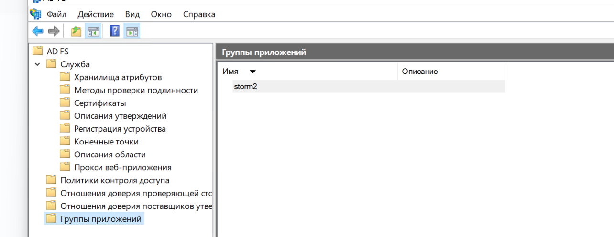

2. В группе создайте **2 приложения**:  
   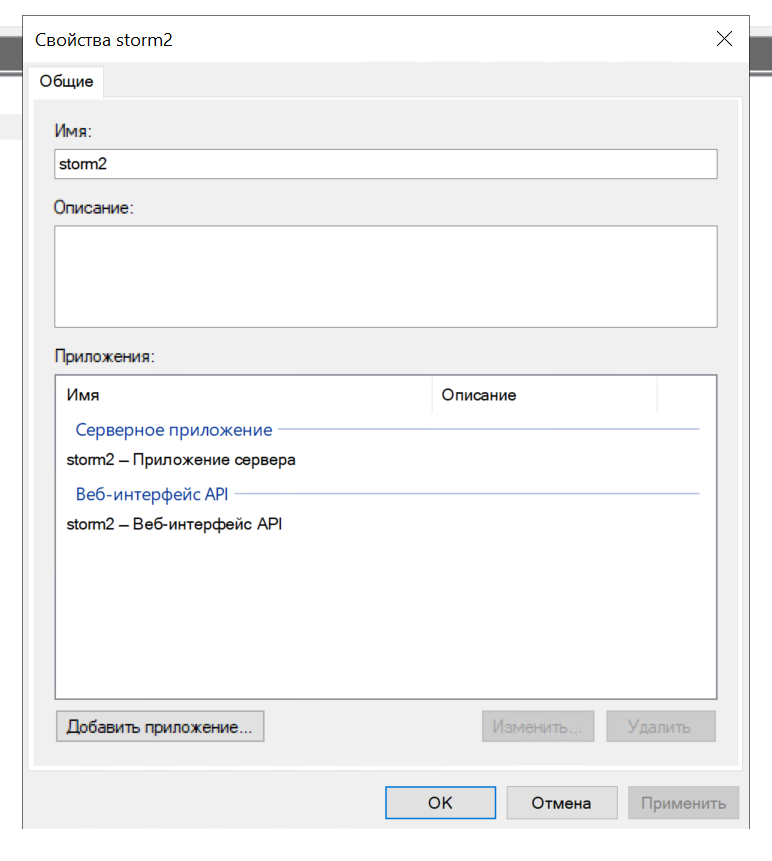

##### Настройка серверного приложения

3. **Первое приложение** - Server application (серверное приложение):  
   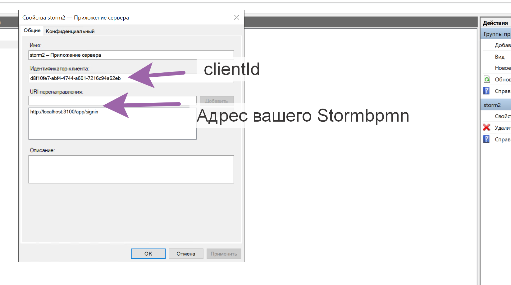

4. В настройках укажите:
    - Правильный **Redirect URI** перенаправления
    - Запомните **Client ID** и **Client Secret**
      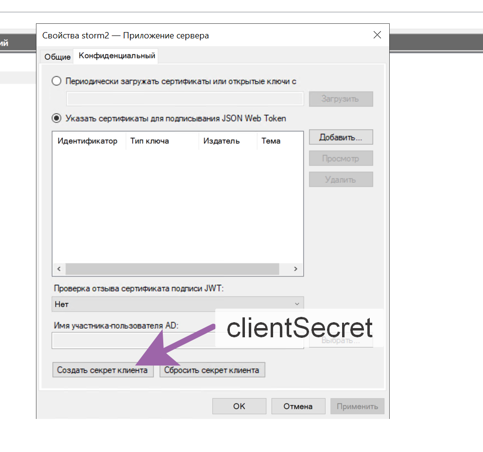

##### Настройка веб-API

5. **Второе приложение** - Web API (веб-интерфейс API):

6. Создайте **Relying party identifier** (идентификатор проверяющей стороны) и запомните его  
   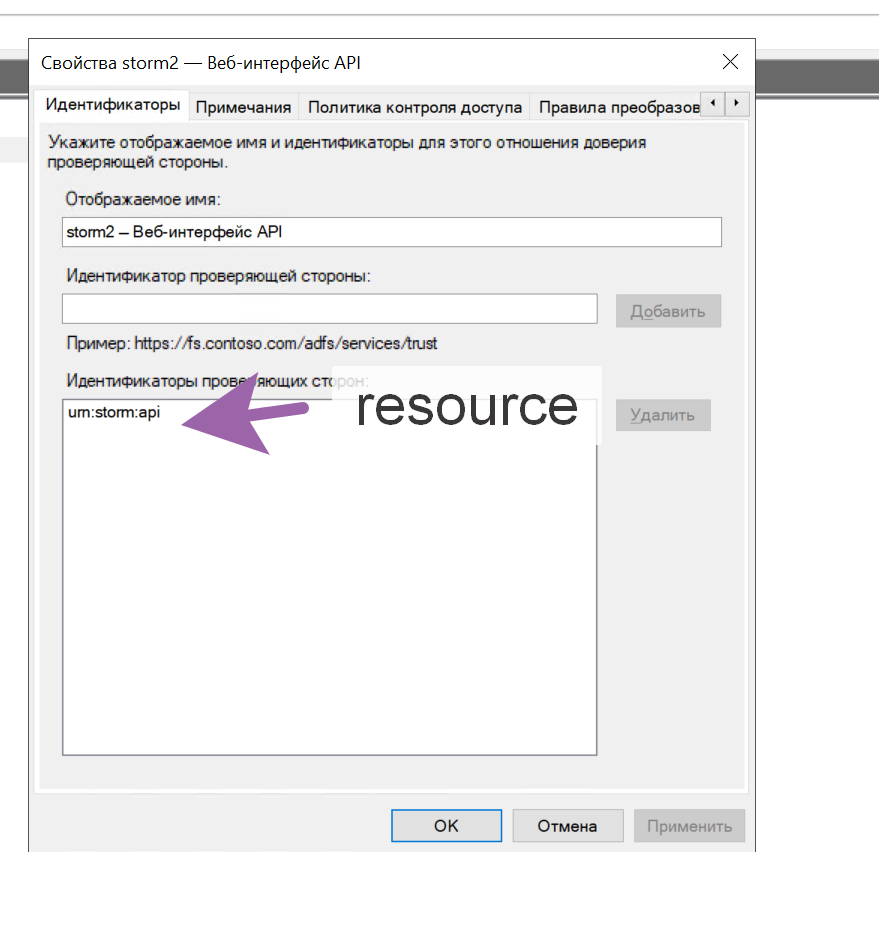

##### Настройка политик доступа

7. Выберите подходящую **Access Control Policy** (политику контроля доступа):  
   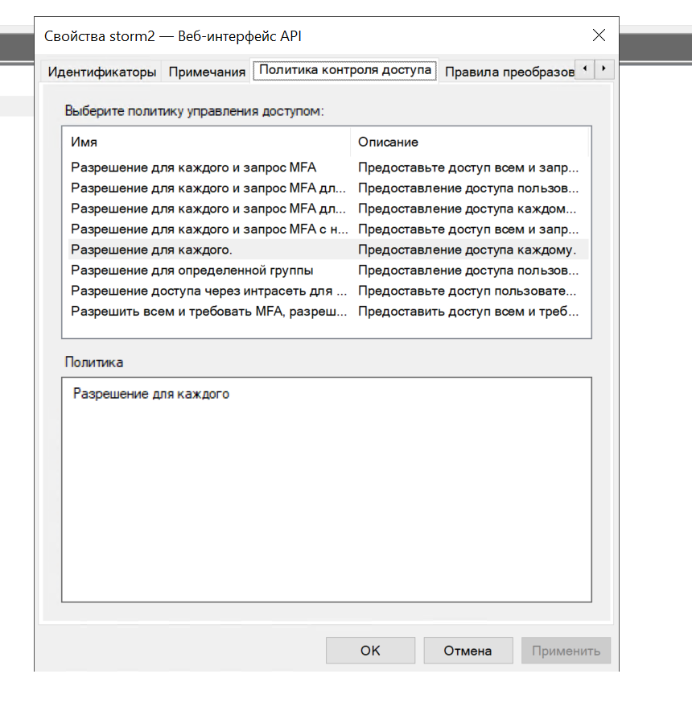

##### Настройка маппинга атрибутов

8. В разделе **Issuance Transform Rules** (Правила преобразования выдачи) настройте маппинг атрибутов:

    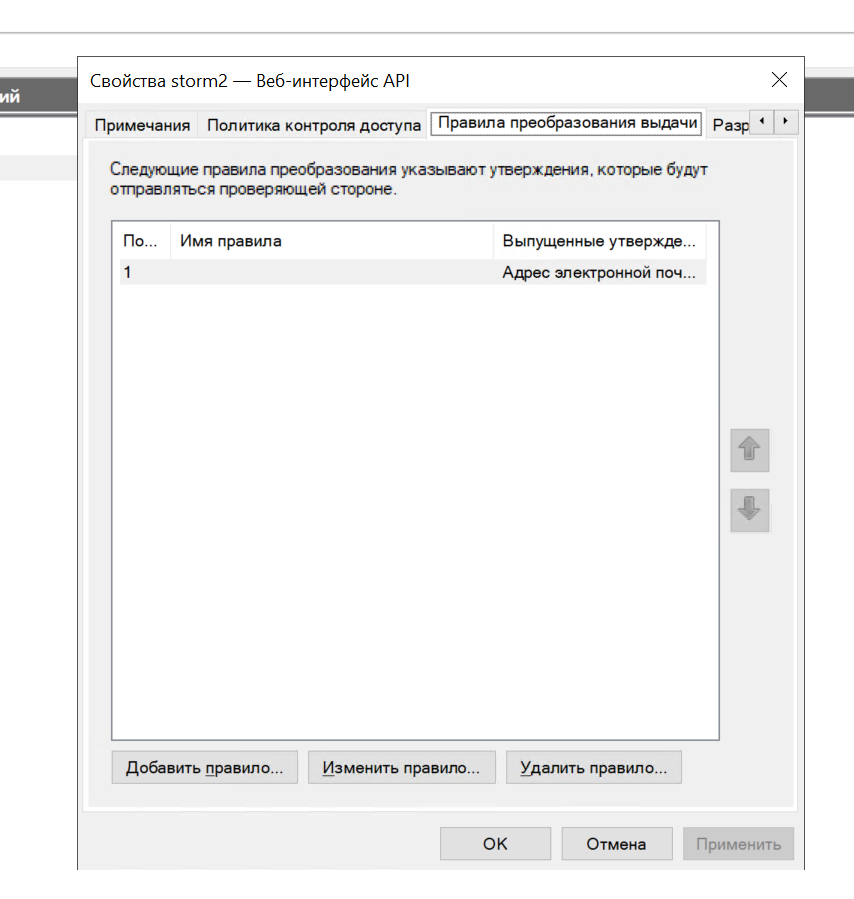
    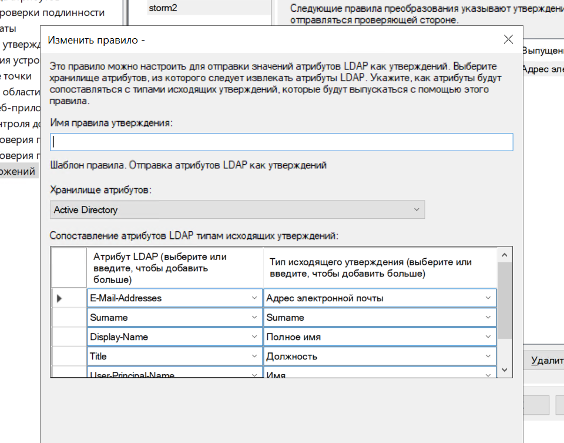

::: danger Важно: маппинг claims
StormBPMN ожидает следующие claims в токене:

| Поле StormBPMN | Ожидаемый claim | Тип         |
| -------------- | --------------- | ----------- |
| `email`        | `email`         | Стандартный |
| `firstName`    | `given_name`    | Стандартный |
| `lastName`     | `family_name`   | Стандартный |
| `middleName`   | `middle_name`   | Стандартный |
| `fullName`     | `full_name`     | Кастомный   |
| `position`     | `position`      | Кастомный   |

Кастомный claim `full_name` настраивать не обязательно: если его (и `displayname`) в токене нет, StormBPMN соберёт «Полное имя» сам из `family_name` (или `surname`), `given_name` и `middle_name` — в формате «Фамилия Имя Отчество».

**Кастомные claims** (Полное Имя, Должность) должны быть созданы и опубликованы в описании утверждений (Claims Description).  
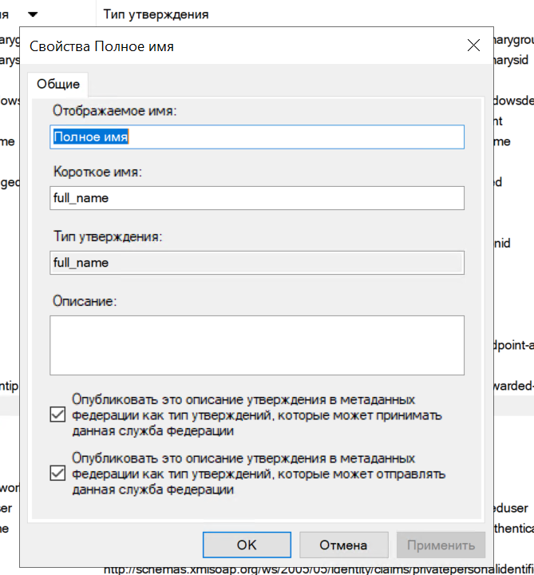

:::

##### Настройка разрешений

9. Установите разрешения клиента:

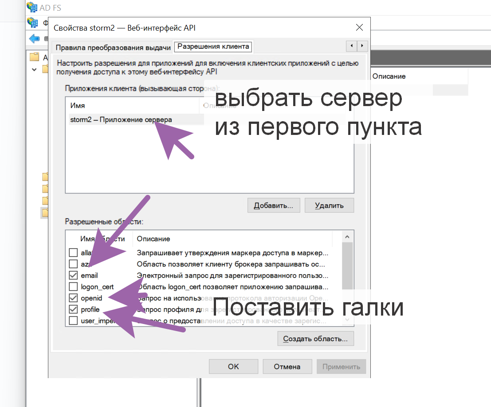

Если все шаги выполнены внимательно, настройка ADFS на стороне сервера завершена.

#### Шаг 2: Настройка StormBPMN

##### Параметры для настройки

Вам потребуются сохраненные значения:

-   **Client ID** (из серверного приложения)
-   **Client Secret** (из серверного приложения)
-   **Resource identifier** (идентификатор ресурса из Web API)

##### Настройка в административной панели

1. Откройте `/app/admin` → **«Брендинг и страница входа»** → **«Вход и регистрация»** → раскройте **«Параметры подключения OAuth 2.0»**.

2. Укажите следующие параметры:

| Параметр                     | Значение                            | Примечание                                                |
| ---------------------------- | ----------------------------------- | --------------------------------------------------------- |
| **OAuthClientId**            | Ваш Client ID                       | Из серверного приложения ADFS                             |
| **OAuthClientSecret**        | Ваш Client Secret                   | Из серверного приложения ADFS                             |
| **OAuthAuthorizeUri**        | `/adfs/oauth2/authorize`            | Стандартный путь ADFS                                     |
| **OAuthUserInfoUri**         | `/adfs/userinfo`                    | Для обратной совместимости (ADFS не использует эту ручку) |
| **OAuthTokenUri**            | `/adfs/oauth2/token`                | Стандартный путь ADFS                                     |
| **OAuthButtonLabel**         | `"Войти через ADFS"`                | Текст на кнопке входа                                     |
| **OAuthIsEnabled**           | `true`                              | Включение OAuth2                                          |
| **OAuthRedirectUri**         | `https://your-storm-url/app/signin` | URL вашего StormBPMN                                      |
| **OAuthResponseType**        | `code`                              | Тип ответа                                                |
| **OAuthScope**               | `openid profile email`            | Области доступа                                           |
| **OAuthCodeChallengeMethod** | `S256`                              | Метод challenge                                           |
| **OAuthFlowMode**            | `PKCE`                              | Режим потока                                              |
| **OAuthResource**            | Ваш Resource identifier             | Из Web API приложения                                     |

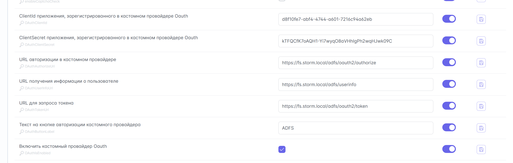
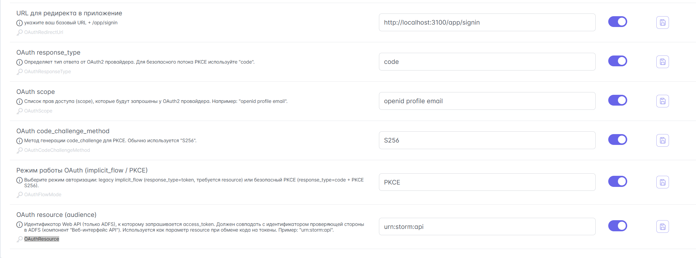

#### Дополнительные требования

::: warning Сертификаты
На самоподписанных сертификатах интеграция работать не будет. Требуется добавить доверенные сертификаты по инструкции в этом разделе.
:::

::: tip Тестирование
Настройка протестирована и гарантированно работает с:

-   **Windows Server 2022**
-   **ADFS 4.0**

Если интеграция не работает, проверьте:

-   Корректность всех параметров
-   Правильность маппинга claims
-   Наличие всех необходимых разрешений в ADFS
-   Доверенные сертификаты (если используются)

:::

### Проверка Claims

Дополнительная проверка прав в токене OAuth2:

| Параметр            | Описание           | Пример значения   |
| ------------------- | ------------------ | ----------------- |
| **OAuthCheckClaim** | Включить проверку  | `true`            |
| **OAuthClaimName**  | Название claim     | `groups`          |
| **OAuthClaimValue** | Требуемое значение | `stormbpmn-users` |

Как сравнивается значение:

- строка — точное совпадение с `OAuthClaimValue`, с учётом регистра;
- массив (например, `groups: ["storm-users", "analysts"]`) — вход разрешён, если **любой** элемент точно совпадает с `OAuthClaimValue`;
- число или логическое значение — сравнивается как текст (`true`, `42`);
- claim отсутствует, пустой или это объект — вход **запрещён** (`sso_access_claim_missing` или `sso_access_denied`).

Если проверка включена, но `OAuthClaimName` или `OAuthClaimValue` не заполнены, вход через SSO отклоняется (`sso_access_policy_misconfigured`), а не пропускает всех.

::: warning Откуда берётся claim
Источник значения зависит от режима: при `OAuthFlowMode = OIDC` claim ищется в проверенном ID Token, а если его там нет — в ответе UserInfo; при `PKCE` — в access token; при `implicit_flow` — в ответе `/userinfo`. Переключая режим, проверьте, что нужный claim попадает именно туда: в Keycloak за это отвечает mapper в client scope (флаги **Add to ID token**, **Add to access token**, **Add to userinfo**).
:::

::: tip Группы-массивы раньше не работали
До поддержки массивов claim `groups` в виде списка не совпадал никогда, и проверка не пускала даже нужных пользователей. Если вы обходили это отдельным строковым claim, он продолжит работать как прежде.
:::

### Встроенная авторизация

::: warning Только для тестирования
Встроенная авторизация подходит только для тестовых сред. В production используйте OAuth2.
:::

**Аварийный вход:** Добавьте `?showBasicLogin=true` к URL входа для доступа к базовой форме, даже если OAuth2 включен.

### Смена пароля

::: warning Безопасность смены пароля
В версии продукта реализованы усиленные правила безопасности для встроенной авторизации:

1. **Проверка текущего пароля:** При смене пароля система требует указать текущий пароль. Это предотвращает захват учётной записи через украденный JWT-токен.
2. **Блокировка отключённых учётных записей:** Пользователи, отключённые администратором, не могут сменить пароль, даже если у них есть действующий токен.
3. **Ротация сессии:** После успешной смены пароля все ранее выданные токены становятся недействительными: другие устройства разлогиниваются, а текущее получает новый токен в ответе и продолжает работать без повторного входа.
:::

---
