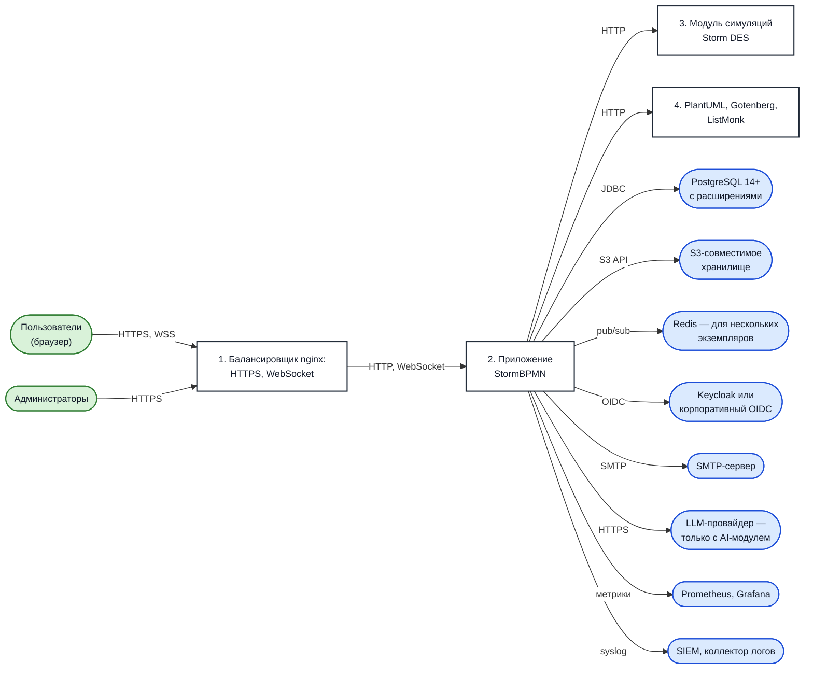

---
dir:
  order: 11
  link: true
  text: 11. Architecture Review
  collapsible: true
index: true
order: 11
source_hash: 8dda135dcb2275bd
---

[[toc]]

# Architectural Review Package {#пакет-для-архитектурного-ревью}

Before purchasing enterprise software, large companies conduct an internal architectural review: the business-side customer, together with the corporate architect and the information security department, presents the solution to a committee. To present the solution, a set of artifacts is required — typically, an article in the company's internal wiki describing the system, diagrams, and requirements.

This section compiles everything usually required for such a presentation in a ready-to-copy format. The materials are the same for all customers: they describe the system itself, not a specific installation. Anything pertaining to your organization — installation size, data classification, target recovery metrics — is to be filled in by you; for each such item below, the source of the initial data is indicated.

::: tip How to use this section
Copy the necessary pages to your wiki and supplement them with data from your installation. Diagrams are provided in SVG format — you can insert them into the document as is or redraw them in your accepted notation, relying on the data flow tables.
:::

## What is included in the package {#что-входит-в-пакет}

| Artifact | Page | What it covers in the review |
| --- | --- | --- |
| Processes within the system and Data Flow Diagrams (DFD) | [Processes and Data Flows](./processes.md) | "What the user does in the system", Dataflow Diagram |
| Role model, privilege matrix, RACI | [Role Model and RACI](./roles-raci.md) | Access control, RBAC, RACI |
| Account lifecycle | [User Management](./user-management.md) | User and access management processes |
| Catalog of functional requirements | [Functional Requirements](./functional-requirements.md) | Functional Requirements, scope of implemented functionality |
| Solution summary card and non-functional requirements | [System Design and NFRs](./system-design.md) | System Design, Non-Functional and Support Requirements |
| Component diagram | [below](#компонентная-схема) | Application Components Diagram |

## System Overview {#краткое-описание-системы}

Ready-to-use text for the "System Overview" section — can be copied without changes.

> **Stormbpmn** is a platform for describing, approving, and maintaining the currency of an organization's business processes. Users model processes in BPMN 2.0 notation and other supported notations, maintain a process registry with attributes and statuses, link processes to the org structure, roles, and IT architecture elements, approve models with stakeholders, and publish approved versions for read-only access.
>
> The solution is delivered as a web application in a container and deployed on the customer's infrastructure (on-premise or in a private cloud). Users work through a browser; no separate client is installed. The system uses external customer components: a PostgreSQL relational database, an S3-compatible object storage, a corporate authentication server using the OIDC/OAuth2 protocol, and a mail server.

Additional information for the application card — deployment model, license type, component composition, and version — is provided on the [System Design and NFR](./system-design.md) page.

## Component diagram {#компонентная-схема}

| No. | Component | Purpose | Requirement |
| --- | --- | --- | --- |
| 1 | nginx load balancer | HTTPS termination, HTTP and WebSocket proxying to the application | Required in production installation |
| 2 | StormBPMN application | Core service: interface, REST API, business logic, background jobs | Required |
| 3 | Storm DES simulation module | Process simulation modeling | Optional, separate license |
| 4 | PlantUML, Gotenberg, ListMonk | UML diagram generation, document conversion to PDF, templated email campaigns | Optional, by feature |
| — | PostgreSQL 14+ (16–17 recommended) | Storage of all platform data | Required |
| — | S3-compatible storage | Files, attachments, model previews | Required |
| — | Redis | Collaborative editing with multiple application instances | Required only for multiple instances |
| — | Corporate IdP | User authentication via OIDC/OAuth2 | Recommended; built-in authentication available |
| — | SMTP server | Emails: invitations, approvals, notifications | Required for notifications |
| — | Prometheus, Grafana | Metrics and alerts | Recommended |
| — | SIEM or log collector | Receiving action logs via syslog | Recommended |
| — | LLM provider | AI assistant functionality | Only when using the AI module |

Detailed requirements for each component are provided in the [Installation](/en/install/README.md) and [External services](/en/install/production/components.md) sections.

## Compliance with the standard application card structure {#соответствие-типовои-структуре-карточки-приложения}

In internal company wikis, the application card is typically built using the same schema. Below is where to source the content for each of its sections.

| Application card section | Source |
| --- | --- |
| Brief description | [Above](#краткое-описание-системы) |
| Functional requirements | [Functional requirements](./functional-requirements.md) |
| Non-functional requirements | [System design and NFRs](./system-design.md#нефункциональные-требования) |
| Support and maintenance requirements | [System design and NFRs](./system-design.md#обслуживание-и-поддержка) |
| Application component diagram | [Above](#компонентная-схема) |
| Data flow diagram | [Processes and data flows](./processes.md) |
| System design (table "category — solution") | [System design and NFRs](./system-design.md#карточка-системного-дизаина) |
| Infrastructure diagram | Built by the customer for their own environment; source data — [Architecture diagram](/en/get-started.md) and [Installation](/en/install/README.md) |
| Service accounts | [System design and NFRs](./system-design.md#сервисные-учетные-записи) |
| Constraints | [System design and NFRs](./system-design.md#ограничения) |
| Installation instructions | [Installation](/en/install/README.md), [Quick start](/en/install/quickstart/QUICKSTART_MANUAL.md) |
| Backup and restore | [Maintenance](/en/operation/README.md#резервное-копирование), [Monitoring and backups](/en/install/production/monitoring-backup.md) |

## What to Request from the Vendor {#что-запросить-у-поставщика}

Some data for the review depends on the contract and cannot be published in advance. This information is provided by your project manager — write to **help@stormbpmn.com**:

- a letter specifying the license scope and validity period, as well as the renewal procedure;
- support details: mode, channels, and target response times;
- confirmation of the composition of personal data processed for your use case;
- access parameters for the container registry and the procedure for verifying image signatures (Cosign);
- if necessary — completion of your information security department’s questionnaire.

## Pre-Review Preparation Checklist {#чек-лист-подготовки-к-ревью}

1. Copy the brief description and the catalog of functional requirements, and cross out the features that you are not implementing in the first iteration.
2. Take the diagrams from [DFD](./processes.md) that correspond to your scenario, and redraw them in the adopted notation if necessary.
3. Fill in the [system design card](./system-design.md#карточка-системного-дизаина) with the values of your installation: OS version, size, authentication method, integrations.
4. Determine the data classification and the composition of personal data for your environment — see [processed data](./system-design.md#обрабатываемые-данные).
5. Agree on the target RTO and RPO and the backup schedule with the operations service.
6. Assign roles according to [RACI](./roles-raci.md#матрица-raci-по-процессам) and agree on who in the organization grants permissions in the system.
7. Attach the infrastructure diagram of your site and the list of service accounts.
