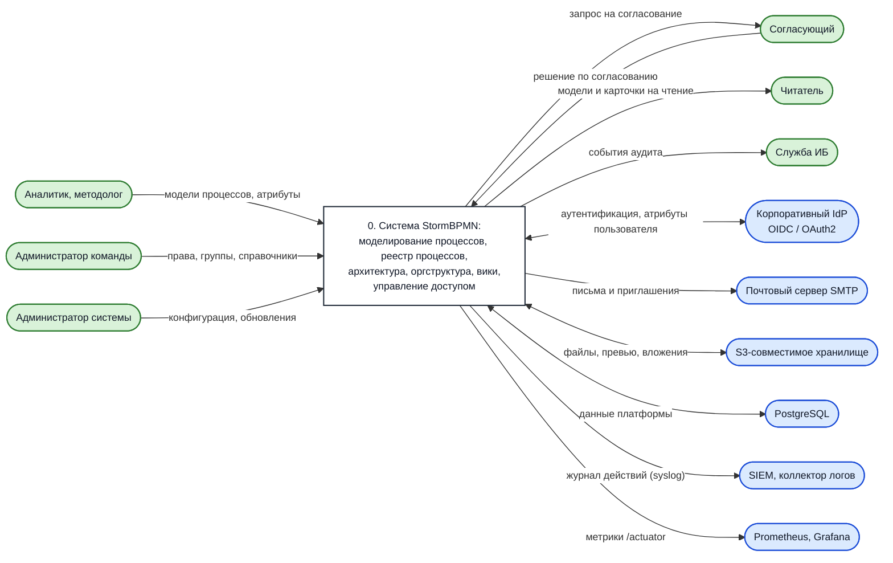
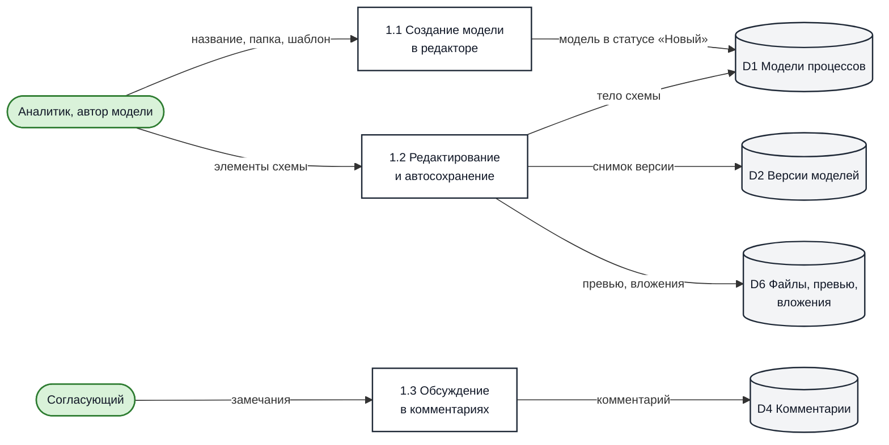
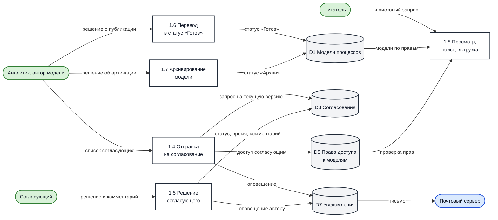
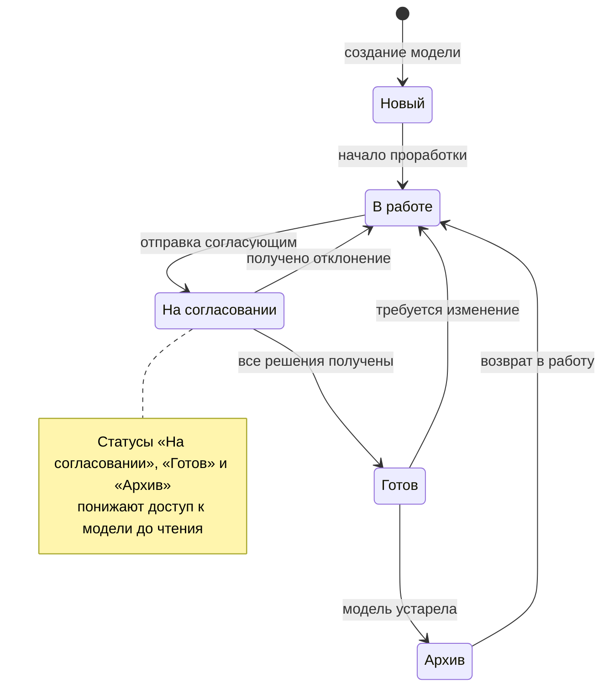
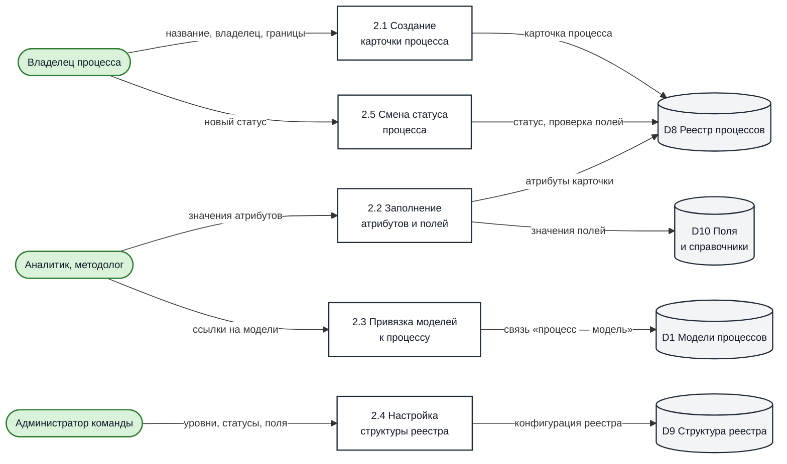
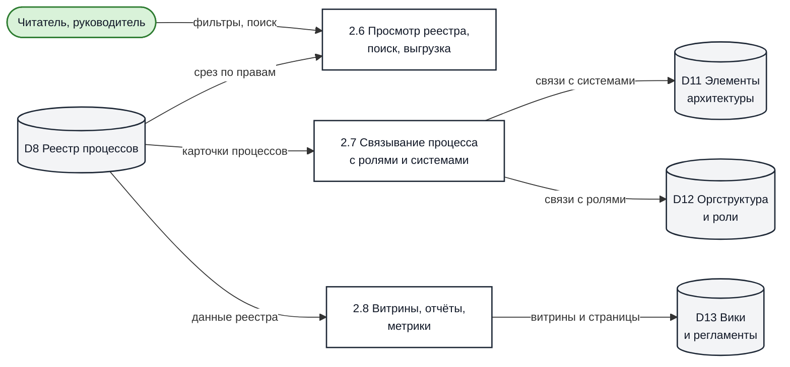
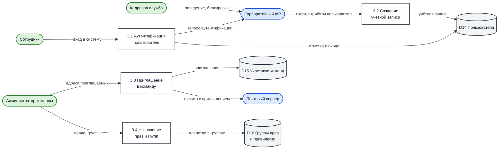
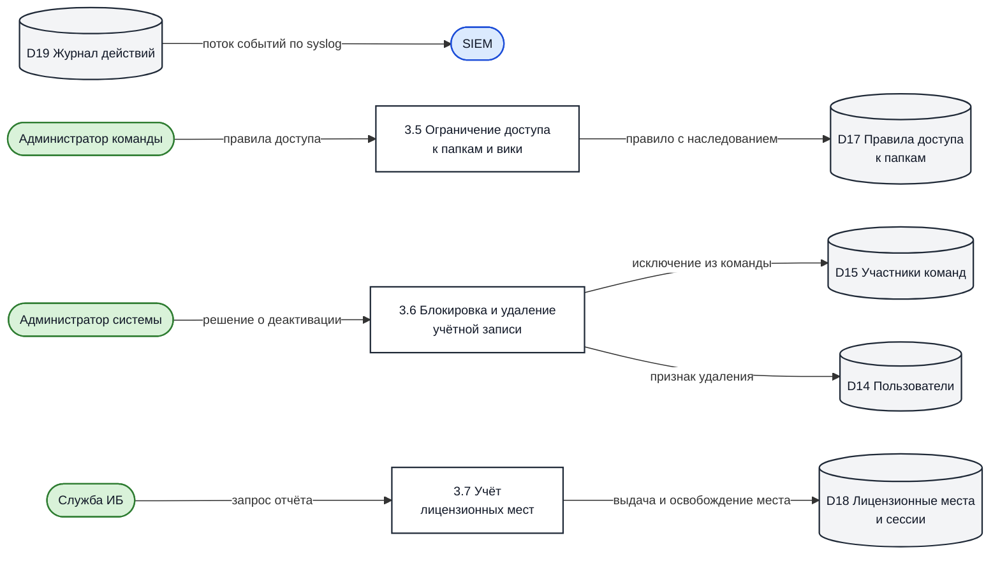

[[toc]]

# Processes and Data Flow Diagrams (DFD) {#процессы-и-потоки-данных-dfd}

At an architecture review, the question is almost always asked: “The user opened the system — what do they do in it?” The answer is not a list of interface buttons, but a description of the processes that occur within the system and the data that moves during them.

This section describes the processes of **the platform itself**: modeling, approval, and publication of process models, maintaining the process registry, and managing users and permissions. These are the chains that the product supports regardless of which business processes you describe in it.

::: tip What is not described here
The workflow for using the tool within your organization — who and when is required to model, which methodology is adopted, and which processes are described first — is determined by your internal regulations. The platform supports different approaches; see the [Implementation Plan](/en/recipes/Implementation_plan.md) for a typical implementation scheme.
:::

## Notation {#условные-обозначения}

The diagrams are constructed as Data Flow Diagrams (DFD) using simplified notation.

| Symbol | Meaning |
| --- | --- |
| Rectangle with a number | Process — an action that transforms data |
| Cylinder | Data store |
| Green rounded shape | External entity: user role |
| Blue rounded shape | External entity: adjacent system |
| Arrow with a label | Data flow and its content |

::: tip Diagrams can be redrawn to match your notation
If you use a strict DFD notation — Yourdon–DeMarco, Gane–Sarson, or another —
redraw the diagrams in it: the composition of processes, stores, and flows will remain unchanged. The source
diagrams are located directly in the page text (blocks `mermaid`) — they are easy to copy and edit.
The complete list of flows is duplicated in tables: using them, the diagram can be rebuilt in any
editor.
:::

## Context Diagram (Level 0) {#контекстная-диаграмма-уровень-0}

The entire system, its users, and adjacent systems.

| External Entity | Type | What it sends to the system | What it receives from the system |
| --- | --- | --- | --- |
| Analyst, Methodologist | Role | Process models, card attributes, reference data | Models, registry, search results |
| Approver | Role | Approval decision, comments | Approval request, notifications |
| Reader | Role | Search queries | Read-only process models and cards |
| Team Administrator | Role | Permissions, group composition, registry structure | Report on participant composition and permissions |
| System Administrator | Role | Configuration, updates | Metrics, logs, system status |
| Information Security Service | Role | Export requests | Audit events |
| Corporate IdP | System | Token, confirmed user attributes | Authentication request |
| Mail Server | System | — | Emails: invitations, approvals, notifications |
| S3-compatible Storage | System | Files on request | Files, attachments, model previews |
| PostgreSQL | System | Data on request | Platform data |
| SIEM, Log Collector | System | — | Action log via syslog protocol |
| Prometheus, Grafana | System | — | Metrics via endpoint `/actuator` |

## DFD-1. Process model lifecycle {#dfd-1-жизненныи-цикл-модели-процесса}

The main scenario for an analyst: create a process model, discuss it, approve it, publish it, and eventually archive it.

**Creating and editing a model.**

**Approval, publication, and reading.**

### Processes {#процессы}

| No. | Process | What happens |
| --- | --- | --- |
| 1.1 | Creating a model in the editor | The user creates a process model in the selected folder, optionally from a template. The model is assigned the "New" status and the author as its owner |
| 1.2 | Editing and autosave | Editing the diagram, element descriptions, and links to roles and architecture elements. Changes are saved automatically, and a version is recorded upon saving |
| 1.3 | Discussion in comments | Participants leave comments, including those attached to a specific diagram element |
| 1.4 | Submission for approval | The author specifies the approvers. Requests are created for the current version of the model; approvers receive read access and a notification. The model transitions to the "Under Review" status |
| 1.5 | Approver's decision | The approver responds with "Approved" or "Rejected" along with a comment. The decision is recorded along with the timestamp |
| 1.6 | Transition to "Ready" status | After receiving all decisions, the author publishes the model. In the "Ready" status, the model is available for read-only access |
| 1.7 | Archiving a model | An outdated model is moved to the "Archive" status and remains available for read-only access |
| 1.8 | Viewing, searching, and exporting | Readers search for models, open them, and export them to supported formats within the scope of their permissions |

### Data Flows {#потоки-данных}

| Flow | Source | Receiver | Content |
| --- | --- | --- | --- |
| Name, folder, template | Analyst | 1.1 | Parameters of the process model to be created |
| New model | 1.1 | D1 | Model in "New" status, author, folder |
| Diagram elements and descriptions | Analyst | 1.2 | Diagram content |
| Diagram body and elements | 1.2 | D1 | Current state of the model |
| Version snapshot | 1.2 | D2 | Model version with author and timestamp |
| Preview and attachments | 1.2 | D6 | Diagram image, attached files |
| Comment | 1.3 | D4 | Text, author, link to element |
| List of approvers | Analyst | 1.4 | Email addresses of approvers |
| Approval request | 1.4 | D3 | Request linked to the current model version |
| Approver access | 1.4 | D5 | Read-only access to the model for approvers |
| Request notification | 1.4 | D7 | System notification and email |
| Decision and comment | Approver | 1.5 | "Approved" or "Rejected", text |
| Decision status | 1.5 | D3 | Decision, timestamp, comment |
| Decision notification | 1.5 | D7 | Notification to the author, email regarding approval completion |
| "Ready" status | 1.6 | D1 | Status change; model becomes read-only |
| "Archive" status | 1.7 | D1 | Status change |
| Models available to reader | D1 | 1.8 | List of models considering permissions |
| Permission check | D5 | 1.8 | Specific user's permissions for the model |
| Email to recipient | D7 | Mail server | Email based on template |

### Process model statuses {#статусы-модели}

| Status | Meaning | Maximum access |
| --- | --- | --- |
| New | Model created, work not started | Based on user permissions |
| In progress | Model under active development | Based on user permissions |
| Under review | Submitted by the approver, collecting decisions | Read-only |
| Ready | Approved and published | Read-only |
| Archive | Retired, preserved for history | Read-only |

::: warning Status overrides permissions
The statuses "Under review", "Ready", and "Archive" restrict access to the read level regardless of user permissions: even a team administrator cannot modify such a model without removing the status. This protects approved versions from unnoticed edits. The complete order of permission checks for a specific model is described in the article [Access rights separation for diagrams](/en/recipes/Access_to_diagrams.md).
:::

### Approval Rules {#правила-согласования}

- An approval request is tied to a **specific version** of the process model. If the model is modified and resubmitted after the request is sent, any open requests for the previous version are closed, and approvers receive a request for the current version — retroactive approval is not possible.
- The process model cannot be moved out of the "Under Approval" status until at least one request for the current version has been answered.
- Approvers can be specified as individuals who are not yet in the system: the request is created for an email address and linked to the user account once the person registers.
- Once all decisions are received, the author is notified and receives an email confirming the completion of the approval process.
- A decision includes the author, timestamp, and comment, and remains in the system as an audit trail.

## DFD-2. Process Registry and Reference Data {#dfd-2-реестр-процессов-и-справочники}

The process registry is a catalog of the organization's processes, including attributes, statuses, and relationships. Process models are linked to process cards rather than replacing them.

**Managing process cards.**

**Relationships, views, and dashboards.**

| No. | Process | Description |
| --- | --- | --- |
| 2.1 | Creating a process card | A card is created: name, owner, position in the hierarchy |
| 2.2 | Filling in attributes and fields | Description, reusability flag, custom field values, and reference data are populated |
| 2.3 | Linking models to a process | Models describing the process at different levels are linked to the card |
| 2.4 | Configuring the registry structure | The administrator defines process levels, the set of statuses, and the composition and mandatory nature of fields |
| 2.5 | Changing process status | Moving the card to the next status; if validation is configured, the system requires mandatory fields to be filled in |
| 2.6 | Viewing the registry, search, export | Reading the registry with permission checks, filtering, and export |
| 2.7 | Linking a process to roles and systems | Linking cards and model elements to roles, departments, and IT architecture elements |
| 2.8 | Dashboards, reports, metrics | Summary views of the registry, wiki pages with links to processes |

| Flow | Source | Receiver | Content |
| --- | --- | --- | --- |
| Name, owner, boundaries | Process owner | 2.1 | Initial card attributes |
| Process card | 2.1 | D8 | New registry entry |
| Field values | 2.2 | D10 | Custom field and reference data values |
| "Process – model" link | 2.3 | D1 | Model linked to the card |
| Registry configuration | 2.4 | D9 | Levels, statuses, field mandatory flags |
| Process status | 2.5 | D8 | New status after mandatory field validation |
| Architecture links | 2.7 | D11 | Links to information systems and their elements |
| Org structure links | 2.7 | D12 | Links to roles and departments |
| Dashboards and reports | 2.8 | D13 | Wiki pages, summary views |
| Registry snapshot | D8 | 2.6 | Registry data filtered by user permissions |

::: tip Registry statuses are configurable
Unlike model statuses, the set of process statuses is not fixed: the team administrator creates custom statuses, defines the initial status, and enables validation of mandatory fields upon transition if needed.
:::

## DFD-3. User and Permission Management {#dfd-3-управление-пользователями-и-правами}

**User onboarding and permission assignment.**

**Access restrictions, revocation, and seat accounting.**

Processes 3.1–3.7 are described in detail on a separate page —
[User Management](./user-management.md), including the account lifecycle,
corporate directory integration, and the access revocation procedure.

| No. | Process | Brief Description |
| --- | --- | --- |
| 3.1 | User Authentication | Login via corporate IdP using OIDC/OAuth2 or built-in authentication |
| 3.2 | Account Creation | Profile is created based on verified attributes from the IdP upon first login or via invitation |
| 3.3 | Team Invitation | Team administrator invites participants and assigns their team permissions |
| 3.4 | Permission and Group Assignment | Adding a participant to permission groups that define available actions |
| 3.5 | Access Restriction to Folders and Wiki | "Allow" and "Deny" rules on folders and pages with inheritance |
| 3.6 | Account Blocking and Deletion | Disabling access, removing from teams, deleting the profile |
| 3.7 | License Seat Accounting | Monitoring occupied seats and concurrent sessions |

## Data Stores {#хранилища-данных}

| Code | Store | Physical Location | Contents |
| --- | --- | --- | --- |
| D1 | Process models | PostgreSQL | Schemas, their attributes, owners, statuses, folder placement |
| D2 | Model versions | PostgreSQL | Model snapshots with author and modification time |
| D3 | Approvals | PostgreSQL | Requests, decisions, comments, binding to a version |
| D4 | Comments | PostgreSQL | Model discussions, binding to elements |
| D5 | Access rights to models | PostgreSQL | Personal access, link access, approver access |
| D6 | Files, previews, attachments | S3-compatible storage | Schema images, embedded documents |
| D7 | Notifications | PostgreSQL | Interface alerts and email queue |
| D8 | Process registry | PostgreSQL | Process cards, hierarchy, statuses |
| D9 | Registry structure | PostgreSQL | Levels, statuses, filling rules |
| D10 | Fields and reference data | PostgreSQL | Custom fields, reference data and their values |
| D11 | Architecture elements | PostgreSQL | Information systems and their elements, links to processes |
| D12 | Org structure and roles | PostgreSQL | Departments, positions, employees, roles |
| D13 | Wikis and regulations | PostgreSQL | Wiki pages, links to processes and models |
| D14 | Users | PostgreSQL | Profiles: name, email, position, locale, last login date |
| D15 | Team members | PostgreSQL | Team membership, team role, invitation status |
| D16 | Permission groups and privileges | PostgreSQL | Groups and privilege sets |
| D17 | Access rules for folders and wikis | PostgreSQL | Permissions and prohibitions, inheritance flag |
| D18 | License seats and sessions | PostgreSQL | Occupied seats, active sessions |
| D19 | Action log | Console, SIEM via syslog, separate TimescaleDB database | User login and action events |

## Terms and Abbreviations {#термины-и-сокращения}

| Term | Definition |
| --- | --- |
| BPMN | Business Process Model and Notation — a business process modeling notation |
| DFD | Data Flow Diagram — a data flow diagram |
| Model (diagram) | A process diagram created in the editor |
| Process card | A record in the process registry with attributes to which models are linked |
| Team | The workspace of an organization or department: members, folders, reference data |
| Team permission | The basic level of a member's capabilities: administrator, read and write, read-only, view |
| Permission group | A named set of privileges granted to members |
| Privilege | Permission to perform an action on a system object (create, read, modify, delete) |
| Approval | A request for a decision on a specific version of a process model, addressed to a specific person |
| Architecture element | An information system or its component to which processes are linked |
| IdP | Identity Provider — a corporate authentication server |
| OIDC | OpenID Connect — an authentication protocol over OAuth2 |
| SIEM | Security Information and Event Management — a system for collecting and analyzing security events |
| RTO, RPO | Recovery Time Objective and Recovery Point Objective |
