[[toc]]

# Authorization System (OpenID Connect, OAuth2, ADFS) {#система-авторизации-openid-connect-oauth2-adfs}

### SSO sign-in (OpenID Connect and OAuth2) {#вход-через-sso-openid-connect-и-oauth2}

::: warning Deprecated login methods
**LDAP** and direct (built-in) Keycloak integration are deprecated. For new installations, use SSO sign-in in **OIDC** mode as described below: Keycloak connects to Storm as a standard OpenID Connect provider.
:::

Corporate sign-in through external providers: Keycloak, Okta, Microsoft Entra ID, ADFS, and others.

::: tip Where to find OAuth2 settings in Enterprise
Open **Administration** (`/app/admin`) → **Branding and Login Page** → **Login and Registration** → **OAuth 2.0 connection parameters**. Configure `OAuthClientId`, `OAuthClientSecret`, provider endpoints, and the other parameters below, then click **Save**.

In the current Enterprise interface, OAuth2 settings have moved out of the general **Application Settings** list. Searching for `OAuthClientId` in the old section may return no results. See [Branding and Login Page](/en/configure/branding.md).
:::

#### Choosing a mode {#какои-режим-выбрать}

The sign-in mode is set by **OAuthFlowMode**:

| Mode | How sign-in works | When to choose |
| --- | --- | --- |
| `OIDC` (recommended) | OpenID Connect: Authorization Code + PKCE (S256) + `state` + `nonce`. The user's identity comes from the ID Token, whose signature Storm verifies with the provider's keys. The access token can be anything, including an opaque token | All new connections: Keycloak, Okta, Microsoft Entra ID, ADFS 2019+, and any provider with OpenID Connect Discovery |
| `PKCE` (legacy) | Authorization Code + PKCE; user data is read from the **access token** claims | Connections that already work, primarily ADFS set up with the [instructions below](#microsoft-adfs) |
| `implicit_flow` (legacy, deprecated) | The access token arrives in the browser in the URL fragment; user data comes from `/userinfo` | Only existing old connections. RFC 9700 advises against the implicit flow |

If the parameter is not set, `implicit_flow` is used for backward compatibility with older installations. The mode never changes by itself, neither on upgrade nor after a failed sign-in: Storm never falls back from OIDC to a weaker mode.

#### OIDC mode (recommended) {#режим-oidc-рекомендуется}

In OIDC mode Storm finds the provider's endpoints in its Discovery document (`<issuer>/.well-known/openid-configuration`). Usually the provider address and the client credentials are all you need.

##### Minimal setup {#минимальная-настроика}

| Parameter | Example value | Note |
| --- | --- | --- |
| **OAuthIsEnabled** | `true` | |
| **OAuthFlowMode** | `OIDC` | |
| **OAuthIssuerUri** | `https://sso.company.com/realms/company` | The provider's issuer **exactly** as in its Discovery document, character for character |
| **OAuthClientId** | `stormbpmn` | Client (application) ID at the provider |
| **OAuthClientSecret** | `<client secret>` | Not needed only when `OAuthTokenEndpointAuthMethod = none` |
| **OAuthRedirectUri** | `https://stormbpmn.company.com/app/signin` | Must match the URI registered at the provider |
| **OAuthButtonLabel** | `Sign in with your company account` | Button text on the sign-in page |
| **OAuthScope** | `openid profile email` | `openid` is required |

In OIDC mode `OAuthAuthorizeUri`, `OAuthTokenUri`, and `OAuthUserInfoUri` can stay empty: the endpoints come from Discovery. If you fill them in, Storm uses your values instead of the discovered ones.

::: tip https only
The provider address and all its endpoints must use `https://`. The only exception is `http://localhost` for a test environment.
:::

##### All OIDC mode parameters {#все-параметры-режима-oidc}

| Parameter | Default | What it does |
| --- | --- | --- |
| **OAuthTokenEndpointAuthMethod** | `client_secret_post` | How Storm presents the secret when exchanging the code for tokens: `client_secret_post` in the request body, `client_secret_basic` in the `Authorization` header (the Okta default), `none` for a public client without a secret, protected by PKCE only |
| **OAuthUserInfoEnabled** | `true` | Request UserInfo after the ID Token is verified, to complete the profile. The response is accepted only if its `sub` matches the ID Token. Turn it off if all required claims are already in the ID Token or the provider has no usable UserInfo (ADFS) |
| **OAuthEmailClaim** | `email` | Which claim holds the email address the account is keyed on. For Entra ID and ADFS without a mail attribute you can use `upn` or `preferred_username` |
| **OAuthLinkByEmail** | `true` | On first sign-in, link an existing account with the same email address. See [Account linking](#привязка-учетных-записеи) |
| **OAuthJwksUri** | from Discovery | The provider's public keys endpoint. Set it only if the provider's Discovery is unavailable |
| **OAuthResource** | — | The `resource` parameter for ADFS. Sent only when set |
| **OAuthCheckClaim**, **OAuthClaimName**, **OAuthClaimValue** | off | Let in only users with the required claim value. See [Claims Validation](#проверка-claims) |
| **OAuthUseRefreshTokens** | off | The Storm session lives exactly as long as the provider session. See [Session Binding to SSO](./sso-session-binding.md) |

`OAuthResponseType` and `OAuthCodeChallengeMethod` are not used in OIDC mode: the response type is always `code`, the PKCE method is always `S256`.

##### What Storm verifies at sign-in {#что-storm-проверяет-при-входе}

1. Before redirecting to the provider, the sign-in page creates a one-time `state`, `nonce`, and `code_verifier`. They live only in the browser tab and are erased after the redirect back.
2. On return, `state` is checked. A foreign or replayed response is rejected, so nobody can slip a user into someone else's account. The code, `state`, and tokens are removed from the address bar and browser history.
3. The server exchanges the code for tokens, presenting the `code_verifier` and the client secret.
4. The ID Token is validated per OpenID Connect Core §3.1.3.7:
   - signature with the provider's keys (RS256/384/512, PS256/384/512, ES256/384/512); unsigned and HMAC-signed tokens are rejected;
   - `iss` equals `OAuthIssuerUri`;
   - `aud` contains `OAuthClientId`; `azp`, if present, equals it;
   - lifetime (`exp`, `iat`, `nbf`) with 60 seconds of clock skew allowed;
   - `nonce` matches the one sent;
   - `at_hash` matches the access token, if the provider sent it.
5. If UserInfo is enabled, Storm requests it with the access token in the `Authorization: Bearer` header and accepts the data only if `sub` matches the ID Token.
6. The claim-based access check runs, if enabled.
7. The account is found by the "issuer + `sub`" pair, not by email address.

Storm does not parse the access token in OIDC mode: it is only used to call UserInfo. So opaque tokens work, and so do JWTs issued for another API (for example, by the Okta Org Authorization Server).

Tokens, secrets, and codes are never written to logs or printed to the browser console.

##### Account linking {#привязка-учетных-записеи}

On the first OIDC sign-in Storm stores the user's "issuer + `sub`" pair (table `sm_sso_identity`). After that, sign-in goes by this pair:

- the user changed their email address or last name at the provider: they still sign in to the same account;
- Storm already has an account with this email (created with a password, via LDAP, or by an earlier SSO mode) but no pair yet: with `OAuthLinkByEmail = true` the account is linked to the pair. With `false` the sign-in is rejected with code `sso_account_not_linked`;
- the account with this email is already linked to **another** user of the same provider (the address was reassigned to a new employee): the sign-in is rejected with code `sso_account_conflict`. An account is never relinked: find out whose it is and, if needed, change the email address in Storm;
- there is no account: it is created as before and linked right away.

Linking happens only at sign-in. The upgrade does not relink anything in bulk, and existing data is not changed. Moving to another provider (a different issuer) creates a new link by email address; the old one is kept.

::: warning When to turn off OAuthLinkByEmail
Linking by email is safe only if the provider does not let users type in an arbitrary address. Corporate directories (Active Directory, Okta with email from an HR system) guarantee this. If the provider sends `email_verified = false` for the `email` claim in the ID Token or in UserInfo, the sign-in is always rejected.

Microsoft Entra ID does not verify the `email` claim. If guests sign in to the application or the tenant has unverified domains, turn `OAuthLinkByEmail` off or take the address from `upn` (`OAuthEmailClaim = upn`).
:::

##### Connection test {#проверка-подключения}

**OAuth 2.0 connection parameters** has a **Test connection** button. It checks the **saved** settings without attempting a sign-in:

- whether Discovery is reachable and the issuer matches;
- which endpoints Storm will use and where they come from (a setting or Discovery);
- whether the signing keys are reachable and how many there are;
- whether the client authentication method matches what the provider advertises, and whether the secret is set;
- whether the provider supports PKCE S256, whether `email` is in the scope, and whether UserInfo, the claim check, and linking by email are on.

Each item is marked OK, Warning, or Error. The report contains no tokens, secrets, or user data and is available only to the installation administrator.

##### Provider examples {#примеры-для-проваидеров}

::: warning What has been tested in practice
- **Keycloak 26.4**: tested with real sign-ins in a test environment: `client_secret_post`, `client_secret_basic`, and public (`none`) clients, a group-based claim check, sign-in without UserInfo, and the legacy `PKCE` and `implicit_flow` modes with their existing settings.
- **Okta (Org Authorization Server)**: tested by an automated test against a simulated provider with an opaque access token. Sign-in has not been tested on a real Okta tenant.
- **Microsoft Entra ID and ADFS in OIDC mode**: the settings below are based on the providers' documentation and have not been tested in practice.
:::

**Keycloak**

| Parameter | Value |
| --- | --- |
| **OAuthIssuerUri** | `https://keycloak.company.com/realms/company` |
| **OAuthTokenEndpointAuthMethod** | `client_secret_post` or `client_secret_basic` |

In the Keycloak client: **Client authentication** ON, **Standard flow** ON, **Implicit flow** OFF, **Valid redirect URIs** `https://stormbpmn.company.com/app/signin`, **Advanced** tab → **Proof Key for Code Exchange Code Challenge Method** `S256`. For a group check, add a **Group Membership** mapper to the client scope with claim name `groups`, **Full group path** off, and **Add to ID token** on.

**Okta**

| Parameter | Org Authorization Server | Custom Authorization Server |
| --- | --- | --- |
| **OAuthIssuerUri** | `https://company.okta.com` | `https://company.okta.com/oauth2/default` |
| **OAuthTokenEndpointAuthMethod** | `client_secret_basic` | `client_secret_basic` |

Okta application: **OIDC — Web Application**, grant type **Authorization Code**, **Sign-in redirect URI** `https://stormbpmn.company.com/app/signin`. The Org Authorization Server issues access tokens only for Okta's own APIs, and a third-party application cannot validate them. In OIDC mode this does not matter: Storm takes the identity from the ID Token and uses the access token only for UserInfo. You do not need a custom Authorization Server for Storm. For a group check, set a **Groups claim filter** on the application's **Sign On** tab so that the `groups` claim is included in the ID Token.

**Microsoft Entra ID**

| Parameter | Value |
| --- | --- |
| **OAuthIssuerUri** | `https://login.microsoftonline.com/<tenant-id>/v2.0` |
| **OAuthScope** | `openid profile email` |
| **OAuthEmailClaim** | `email`, or `preferred_username` if users have no mail attribute |

Use a specific tenant: the `common` and `organizations` endpoints do not work, because the issuer in their Discovery contains a `{tenantid}` template. In the app registration, add a **Web** platform with the redirect URI and create a client secret. The `email` claim may be missing from the ID Token by default: add it in **Token configuration** → **Add optional claim** → **ID** → `email`. Entra ID's `groups` claim contains group IDs (Object IDs), not names, so put the group's Object ID in `OAuthClaimValue`.

**ADFS (Windows Server 2019 and later)**

| Parameter | Value |
| --- | --- |
| **OAuthIssuerUri** | `https://adfs.company.com/adfs` |
| **OAuthUserInfoEnabled** | `false` |
| **OAuthEmailClaim** | `upn` or `email` |

ADFS UserInfo returns only `sub`, so turn it off and pass the first name, last name, and email in the ID Token with claim issuance rules. An ADFS connection that already works in `PKCE` mode with the [instructions below](#microsoft-adfs) does not have to be switched.

##### Sign-in errors {#ошибки-входа}

The user sees the reason for a rejection in a message on the sign-in page. The server log records its code in the `code` field. The most common codes:

| Code | What happened | What to do |
| --- | --- | --- |
| `sso_issuer_missing`, `sso_config_invalid`, `sso_insecure_endpoint` | The provider address is missing or wrong, or an endpoint is not `https` | Check `OAuthIssuerUri` and the provider endpoints |
| `sso_discovery_unavailable` | The provider's Discovery is unreachable | Check network access from the Storm server to the provider and the trusted certificates |
| `sso_discovery_issuer_mismatch`, `sso_id_token_issuer` | The issuer in Discovery or in the ID Token differs from `OAuthIssuerUri` | Copy the issuer from Discovery character for character, including a trailing `/` if it has one |
| `sso_client_auth_failed`, `sso_client_secret_missing` | The provider rejected the client secret, or no secret is set | Check `OAuthClientSecret` and `OAuthTokenEndpointAuthMethod` |
| `sso_code_rejected` | The provider rejected the code: expired, already used, or the redirect URI does not match | Sign in again. If it keeps happening, compare `OAuthRedirectUri` with the provider's setting |
| `sso_id_token_missing` | The response has no ID Token | Add `openid` to `OAuthScope` |
| `sso_id_token_signature`, `sso_jwks_unavailable`, `sso_id_token_algorithm` | The ID Token signature cannot be verified: keys are unreachable or the algorithm is not supported | Check access to the JWKS; set the client's signing algorithm to RS256 or ES256 |
| `sso_id_token_audience`, `sso_id_token_azp` | The ID Token was issued for another client | Check `OAuthClientId` |
| `sso_id_token_expired`, `sso_id_token_iat`, `sso_id_token_nbf` | The ID Token's lifetime does not add up | Synchronize the clocks of the Storm server and the provider (NTP) |
| `sso_id_token_nonce` | The `nonce` does not match: the response belongs to another sign-in attempt | Sign in again from the same tab |
| `sso_userinfo_sub_mismatch` | UserInfo returned another user's data | Check the provider settings. Sign-in is not performed in this case |
| `sso_userinfo_failed`, `sso_userinfo_unavailable` | UserInfo did not respond | Check that the provider is reachable, or turn off `OAuthUserInfoEnabled` |
| `sso_email_missing`, `sso_email_invalid`, `sso_email_not_verified` | The provider did not send a valid, verified email address | Add the `email` scope or set `OAuthEmailClaim` |
| `sso_access_claim_missing`, `sso_access_denied` | The user lacks the required claim value | Grant the user the group or role at the provider |
| `sso_access_policy_misconfigured` | The claim check is on, but the claim name or value is empty | Fill in `OAuthClaimName` and `OAuthClaimValue` |
| `sso_account_not_linked`, `sso_account_conflict` | The account cannot be linked to the provider's user | See [Account linking](#привязка-учетных-записеи) |
| `sso_idp_unavailable` | The provider does not respond | Try again later. Password sign-in keeps working if it is enabled |
| `sso_request_incomplete` | The sign-in page did not send a `code_verifier` | Reopen the sign-in page and sign in again |

##### Moving to OIDC from a legacy mode {#переход-на-oidc-со-старого-режима}

1. Check that the provider publishes Discovery: open `https://<issuer>/.well-known/openid-configuration`.
2. Fill in `OAuthIssuerUri`, and `OAuthTokenEndpointAuthMethod` if needed, and change `OAuthFlowMode` to `OIDC`. You do not have to delete the old endpoints: endpoints set manually take priority over Discovery, so keep them only if they are correct.
3. Click **Save**, then **Test connection**. Every item should be OK or Warning.
4. Sign in via SSO in a separate window, keeping the administrator window open. If sign-in fails, set `OAuthFlowMode` back: the other settings of the old mode have not changed.

Existing users sign in to their own accounts after the switch: on the first sign-in Storm links them by email address.

#### Legacy PKCE and implicit_flow modes {#легаси-режимы-pkce-и-implicit-flow}

The `PKCE` and `implicit_flow` modes remain for connections that already work and behave as before after the upgrade, with these security refinements:

- the sign-in page always sends `state` and checks it on return. A sign-in that did not start on the Storm page (for example, from a tile on the provider's portal) is rejected: such a response cannot be told apart from a forged one. To keep the tile working, point it at the Storm sign-in page (in Okta, the **Initiate login URI** field): the sign-in then starts there;
- in `PKCE` mode a sign-in without a `code_verifier` is rejected (`sso_request_incomplete`) instead of falling back to a weaker scheme;
- in `implicit_flow` the token is expected in the URL fragment (`#access_token=…`). If the provider returns it in query parameters (`?access_token=…`), sign-in still works as before, but only when `state` matches. Such a URL ends up in proxy logs: the stock nginx in the Storm image replaces the query part of a URL with a token with `***` in its log, and on an external proxy or load balancer you have to set this up yourself. It is better to switch the provider to the fragment or to `OIDC` mode;
- after sign-in the code and token are erased from the address bar and browser history and are not printed to the browser console;
- the claim check understands arrays (see [Claims Validation](#проверка-claims)).

Legacy mode parameters:

| Parameter              | Description                                | Example value                                                                    |
| --------------------- | --------------------------------------- | ---------------------------------------------------------------------------------- |
| **OAuthIsEnabled**    | Enable OAuth2                        | `true`                                                                             |
| **OAuthClientId**     | Client ID in the provider                 | `stormbpmn-client`                                                                 |
| **OAuthClientSecret** | Client secret                          | `your-client-secret`                                                               |
| **OAuthAuthorizeUri** | Authorization URL                         | `https://keycloak.company.com/realms/company/protocol/openid-connect/auth`     |
| **OAuthUserInfoUri**  | User information URL | `https://keycloak.company.com/realms/company/protocol/openid-connect/userinfo` |
| **OAuthTokenUri**     | Token URL                    | `https://keycloak.company.com/realms/company/protocol/openid-connect/token`    |
| **OAuthButtonLabel**  | Login button text                   | `"Войти через корпоративный аккаунт"`                                              |
| **OAuthRedirectUri**  | Return URL after authorization          | `https://stormbpmn.company.com/app/signin`                                         |
| **OAuthFlowMode**     | Mode: `OIDC`, `PKCE`, or `implicit_flow` | `PKCE`                                                                        |

::: tip Keycloak 26 endpoint examples
By default, Keycloak 26 exposes OIDC endpoints under `/realms/<realm>/protocol/openid-connect/...` — **without** the old `/auth` prefix. Create a dedicated realm for application users (the example uses `company`), not the administrative `master` realm. If your Keycloak server has a custom base path, use the actual endpoints from the realm's `/.well-known/openid-configuration` document. See [official Keycloak OIDC endpoints](https://www.keycloak.org/securing-apps/oidc-layers).
:::

##### PKCE mode parameters {#параметры-режима-pkce}

| Parameter                     | Value              | Note                                                          |
| ---------------------------- | --------------------- | -------------------------------------------------------------------- |
| **OAuthFlowMode**            | `PKCE`                | Enables Authorization Code Flow                                     |
| **OAuthResponseType**        | `code`                | Must be set together with `OAuthFlowMode`                          |
| **OAuthScope**               | `openid profile email` | Must grant access to the user's email                           |
| **OAuthCodeChallengeMethod** | `S256`                | Keep `S256`, `plain` — only for legacy providers          |
| **OAuthResource**            | Web API identifier | Only for ADFS; other providers ignore this parameter            |

::: danger OAuthFlowMode and OAuthResponseType are changed together
If you enable `OAuthFlowMode = PKCE` but do not fill in `OAuthResponseType`, the login page will redirect to the provider with the old `response_type=token` and wait for `code`, which will not arrive. The login will hang without a clear error. Both parameters are required for PKCE.
:::

::: warning Client requirements in PKCE mode
- The client must be **confidential**: `OAuthClientSecret` is required and is sent when exchanging the code for a token.
- The access token must be a **JWT** and contain `email` (or `upn`, or `unique_name`). For providers with opaque tokens, choose `OIDC` mode.
- `OAuthRedirectUri` must match the value registered with the provider character by character.
:::

::: tip The StormBPMN session can live exactly as long as the provider session
By default, after login, StormBPMN issues its own token for the duration of `SESSION_EXPIRATION` and operates independently of the provider. If security policy does not allow this, enable session binding to SSO — then the token is renewed with the provider via `refresh_token`, and revoking the session in the provider logs the user out of StormBPMN.

Details and enabling procedure — [Session binding to SSO](./sso-session-binding.md).
:::

::: tip Keycloak configuration
**Step-by-step instructions for Keycloak 26.0.7 in PKCE mode** (for OIDC mode, see the [examples above](#примеры-для-проваидеров)):

1. **Create a client** in the required realm
2. **Client ID:** `stormbpmn-client`
3. **Valid redirect URIs:** `https://stormbpmn.company.com/app/signin`
4. **Web origins:** `https://stormbpmn.company.com`
5. **Client authentication:** ON
6. **Standard flow:** ON. Keep **Implicit flow** OFF if `OAuthFlowMode = PKCE` is selected in StormBPMN; enable it only for the legacy mode `implicit_flow`
7. For PKCE: **Advanced** tab → **Proof Key for Code Exchange Code Challenge Method** → `S256`
8. **Client Scopes:** email and profile must be default
9. **Get Client Secret** on the Credentials tab

:::

#### Filling in the full name in the user profile {#заполнение-фио-в-профиле-пользователя}

With each OAuth2 login, StormBPMN synchronizes the profile fields "Full name" (`fullName`), "First name" (`firstName`), and "Last name" (`lastName`) from the provider data — if you change the last name in the provider, it will be updated in StormBPMN on the next login. If the provider does not send name attributes, already filled profile fields are not overwritten.

The data source depends on the flow mode:

| Mode            | Source                | Attributes                                                                                   |
| ---------------- | ----------------------- | ------------------------------------------------------------------------------------------ |
| `implicit_flow`  | Response `/userinfo`       | `family_name` — last name, `given_name` (or `name`, if `given_name` is not present) — first name, `middle_name` — patronymic |
| `PKCE`           | Claims access token     | A ready-made `full_name` or `displayname`; if they are not present, the full name is assembled from `family_name` (or `surname`), `given_name`, and `middle_name` |
| `OIDC`           | UserInfo (if enabled), then the ID Token | A ready-made `name`; if it is not present, the full name is assembled from `family_name`, `given_name`, and `middle_name` |

The "Full name" is assembled in the format **"Last Name First Name Patronymic"** from the parts provided by the provider.

::: tip What to configure on the provider
As a rule, the standard scope `profile` is sufficient — it returns name attributes in the `/userinfo`. No special permissions or custom mappings are required: if the provider passes `family_name`, `given_name`/`name`, and `middle_name`, the full name will be populated automatically.
:::

### Microsoft ADFS {#microsoft-adfs}

::: tip Mode used in these instructions
The steps below connect ADFS in the legacy `PKCE` mode, tested on Windows Server 2022 and ADFS 4.0. For ADFS 2019 and later you can choose `OIDC` mode ([example above](#примеры-для-проваидеров)), but it has not been tested with ADFS in practice.
:::

::: warning Microsoft ADFS Features
Microsoft has a specific (alternatively gifted) approach to OAuth2/OpenID Connect standards. In particular, ADFS does not return user information via the standard `/userinfo` endpoint, which complicates integration. Additionally, ADFS interfaces (especially in the Russian localization) may appear confusing.
:::

Configuring authorization via ADFS requires more time and attention compared to other providers.

#### Step 1: ADFS Configuration {#шаг-1-настроика-adfs}

##### Creating an Application Group {#создание-группы-приложении}

1. In the ADFS Management console, create an application group:  
   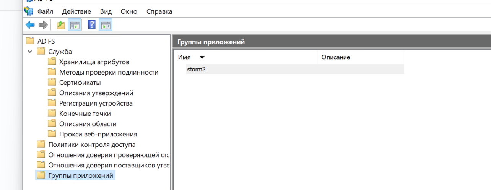

2. Create **2 applications** in the group:  
   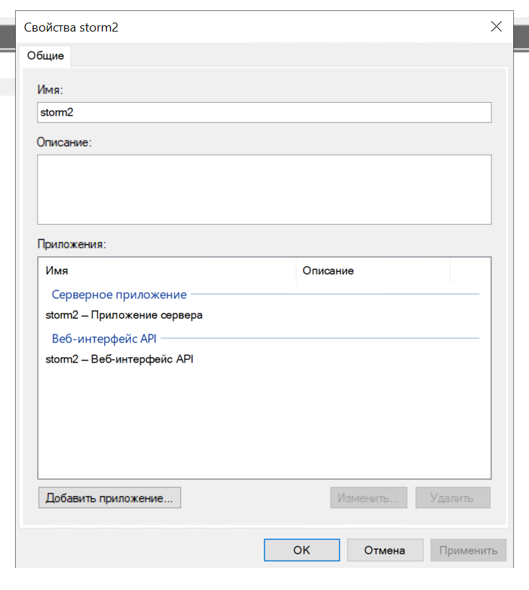

##### Configuring the Server Application {#настроика-серверного-приложения}

3. **First application** - Server application:  
   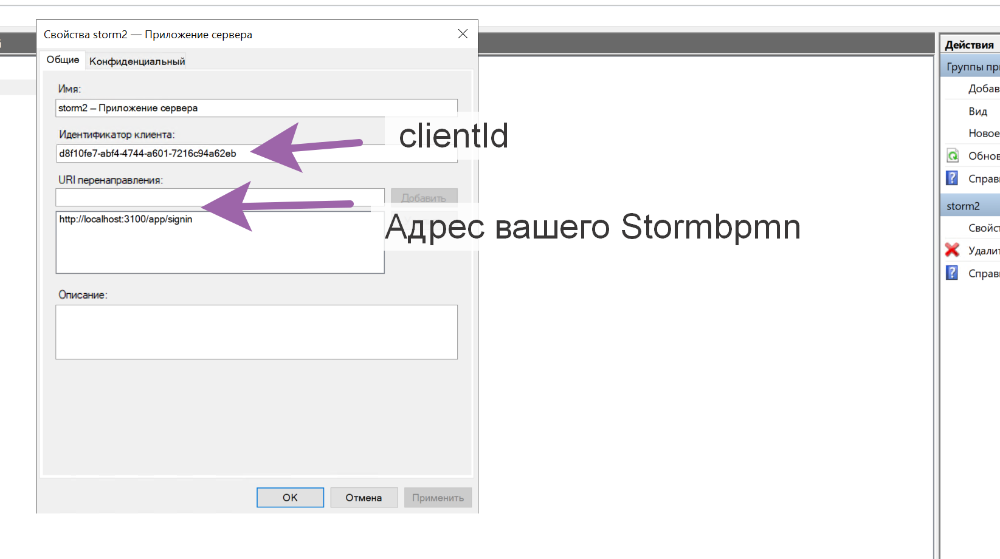

4. In the settings, specify:
    - The correct **Redirect URI**
    - Note down the **Client ID** and **Client Secret**
      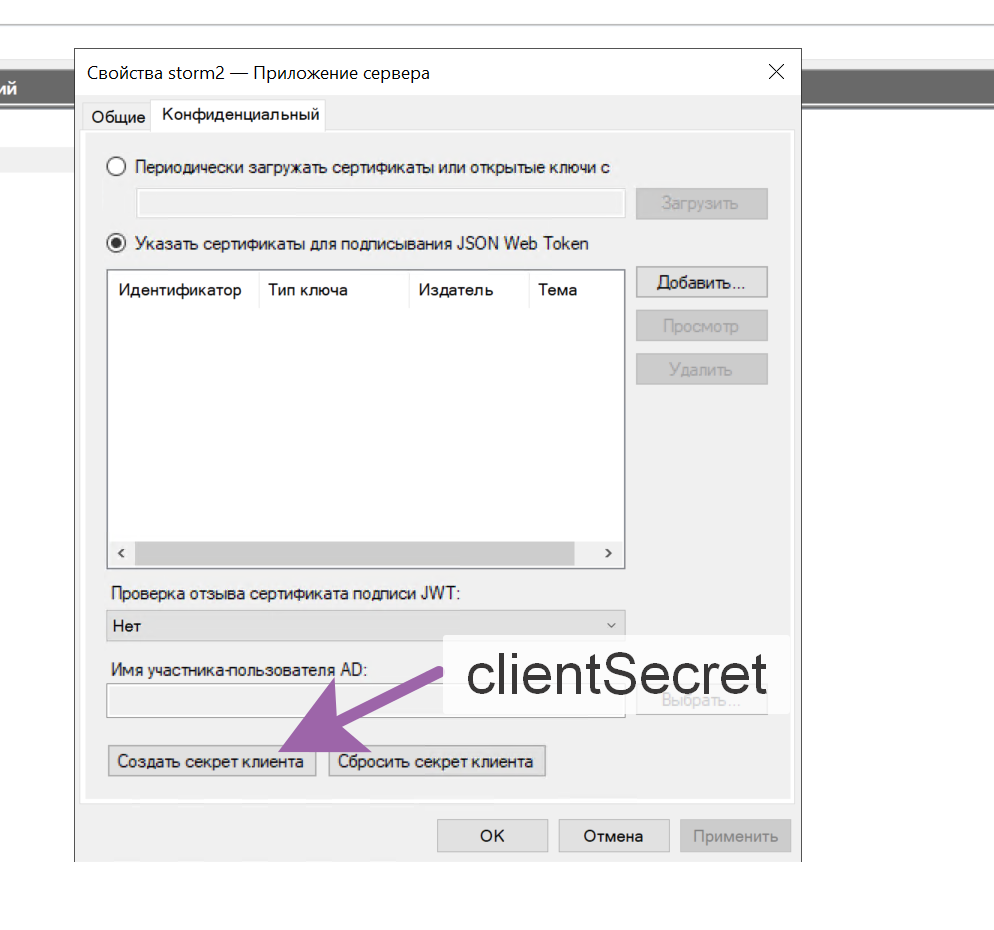

##### Configuring the Web API {#настроика-веб-api}

5. **Second application** - Web API:

6. Create a **Relying party identifier** and note it down  
   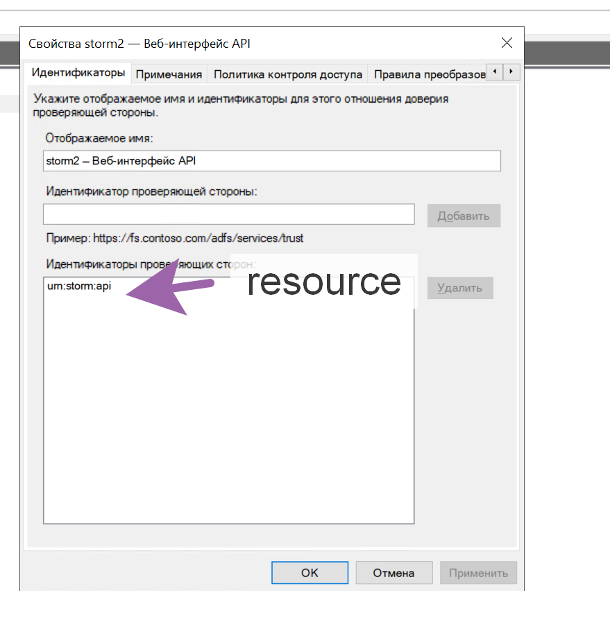

##### Configuring Access Policies {#настроика-политик-доступа}

7. Select an appropriate **Access Control Policy**:  
   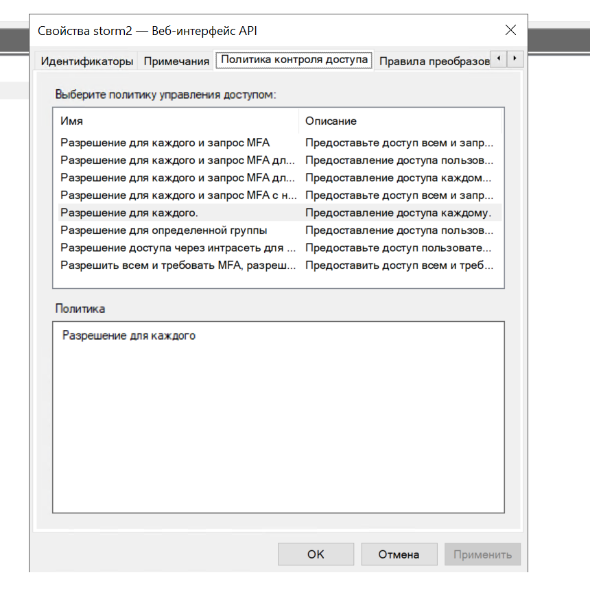

##### Configuring Attribute Mapping {#настроика-маппинга-атрибутов}

8. In the **Issuance Transform Rules** section, configure attribute mapping:

    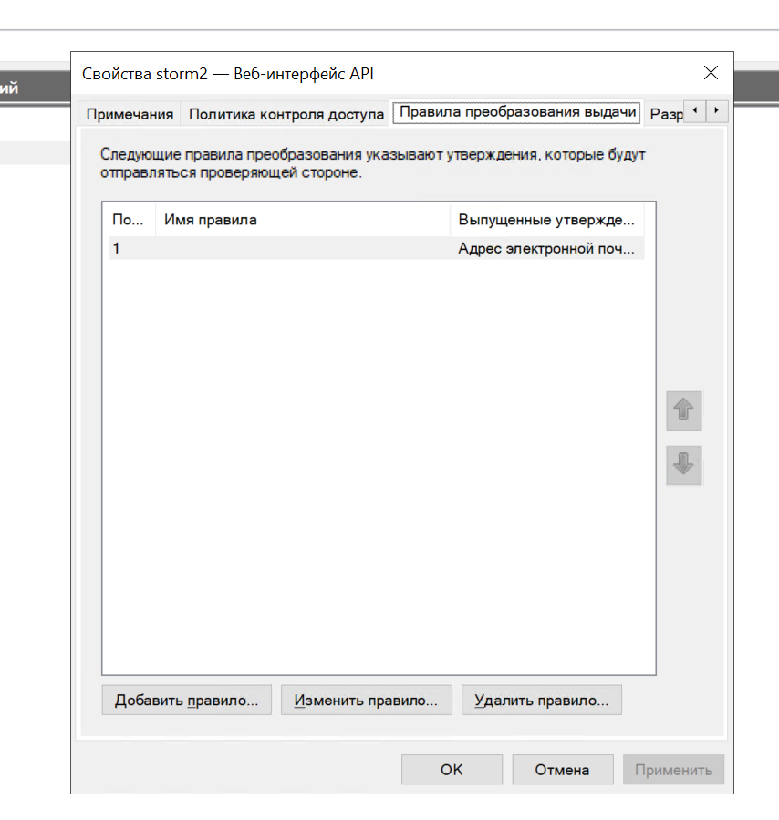
    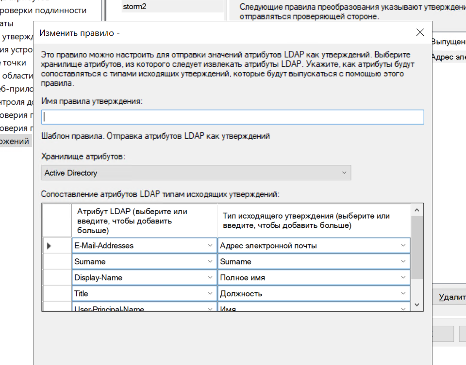

::: danger Important: claims mapping
StormBPMN expects the following claims in the token:

| StormBPMN Field | Expected claim | Type         |
| -------------- | --------------- | ----------- |
| `email`        | `email`         | Standard |
| `firstName`    | `given_name`    | Standard |
| `lastName`     | `family_name`   | Standard |
| `middleName`   | `middle_name`   | Standard |
| `fullName`     | `full_name`     | Custom   |
| `position`     | `position`      | Custom   |

The custom claim `full_name` does not need to be configured: if it (and `displayname`) is not present in the token, StormBPMN will assemble the "Full Name" itself from `family_name` (or `surname`), `given_name`, and `middle_name` — in the format "Last Name First Name Patronymic".

**Custom claims** (Full Name, Position) must be created and published in the Claims Description.  
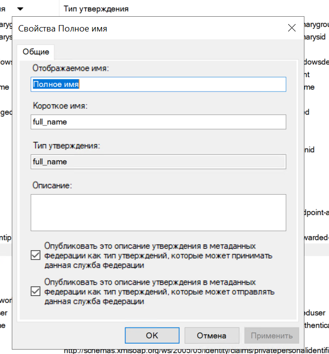

:::

##### Configuring Permissions {#настроика-разрешении}

9. Set client permissions:

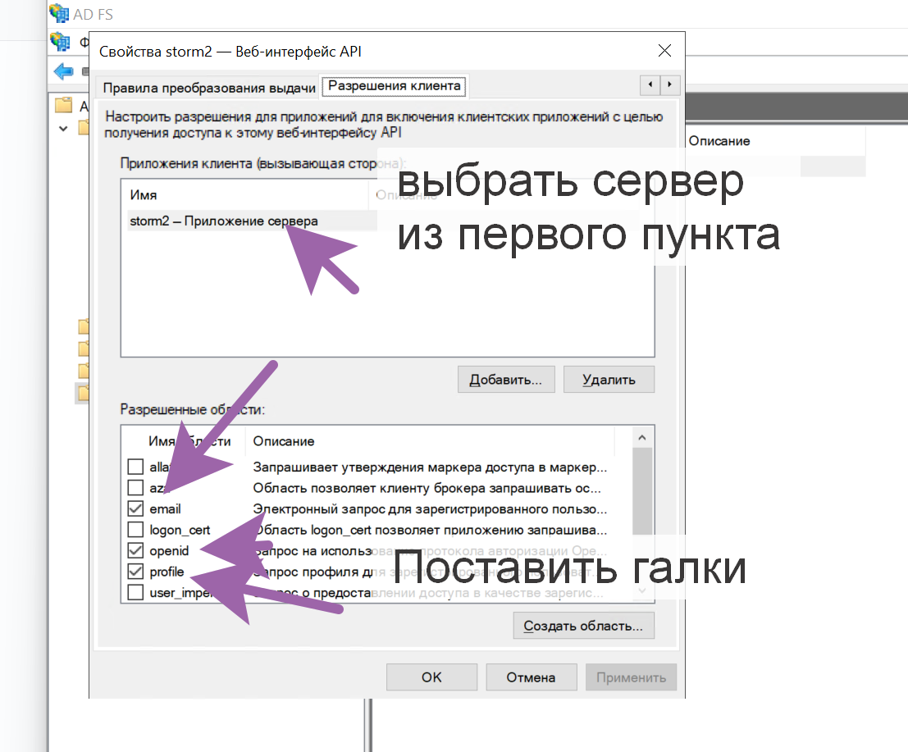

If all steps are performed carefully, the ADFS configuration on the server side is complete.

#### Step 2: StormBPMN Configuration {#шаг-2-настроика-stormbpmn}

##### Parameters for Configuration {#параметры-для-настроики}

You will need the saved values:

-   **Client ID** (from the server application)
-   **Client Secret** (from the server application)
-   **Resource identifier** (from the Web API)

##### Configuration in the Admin Panel {#настроика-в-административнои-панели}

1. Open `/app/admin` → **Branding and Login Page** → **Login and Registration** → expand **OAuth 2.0 connection parameters**.

2. Specify the following parameters:

| Parameter                     | Value                            | Note                                                |
| ---------------------------- | ----------------------------------- | --------------------------------------------------------- |
| **OAuthClientId**            | Your Client ID                       | From the ADFS server application                             |
| **OAuthClientSecret**        | Your Client Secret                   | From the ADFS server application                             |
| **OAuthAuthorizeUri**        | `/adfs/oauth2/authorize`            | Standard ADFS path                                     |
| **OAuthUserInfoUri**         | `/adfs/userinfo`                    | For backward compatibility (ADFS does not use this endpoint) |
| **OAuthTokenUri**            | `/adfs/oauth2/token`                | Standard ADFS path                                     |
| **OAuthButtonLabel**         | `"Войти через ADFS"`                | Text on the login button                                     |
| **OAuthIsEnabled**           | `true`                              | Enable OAuth2                                          |
| **OAuthRedirectUri**         | `https://your-storm-url/app/signin` | Your StormBPMN URL                                      |
| **OAuthResponseType**        | `code`                              | Response type                                                |
| **OAuthScope**               | `openid profile email`            | Access scopes                                           |
| **OAuthCodeChallengeMethod** | `S256`                              | Challenge method                                           |
| **OAuthFlowMode**            | `PKCE`                              | Flow mode                                              |
| **OAuthResource**            | Your Resource identifier             | From the Web API application                                     |

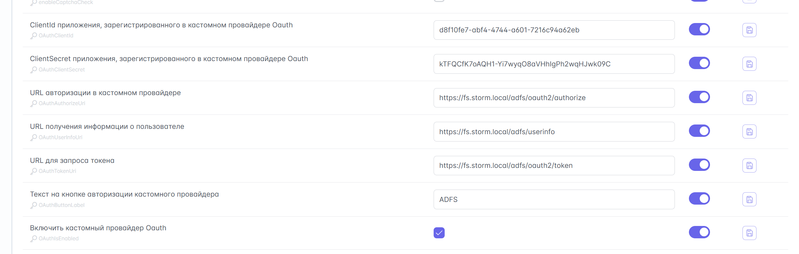
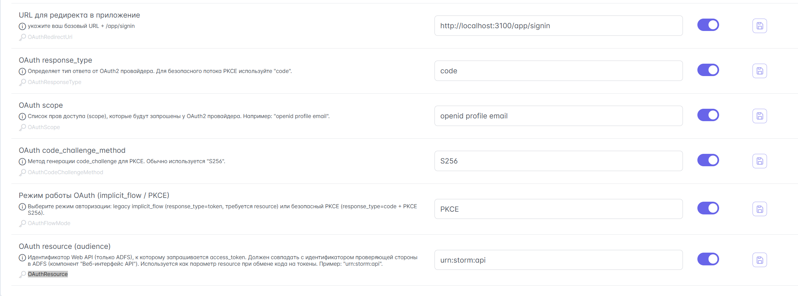

#### Additional Requirements {#дополнительные-требования}

::: warning Certificates
Integration will not work with self-signed certificates. Trusted certificates must be added according to the instructions in this section.
:::

::: tip Testing
The configuration has been tested and is guaranteed to work with:

-   **Windows Server 2022**
-   **ADFS 4.0**

If the integration does not work, check:

-   Correctness of all parameters
-   Correctness of claims mapping
-   Presence of all necessary permissions in ADFS
-   Trusted certificates (if used)

:::

### Claims Validation {#проверка-claims}

Additional validation of rights in the OAuth2 token:

| Parameter            | Description           | Example Value   |
| ------------------- | ------------------- | ------------------ |
| **OAuthCheckClaim** | Enable validation  | `true`            |
| **OAuthClaimName**  | Claim name     | `groups`          |
| **OAuthClaimValue** | Required value | `stormbpmn-users` |

How the value is compared:

- a string must equal `OAuthClaimValue` exactly, case-sensitive;
- an array (for example, `groups: ["storm-users", "analysts"]`) passes if **any** element equals `OAuthClaimValue` exactly;
- a number or boolean is compared as text (`true`, `42`);
- a missing or empty claim, or an object, **denies** sign-in (`sso_access_claim_missing` or `sso_access_denied`).

If the check is on but `OAuthClaimName` or `OAuthClaimValue` is empty, SSO sign-in is rejected (`sso_access_policy_misconfigured`) rather than letting everyone in.

::: warning Claim Source
The source of the value depends on the mode: with `OAuthFlowMode = OIDC` the claim is looked up in the verified ID Token, then in the UserInfo response; with `PKCE` it is read from the access token; with `implicit_flow` from the `/userinfo` response. When switching modes, verify that the required claim ends up there: in Keycloak this is controlled by the mapper in the client scope (**Add to ID token**, **Add to access token**, **Add to userinfo**).
:::

::: tip Array groups did not work before
Before arrays were supported, a `groups` claim sent as a list never matched, and the check kept out even the intended users. If you worked around this with a separate string claim, it keeps working as before.
:::

### Built-in Authentication {#встроенная-авторизация}

::: warning For testing only
Built-in authentication is suitable only for test environments. Use OAuth2 in production.
:::

**Emergency login:** Add `?showBasicLogin=true` to the login URL to access the basic form, even if OAuth2 is enabled.

### Password Change {#смена-пароля}

::: warning Password Change Security
The product build implements enhanced security rules for built-in authentication:

1. **Current password verification:** When changing a password, the system requires the current password. This prevents account takeover via a stolen JWT token.
2. **Lockout of disabled accounts:** Users disabled by an administrator cannot change their password, even if they possess a valid token.
3. **Session rotation:** After a successful password change, all previously issued tokens become invalid: other devices are logged out, while the current device receives a new token in the response and continues operating without requiring re-login.
:::

---
