[[toc]]

# Authorization System (OAuth2, Keycloak, ADFS) {#система-авторизации-oauth2-keycloak-adfs}

### OAuth2 (recommended) {#oauth2-рекомендуется}

::: warning Deprecated login methods
**LDAP** and direct (built-in) Keycloak integration are deprecated. For new installations, use **OAuth2** as described below: Keycloak connects to Storm as a standard OAuth2 provider.
:::

Corporate authentication via external providers (Keycloak, Azure AD, etc.)

| Parameter              | Description                                | Example value                                                                    |
| --------------------- | --------------------------------------- | ---------------------------------------------------------------------------------- |
| **OAuthIsEnabled**    | Enable OAuth2                        | `true`                                                                             |
| **OAuthClientId**     | Client ID in the provider                 | `stormbpmn-client`                                                                 |
| **OAuthClientSecret** | Client secret                          | `your-client-secret`                                                               |
| **OAuthAuthorizeUri** | Authorization URL                         | `https://keycloak.company.com/auth/realms/master/protocol/openid-connect/auth`     |
| **OAuthUserInfoUri**  | User information URL | `https://keycloak.company.com/auth/realms/master/protocol/openid-connect/userinfo` |
| **OAuthTokenUri**     | Token URL                    | `https://keycloak.company.com/auth/realms/master/protocol/openid-connect/token`    |
| **OAuthButtonLabel**  | Login button text                   | `"Войти через корпоративный аккаунт"`                                              |
| **OAuthRedirectUri**  | Return URL after authorization          | `https://stormbpmn.company.com/app/signin`                                         |
| **OAuthFlowMode**     | Flow mode: `PKCE` or `implicit_flow` | `PKCE`                                                                            |

#### Flow mode: PKCE or implicit {#режим-потока-pkce-или-implicit}

StormBPMN supports two modes, switched by the **OAuthFlowMode** parameter:

| Mode                     | What happens                                                                                                              | When to choose                                                                       |
| ------------------------- | --------------------------------------------------------------------------------------------------------------------------- | ------------------------------------------------------------------------------------ |
| `PKCE` (recommended)    | Authorization Code Flow with PKCE: the provider returns `code`, the server exchanges it for a token over a secure channel                | Always, if the provider supports Authorization Code Flow. There is no need to enable Implicit flow |
| `implicit_flow` (legacy)  | `response_type=token`, the access token arrives in the browser via the URL fragment, and user data is retrieved from `/userinfo`          | The provider issues an opaque (non-JWT) access token or does not support PKCE          |

If the parameter is not set, `implicit_flow` is used — this is done for backward compatibility with older installations.

##### PKCE mode parameters {#параметры-режима-pkce}

| Parameter                     | Value              | Note                                                          |
| ---------------------------- | --------------------- | -------------------------------------------------------------------- |
| **OAuthFlowMode**            | `PKCE`                | Enables Authorization Code Flow                                     |
| **OAuthResponseType**        | `code`                | Must be set together with `OAuthFlowMode`                          |
| **OAuthScope**               | `openid profile email` | Must grant access to the user's email                           |
| **OAuthCodeChallengeMethod** | `S256`                | Keep `S256`, `plain` — only for legacy providers          |
| **OAuthResource**            | Web API identifier | Only for ADFS; other providers ignore this parameter            |

::: danger OAuthFlowMode and OAuthResponseType are changed together
If you enable `OAuthFlowMode = PKCE` but do not fill in `OAuthResponseType`, the login page will redirect to the provider with the old `response_type=token` and wait for `code`, which will not arrive. The login will hang without a clear error. Both parameters are required for PKCE.
:::

::: warning Client requirements in PKCE mode
- The client must be **confidential**: `OAuthClientSecret` is required and is sent when exchanging the code for a token.
- The access token must be a **JWT** and contain `email` (or `upn`, or `unique_name`). For providers with opaque tokens, keep `implicit_flow`.
- `OAuthRedirectUri` must match the value registered with the provider character by character.
:::

::: tip The StormBPMN session can live exactly as long as the provider session
By default, after login, StormBPMN issues its own token for the duration of `SESSION_EXPIRATION` and operates independently of the provider. If security policy does not allow this, enable session binding to SSO — then the token is renewed with the provider via `refresh_token`, and revoking the session in the provider logs the user out of StormBPMN.

Details and enabling procedure — [Session binding to SSO](./sso-session-binding.md).
:::

::: tip Keycloak configuration
**Step-by-step instructions for Keycloak 26.0.7:**

1. **Create a client** in the required realm
2. **Client ID:** `stormbpmn-client`
3. **Valid redirect URIs:** `https://stormbpmn.company.com/app/signin`
4. **Web origins:** `https://stormbpmn.company.com`
5. **Client authentication:** ON
6. **Standard flow:** ON. Keep **Implicit flow** OFF if `OAuthFlowMode = PKCE` is selected in StormBPMN; enable it only for the legacy mode `implicit_flow`
7. For PKCE: **Advanced** tab → **Proof Key for Code Exchange Code Challenge Method** → `S256`
8. **Client Scopes:** email and profile must be default
9. **Get Client Secret** on the Credentials tab

:::

#### Filling in the full name in the user profile {#заполнение-фио-в-профиле-пользователя}

With each OAuth2 login, StormBPMN synchronizes the profile fields "Full name" (`fullName`), "First name" (`firstName`), and "Last name" (`lastName`) from the provider data — if you change the last name in the provider, it will be updated in StormBPMN on the next login. If the provider does not send name attributes, already filled profile fields are not overwritten.

The data source depends on the flow mode:

| Mode            | Source                | Attributes                                                                                   |
| ---------------- | ----------------------- | ------------------------------------------------------------------------------------------ |
| `implicit_flow`  | Response `/userinfo`       | `family_name` — last name, `given_name` (or `name`, if `given_name` is not present) — first name, `middle_name` — patronymic |
| `PKCE`           | Claims access token     | A ready-made `full_name` or `displayname`; if they are not present, the full name is assembled from `family_name` (or `surname`), `given_name`, and `middle_name` |

The "Full name" is assembled in the format **"Last Name First Name Patronymic"** from the parts provided by the provider.

::: tip What to configure on the provider
As a rule, the standard scope `profile` is sufficient — it returns name attributes in the `/userinfo`. No special permissions or custom mappings are required: if the provider passes `family_name`, `given_name`/`name`, and `middle_name`, the full name will be populated automatically.
:::

### Microsoft ADFS {#microsoft-adfs}

::: warning Microsoft ADFS Features
Microsoft has a specific (alternatively gifted) approach to OAuth2/OpenID Connect standards. In particular, ADFS does not return user information via the standard `/userinfo` endpoint, which complicates integration. Additionally, ADFS interfaces (especially in the Russian localization) may appear confusing.
:::

Configuring authorization via ADFS requires more time and attention compared to other providers.

#### Step 1: ADFS Configuration {#шаг-1-настроика-adfs}

##### Creating an Application Group {#создание-группы-приложении}

1. In the ADFS Management console, create an application group:  
   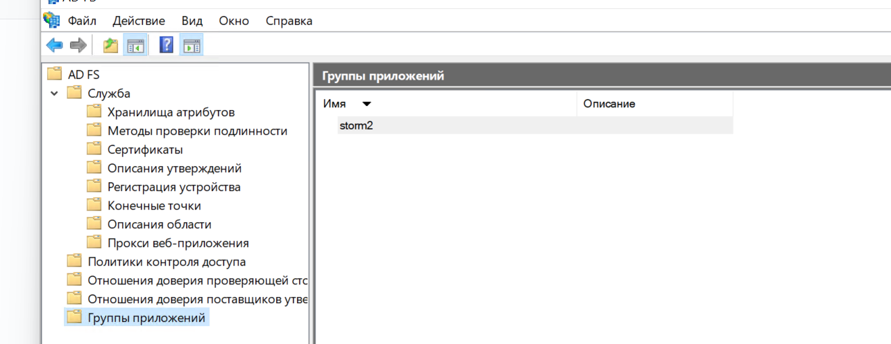

2. Create **2 applications** in the group:  
   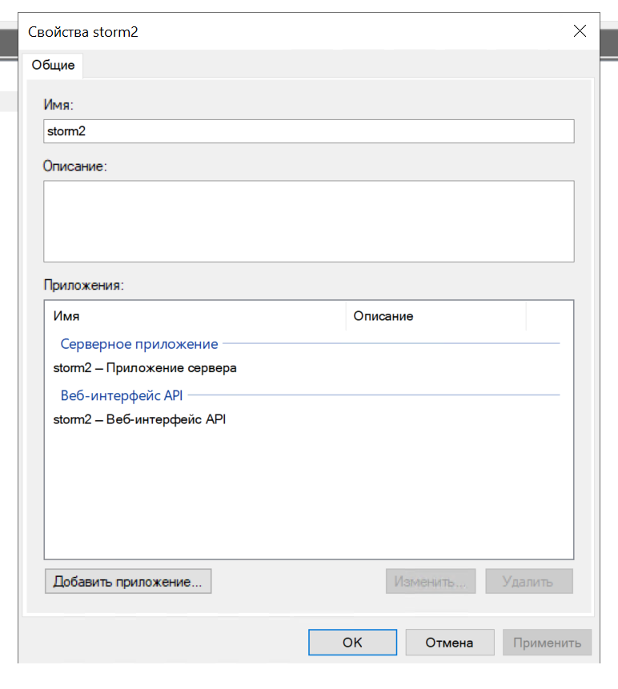

##### Configuring the Server Application {#настроика-серверного-приложения}

3. **First application** - Server application:  
   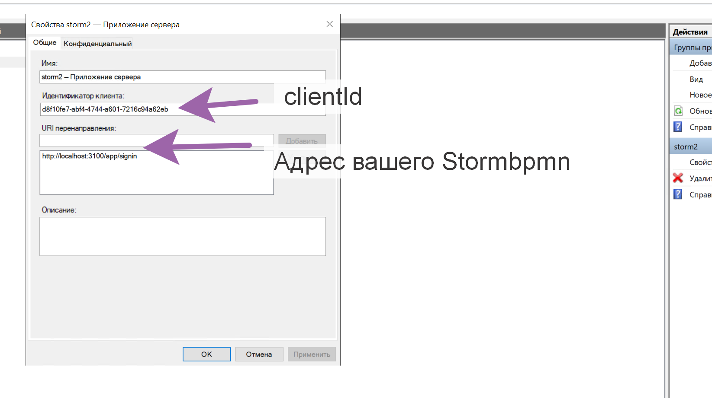

4. In the settings, specify:
    - The correct **Redirect URI**
    - Note down the **Client ID** and **Client Secret**
      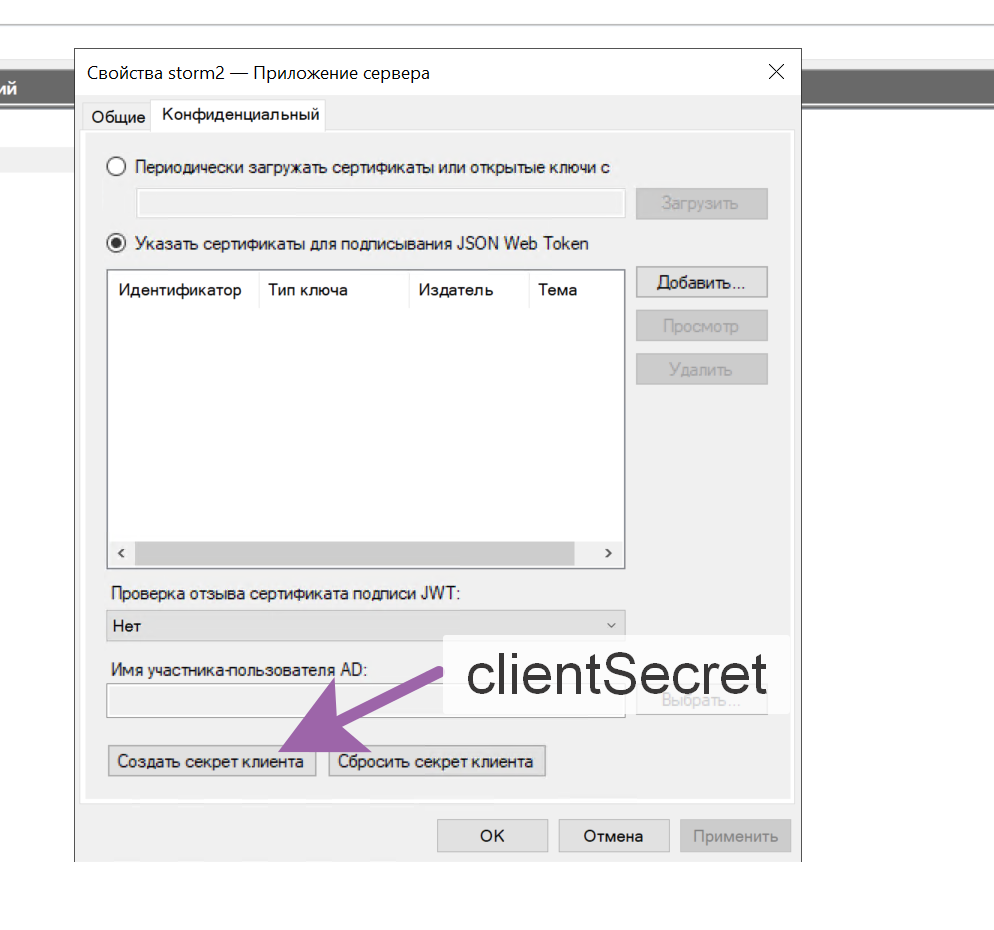

##### Configuring the Web API {#настроика-веб-api}

5. **Second application** - Web API:

6. Create a **Relying party identifier** and note it down  
   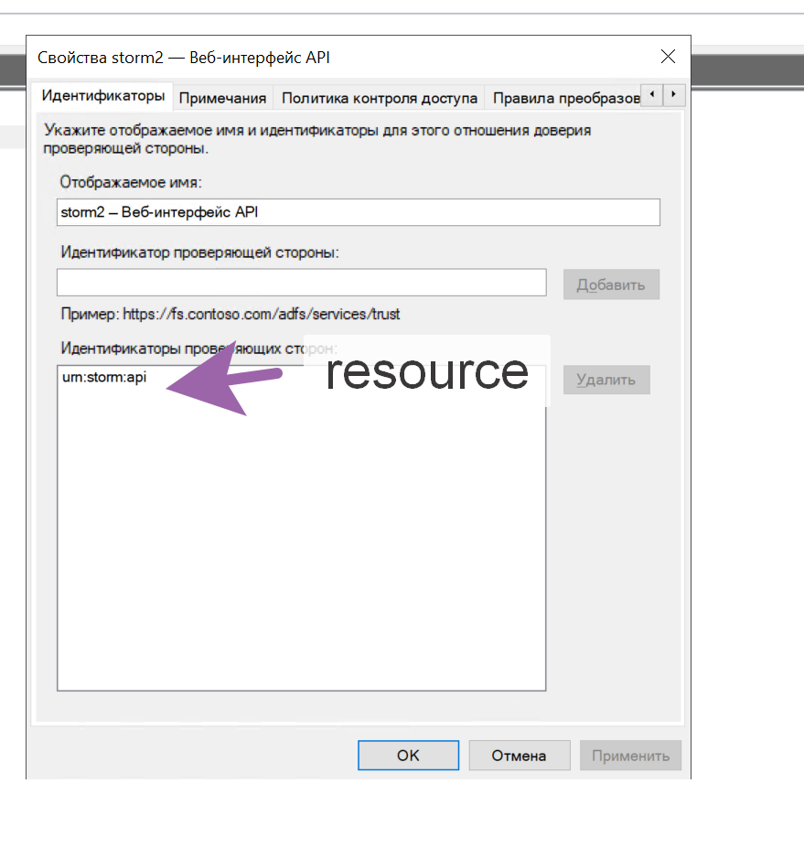

##### Configuring Access Policies {#настроика-политик-доступа}

7. Select an appropriate **Access Control Policy**:  
   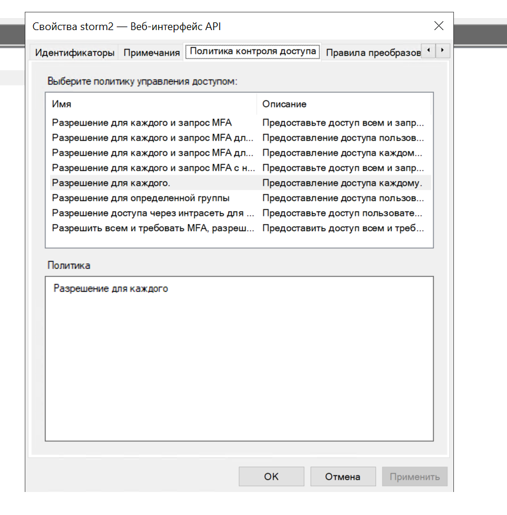

##### Configuring Attribute Mapping {#настроика-маппинга-атрибутов}

8. In the **Issuance Transform Rules** section, configure attribute mapping:

    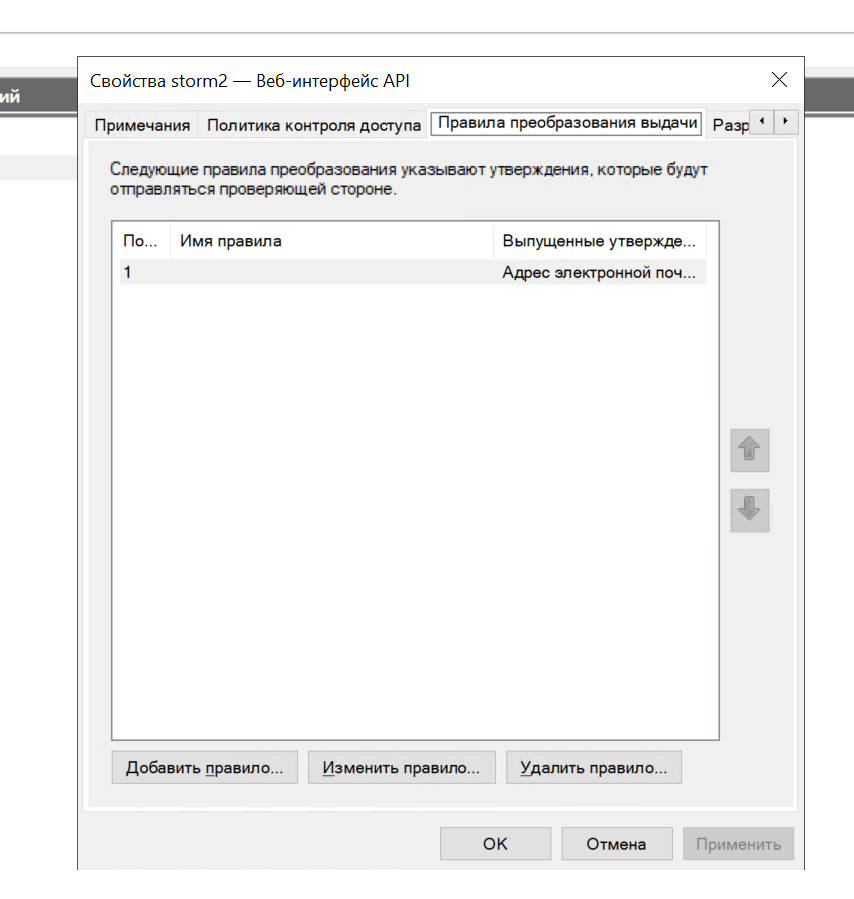
    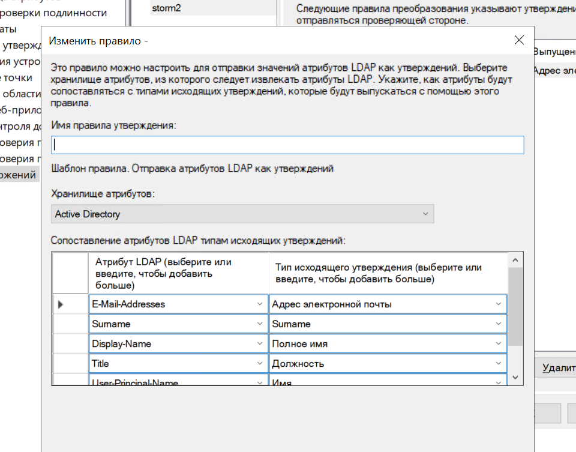

::: danger Important: claims mapping
StormBPMN expects the following claims in the token:

| StormBPMN Field | Expected claim | Type         |
| -------------- | --------------- | ----------- |
| `email`        | `email`         | Standard |
| `firstName`    | `given_name`    | Standard |
| `lastName`     | `family_name`   | Standard |
| `middleName`   | `middle_name`   | Standard |
| `fullName`     | `full_name`     | Custom   |
| `position`     | `position`      | Custom   |

The custom claim `full_name` does not need to be configured: if it (and `displayname`) is not present in the token, StormBPMN will assemble the "Full Name" itself from `family_name` (or `surname`), `given_name`, and `middle_name` — in the format "Last Name First Name Patronymic".

**Custom claims** (Full Name, Position) must be created and published in the Claims Description.  
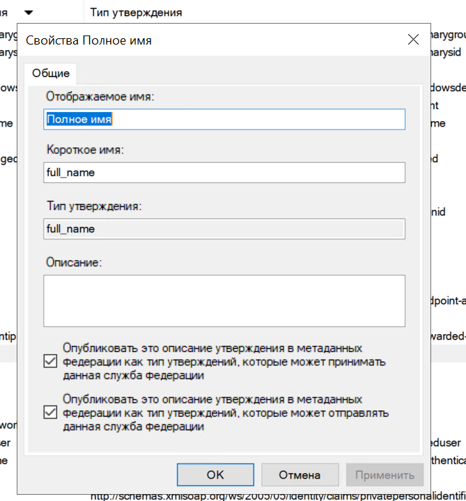

:::

##### Configuring Permissions {#настроика-разрешении}

9. Set client permissions:

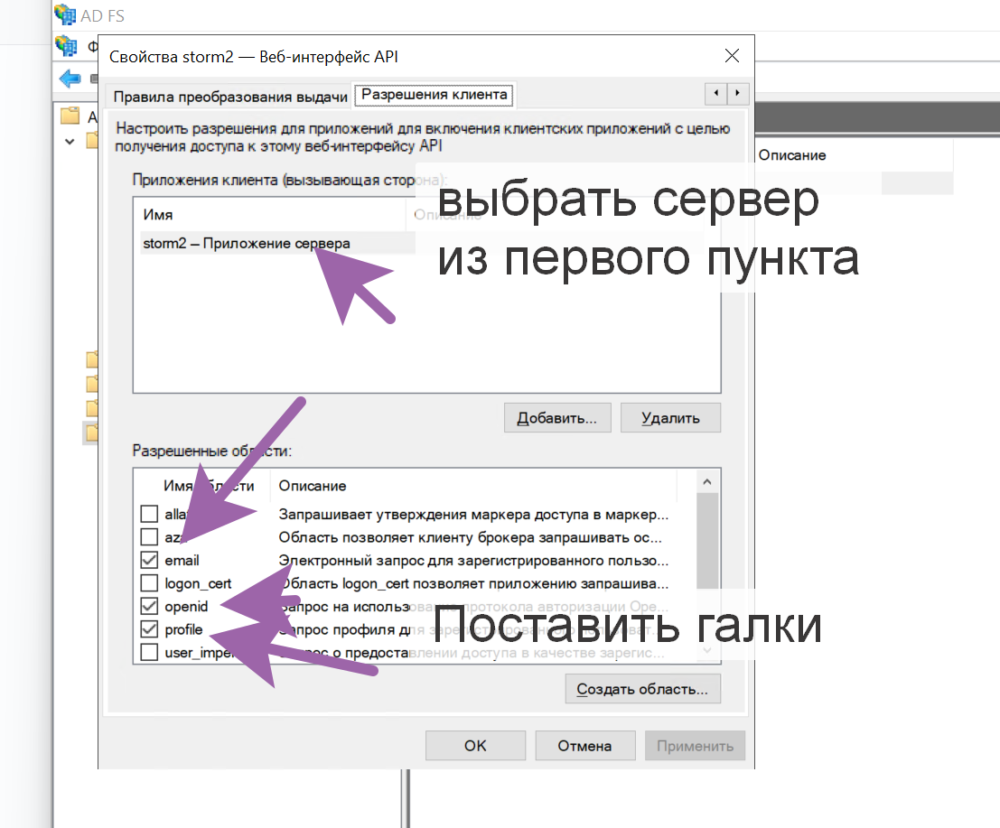

If all steps are performed carefully, the ADFS configuration on the server side is complete.

#### Step 2: StormBPMN Configuration {#шаг-2-настроика-stormbpmn}

##### Parameters for Configuration {#параметры-для-настроики}

You will need the saved values:

-   **Client ID** (from the server application)
-   **Client Secret** (from the server application)
-   **Resource identifier** (from the Web API)

##### Configuration in the Admin Panel {#настроика-в-административнои-панели}

1. Go to the admin panel: `/app/admin` → **Security** tab

2. Specify the following parameters:

| Parameter                     | Value                            | Note                                                |
| ---------------------------- | ----------------------------------- | --------------------------------------------------------- |
| **OAuthClientId**            | Your Client ID                       | From the ADFS server application                             |
| **OAuthClientSecret**        | Your Client Secret                   | From the ADFS server application                             |
| **OAuthAuthorizeUri**        | `/adfs/oauth2/authorize`            | Standard ADFS path                                     |
| **OAuthUserInfoUri**         | `/adfs/userinfo`                    | For backward compatibility (ADFS does not use this endpoint) |
| **OAuthTokenUri**            | `/adfs/oauth2/token`                | Standard ADFS path                                     |
| **OAuthButtonLabel**         | `"Войти через ADFS"`                | Text on the login button                                     |
| **OAuthIsEnabled**           | `true`                              | Enable OAuth2                                          |
| **OAuthRedirectUri**         | `https://your-storm-url/app/signin` | Your StormBPMN URL                                      |
| **OAuthResponseType**        | `code`                              | Response type                                                |
| **OAuthScope**               | `openid profile email`            | Access scopes                                           |
| **OAuthCodeChallengeMethod** | `S256`                              | Challenge method                                           |
| **OAuthFlowMode**            | `PKCE`                              | Flow mode                                              |
| **OAuthResource**            | Your Resource identifier             | From the Web API application                                     |

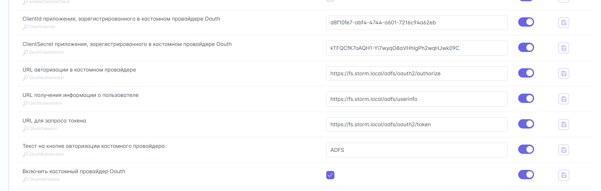
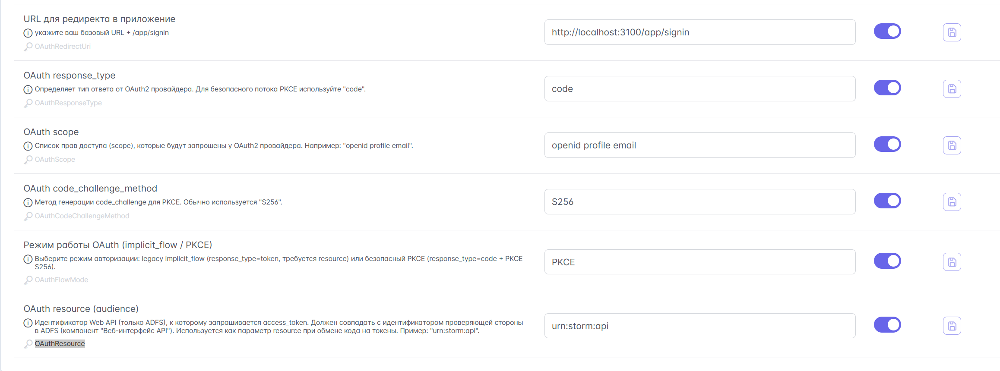

#### Additional Requirements {#дополнительные-требования}

::: warning Certificates
Integration will not work with self-signed certificates. Trusted certificates must be added according to the instructions in this section.
:::

::: tip Testing
The configuration has been tested and is guaranteed to work with:

-   **Windows Server 2022**
-   **ADFS 4.0**

If the integration does not work, check:

-   Correctness of all parameters
-   Correctness of claims mapping
-   Presence of all necessary permissions in ADFS
-   Trusted certificates (if used)

:::

### Claims Validation {#проверка-claims}

Additional validation of rights in the OAuth2 token:

| Parameter            | Description           | Example Value   |
| ------------------- | ------------------- | ------------------ | ----------------- |
| **OAuthCheckClaim** | Enable validation  | `true`            |
| **OAuthClaimName**  | Claim name     | `groups`          |
| **OAuthClaimValue** | Required value | `stormbpmn-users` |

::: warning Claim Source
The source of the value depends on the flow mode: in `OAuthFlowMode = PKCE` mode, the claim is read from the access token; in `implicit_flow` mode, it is read from the `/userinfo` response. When switching modes, verify that the required claim is placed in the correct location: in Keycloak, this is handled by the corresponding mapper in the client scope.
:::

### Built-in Authentication {#встроенная-авторизация}

::: warning For testing only
Built-in authentication is suitable only for test environments. Use OAuth2 in production.
:::

**Emergency login:** Add `?showBasicLogin=true` to the login URL to access the basic form, even if OAuth2 is enabled.

### Password Change {#смена-пароля}

::: warning Password Change Security
The product build implements enhanced security rules for built-in authentication:

1. **Current password verification:** When changing a password, the system requires the current password. This prevents account takeover via a stolen JWT token.
2. **Lockout of disabled accounts:** Users disabled by an administrator cannot change their password, even if they possess a valid token.
3. **Session rotation:** After a successful password change, all previously issued tokens become invalid: other devices are logged out, while the current device receives a new token in the response and continues operating without requiring re-login.
:::

---
