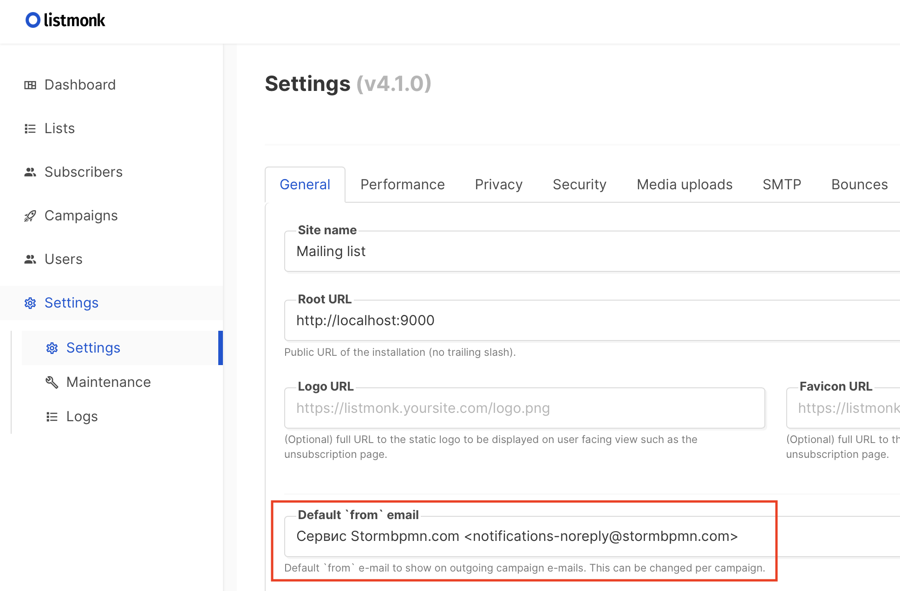
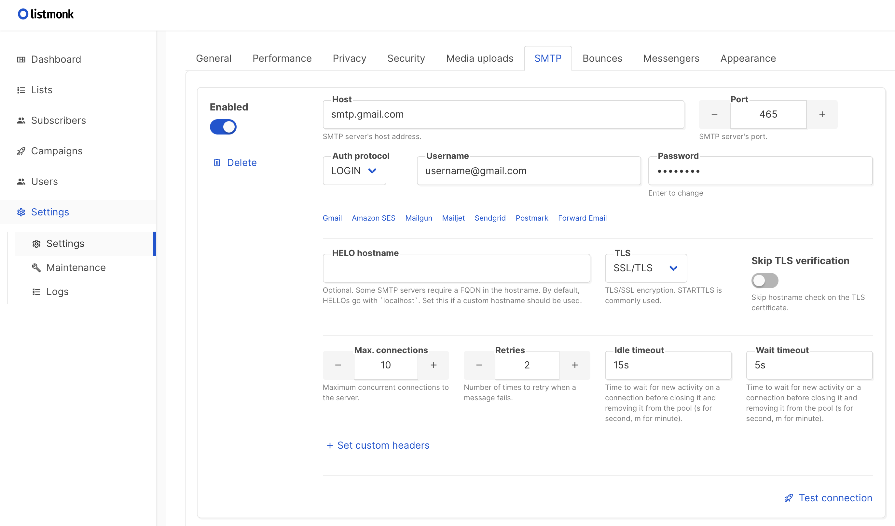
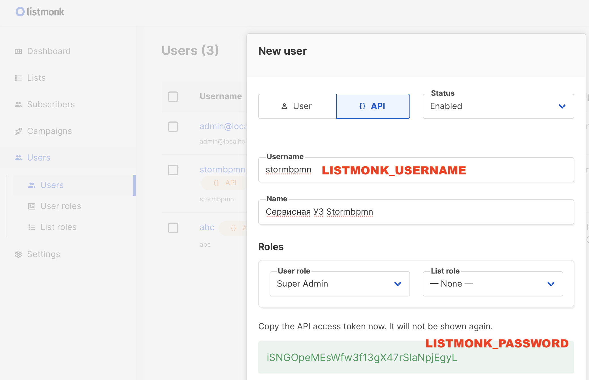
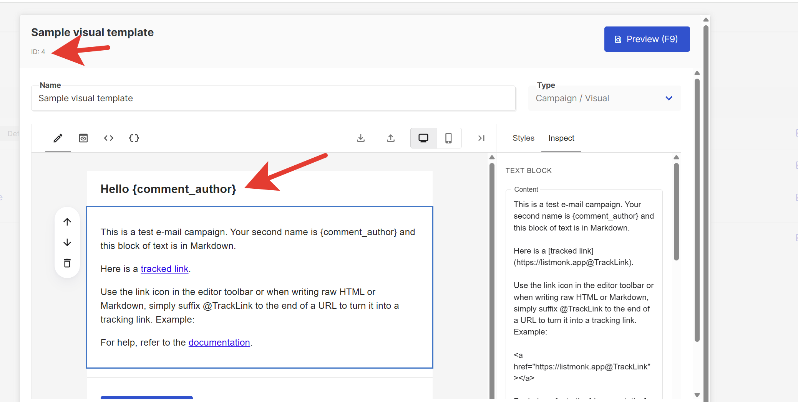
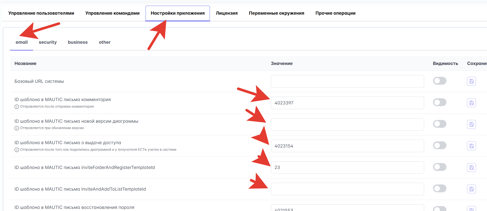

[[toc]]

# External services {#внешние-сервисы}

Deployment of services that StormBPMN depends on: object storage, Redis, PlantUML, document conversion, and email. The basic checklist and load balancer are covered in the [Production installation overview](./README.md).

## S3 storage for files {#s3-хранилище-для-фаилов}

### What is stored in S3: {#что-хранится-в-s3}

-   **Business process images** - diagrams and charts
-   **User avatars** - profile pictures
-   **Document templates** - for report generation
-   **Attachments** - files attached to processes

::: tip What to choose if you don't have a corporate S3
StormBPMN works with any S3-compatible storage. Two simple options for self-host:

- **MinIO** — a familiar option (see below). Note: in recent releases, the MinIO community console has been reduced to a simple object browser — bucket/policy management via the web interface has been removed.
- **[SeaweedFS](#альтернатива-seaweedfs-простое-s3-со-встроенным-ui)** — a lightweight S3 storage in a single container with a **built-in web interface** (Filer). Recommended if you need a simple UI and minimal setup effort.
:::

### Recommended solution: MinIO {#рекомендуемое-решение-minio}

:::info
If you used the [script](/en/install/quickstart/QUICKSTART_SCRIPT.md) for a quick start,
MinIO is already successfully deployed and connected to the system.
:::

#### Installing MinIO {#установка-minio}

```bash
# Запуск MinIO в Docker
docker run -d \
  -p 9000:9000 \
  -p 9001:9001 \
  --name minio \
  -v /mnt/data:/data \
  -e "MINIO_ROOT_USER=stormbpmn-s3-user" \
  -e "MINIO_ROOT_PASSWORD=stormbpmn-s3-password" \
  quay.io/minio/minio server /data --console-address ":9001"
```

#### Creating the default bucket {#создание-дефолтного-бакета}

```bash
curl -fLO https://dl.min.io/client/mc/release/linux-amd64/mc
chmod +x mc
mv mc /usr/local/bin/
mc alias set minio http://localhost:9000 "stormbpmn-s3-user" "stormbpmn-s3-password"
mc mb minio/storm-uploads
```

#### Configuring environment variables {#настроика-переменных-окружения}

| Variable                 | Description                               | Example value           |
|----------------------------|----------------------------------------|---------------------------|
| **S3_ENDPOINT**            | Storage URL                          | `http://192.168.0.4:9000` |
| **S3_ACCESS_KEY**          | Access key                           | `stormbpmn-s3-user`       |
| **S3_SECRET_KEY**          | Secret key                         | `stormbpmn-s3-password`   |
| **S3_BUCKET_UPLOADS**      | Default bucket                     | `storm-uploads`           |
| **S3_BUCKET_USERS**        | Bucket for users                | `storm-users`             |
| **S3_BUCKET_IMPORTS**      | Bucket for imports                     | `storm-imports`           |
| **S3_SINGLE_USERS_BUCKET** | Single bucket mode for users | `true`                    |
| **S3_EXTERNAL_ENDPOINT**   | Address at which the **browser** opens file links (optional) | `https://s3.company.com`  |

::: tip S3_EXTERNAL_ENDPOINT
The Storm server accesses the storage via `S3_ENDPOINT` (usually an internal address), while users are issued temporary (presigned) links to files that their browser opens. If the internal address is not accessible from user computers, specify the external address of the same storage in `S3_EXTERNAL_ENDPOINT`. If the variable is not set, links are constructed using `S3_ENDPOINT`. The [System Check](/en/operation/system-check.md#проверка-фаилового-хранилища-из-браузера) verifies the operation of this address from the browser. After changing `.env`, restart the container.
:::

When using another S3 storage compatible with AWS SDK v2, you may also need to:
- Set the variable `S3_REGION` corresponding to your storage configuration
- Set the variable `S3_VIRTUAL_HOST=true` for vHosted addressing type (default is `false` for Path-Style)

:::info Single user bucket
- For a fresh installation, we recommend using `S3_SINGLE_USERS_BUCKET=true`.
- If you already have Storm installed and connected to an S3 storage where each user has their own bucket (of the form `user123`),
you can migrate them to a single bucket (for example, `storm-users`), specify it in the variable `S3_BUCKET_USERS`
and switch the operating mode to `S3_SINGLE_USERS_BUCKET=true`. In this case, the path to user files will
look like `s3://storm-users/user123/...`
:::

#### Verifying functionality {#проверка-работоспособности}

After configuration, when saving diagrams, their thumbnails should be displayed in the card view.

::: tip MinIO Documentation
Complete installation guide: [MinIO Documentation](https://min.io/docs/minio/linux/index.html)
:::

### Alternative: SeaweedFS (Simple S3 with Built-in UI) {#альтернатива-seaweedfs-простое-s3-со-встроенным-ui}

[SeaweedFS](https://github.com/seaweedfs/seaweedfs) is a lightweight S3-compatible storage solution. It runs as a **single container**, features a built-in web interface (Filer), and supports path-style addressing used by StormBPMN. It is a good choice if you do not have a corporate S3 implementation and MinIO does not meet your requirements.

#### Step 1. Access Credentials {#шаг-1-учетные-данные-доступа}

S3 in SeaweedFS is open by default without a password — you must set access keys via configuration. Create the file `s3-config.json`:

```json
{
  "identities": [
    {
      "name": "stormbpmn",
      "credentials": [
        { "accessKey": "stormbpmn-s3-user", "secretKey": "stormbpmn-s3-password" }
      ],
      "actions": ["Admin", "Read", "Write", "List", "Tagging"]
    }
  ]
}
```

#### Step 2. Container Startup {#шаг-2-запуск-контеинера}

```bash
docker run -d \
  --name seaweedfs \
  --restart unless-stopped \
  -p 8333:8333 \
  -p 8888:8888 \
  -v /mnt/seaweedfs:/data \
  -v "$(pwd)/s3-config.json:/etc/seaweedfs/s3-config.json:ro" \
  chrislusf/seaweedfs server \
    -dir=/data \
    -s3 \
    -s3.port=8333 \
    -s3.config=/etc/seaweedfs/s3-config.json
```

The `server` command starts the master, volume, filer, and S3 gateway in a single process.

| Port     | Purpose                                      |
| -------- | -------------------------------------------- |
| **8333** | S3 API (specified in `S3_ENDPOINT`)                   |
| **8888** | Filer — web interface for browsing files     |

#### Step 3. Bucket Creation {#шаг-3-создание-бакета}

```bash
docker exec -i seaweedfs weed shell <<< "s3.bucket.create -name storm-uploads"
```

Or using any S3 client with the same keys (e.g., AWS CLI):

```bash
aws --endpoint-url http://localhost:8333 s3 mb s3://storm-uploads
```

#### Step 4. StormBPMN Environment Variables {#шаг-4-переменные-окружения-stormbpmn}

```bash
S3_ENDPOINT=http://<хост-seaweedfs>:8333
S3_ACCESS_KEY=stormbpmn-s3-user
S3_SECRET_KEY=stormbpmn-s3-password
S3_BUCKET_UPLOADS=storm-uploads
S3_SINGLE_USERS_BUCKET=true
# Адресация path-style включена по умолчанию (S3_VIRTUAL_HOST=false) — менять не нужно.
```

#### Step 5. Verification {#шаг-5-проверка}

- Open the Filer web interface: `http://<хост-seaweedfs>:8888` — buckets and files are visible there.
- Save a diagram in StormBPMN — its thumbnail should appear in the card view, and the corresponding object should appear in the `storm-uploads` bucket (in Filer).

::: tip SeaweedFS Documentation
S3 API and its configuration: [SeaweedFS — Amazon S3 API](https://github.com/seaweedfs/seaweedfs/wiki/Amazon-S3-API).
:::

---

---

## Redis: Collaborative Diagram Editing {#redis-совместное-редактирование-диаграмм}

Redis is used for the **real-time collaborative diagram editing** feature. It provides:

-   **Pub/Sub** - message delivery between application instances (cursors, XML changes, presence)
-   **Session storage** - information about current participants in collaborative editing

::: tip When is Redis required?
-   **Single StormBPMN instance** — Redis is **not required**. Data is stored in application memory (InMemory mode)
-   **Multiple instances** (multi-instance / HA) — Redis is **mandatory** for synchronization between nodes
:::

### Installation {#установка}

```bash
# Запуск Redis в Docker
docker run -d \
  -p 6379:6379 \
  --name redis \
  redis:7-alpine
```

For production, it is recommended to set a password:

```bash
docker run -d \
  -p 6379:6379 \
  --name redis \
  redis:7-alpine \
  redis-server --requirepass your-secure-password
```

### Configuring environment variables {#настроика-переменных-окружения-1}

| Variable            | Description                | Example value    | Required                |
| --------------------- | ----------------------- | ------------------ | -------------------------- |
| **REDIS_ENABLED**     | Enabling Redis         | `true`             | For multi-instance         |
| **REDIS_HOST**        | Redis host              | `192.168.0.7`      | When REDIS_ENABLED=true     |
| **REDIS_PORT**        | Redis port              | `6379`             | When REDIS_ENABLED=true     |
| **REDIS_PASSWORD**    | Redis password            | `your-password`    | If set on the server      |
| **REDIS_DATABASE**    | Redis database number | `0`                | Optional (default 0)  |
| **REDIS_TIMEOUT**     | Connection timeout     | `1000ms`           | Optional                |

### Functionality Check {#проверка-работоспособности-1}

After configuration, open one diagram in two browser tabs — you should see the avatars of other participants on the canvas and real-time synchronization of changes.

### Configuring the Load Balancer for WebSocket {#настроика-балансировщика-для-websocket}

Collaborative editing uses **WebSocket** (STOMP over SockJS) via the path `/ws`. Ensure that the load balancer proxies WebSocket connections. A configuration example is provided in the [section above](README.md#конфигурация-nginx).

::: warning Sticky Sessions
When using multiple nodes behind the load balancer, WebSocket connections must support **sticky sessions** (node affinity) — otherwise, the SockJS fallback may not work correctly.
:::

---

---

## PlantUML server (optional) {#plantuml-сервер-опционально}

Provides UML diagram generation in the application interface.

:::info
If you used the [script](/en/install/quickstart/QUICKSTART_SCRIPT.md) for quick start,
PlantUML is already successfully deployed and connected to the system.
:::

### Installation {#установка-1}

```bash
# Запуск PlantUML сервера
docker run -d \
  -p 8090:8080 \
  --name plantuml \
  plantuml/plantuml-server:jetty
```

### Configuration {#настроика}

| Variable          | Description             | Example Value            |
| ------------------- | -------------------- | -------------------------- |
| **PLANTUML_SERVER** | PlantUML server URL | `http://192.168.0.5:8090/` |

---

---

## Document Conversion Service {#сервис-конвертации-документов}

Provides conversion of HTML to PDF and other document formats.

:::info
If you used the [script](/en/install/quickstart/QUICKSTART_SCRIPT.md) for a quick start,
Gotenberg is already successfully deployed and connected to the system.
:::

### Installing Gotenberg {#установка-gotenberg}

```bash
# Запуск Gotenberg
docker run -d \
  -p 3001:3000 \
  --name gotenberg \
  gotenberg/gotenberg:8
```

::: tip You can use our Gotenberg image
If external registries (Docker Hub) are prohibited in your organization, use the Gotenberg mirror in our private registry — this is the official image `gotenberg/gotenberg:8`, **signed with the same Cosign signature** as the main StormBPMN image, and available using the **same** credentials `cr.selcloud.ru`:

```bash
docker run -d \
  -p 3001:3000 \
  --name gotenberg \
  cr.selcloud.ru/stormbpmn-enterprise/gotenberg:8
```

The signature is verified in the same way as for the main image (see [Changelog → “Image Signature Verification (Cosign)”](/en/Changelog/README.md)). Transferring the image to a corporate registry — follow the instructions in the [Quick Start](/en/install/quickstart/QUICKSTART_MANUAL.md).
:::

### Configuration {#настроика-1}

| Variable        | Description                | Example Value           |
| ----------------- | ----------------------- | ------------------------- |
| **GOTENBERG_URL** | Conversion service URL | `http://192.168.0.5:3001` |
| **GOTENBERG_WAIT_FOR_EXPRESSION** | Optional. JavaScript expression that Gotenberg waits for on the page before printing to PDF. Do not change: the default value is suitable for Storm pages | `window.overlayReady != undefined && window.overlayReady` |

::: warning The default value is a public demo service
If `GOTENBERG_URL` is not set, `https://demo.gotenberg.dev` is used — a **public demo service on the internet**. Process models and user documents would be sent to a third-party service when exported to PDF, and it is generally inaccessible from a closed network. In production, deploy a **dedicated Gotenberg container** (see above) and ensure that `GOTENBERG_URL` is set. The [System Check](/en/operation/system-check.md) treats the demo address as an error.
:::

#### Additional configuration for complex network setups {#дополнительная-настроика-для-сложных-сетевых-конфигурации}

If load balancers or complex SSL configurations are used, you may need to specify the direct container address:

**In the administrative interface:**

-   **gotenbergOverrideBaseUrl** - direct address: `http://corp.storm.internal`

Gotenberg opens Storm pages itself, so this address must be accessible from the Gotenberg container. If the ["System Check"](/en/operation/system-check.md) reports that Gotenberg could not open the application page, specify the internal Storm address here.

---

---

## Configuring Email Notifications {#настроика-почтовых-уведомлении}

### Choosing an Email Provider {#выбор-проваидера-почты}

| Option          | When to use                                                         | Configuration complexity |
| ---------------- | -------------------------------------------------------------------------- | ------------------- |
| **ListMonk**     | You need to customize email layouts and texts, and maintain a sending log        | ⭐⭐                |
| **Simple SMTP** | Stormbpmn's ready-made emails are sufficient, and sending is done via a corporate SMTP      | ⭐                  |

::: tip Templated emails in both options
In builds after October 7, 2026, all notifications (comments, approvals, invitations, access requests,
simulations, password recovery, etc.) are sent as templated emails: a card with a logo, header, button,
and a plain-text version of the email. For SMTP, the layout is embedded in the application and requires no external resources — the logo
is embedded directly in the email. For ListMonk, the same templates are set up with a single click — see below.
:::

You must specify this value in the administrative panel to ensure that correct URLs are generated in emails. This setting is required for any provider:

| Parameter    | Description                         | Example                          |
| ----------- | -------------------------------- | ------------------------------- |
| **baseUrl** | Base URL for links in emails | `https://stormbpmn.company.com` |

### Option 1: ListMonk (beautiful emails) {#вариант-1-listmonk-красивые-письма}

#### Installing ListMonk {#установка-listmonk}

```bash
# Скачивание конфигурации
 curl -LO https://github.com/knadh/listmonk/raw/master/docker-compose.yml

# Запуск (при необходимости измените порты в docker-compose.yml)
docker compose up -d
```

#### Configuring ListMonk {#настроика-listmonk}

1. **Open the admin panel**: `http://localhost:9000`
2. **Create a super user** and log in to the system
3. **Configure general settings** (Settings → General):

    - Specify the default email address for sending

    

4. **Configure SMTP** (Settings → SMTP):

    - Specify the corporate SMTP server parameters
    - Test the connection

    

5. **Create an API user**:

    - Users → New → Type: API
    - Role: Super Admin
    - Save the API token

    

#### Environment variables for StormBPMN {#переменные-окружения-для-stormbpmn}

```bash
EMAIL_PROVIDER=listmonk
LISTMONK_BASE_URL=http://localhost:9000/api
LISTMONK_USERNAME=stormbpmn  # имя API пользователя
LISTMONK_PASSWORD=api-token-here  # API токен
```

#### Email templates {#шаблоны-писем}

##### Quick path: "Configure basic templates in Listmonk" button {#быстрыи-путь-кнопка-«настроить-базовые-шаблоны-в-listmonk»}

In builds after October 7, 2026, you do not need to create templates manually. Open **Application Settings → "📧 Email" tab** in the admin panel and click **"Configure basic templates in Listmonk"**. Stormbpmn:

1. creates a transactional template in ListMonk for each notification type — with names like
   `Storm BPMN · NEW_COMMENT`, using the same layout as plain SMTP emails;
2. writes the ID of each template to the corresponding setting (`commentEmailTemplateId`, etc. — see the table below).

You can edit the templates directly in ListMonk afterwards: change texts, colors, logos — Stormbpmn will still
send emails using the IDs from the settings.

Re-clicking is safe:

- a template that already exists in ListMonk with that name is **not recreated or overwritten** — your
  edits are preserved;
- a setting that already contains the ID of a **different** template (you linked the trigger to your own) is **not changed** —
  such settings are listed in a warning after clicking;
- empty settings (and the placeholder `0`) are filled in.

::: warning Application permissions and address
The ListMonk user from `LISTMONK_USERNAME` needs permissions for templates (Super Admin, as in the step above).
The logo in ListMonk emails is loaded from the address `<baseUrl>/email/storm-logo.png` — ensure that `baseUrl`
is specified and accessible to recipients.
:::

If ListMonk refuses (incorrect login, unavailable), the button displays the reason and a list of already configured
triggers — re-clicking will complete the rest.

##### Manual configuration {#ручная-настроика}

If you manage your own templates, create them in ListMonk based on the topics in the table and record the ID of each template in the Stormbpmn admin panel.

::: warning Substitution syntax
Listmonk uses Go template syntax: variables are accessed via `{{ .Tx.Data.имя }}`, not `{имя}`. For example, `{{ .Tx.Data.diagram_name }}`.
:::



| Notification type                         | Setting in admin panel                  | Available substitutions                                                                                                       |
| --------------------------------------- | ------------------------------------ | --------------------------------------------------------------------------------------------------------------------------- |
| **New comment**                   | `commentEmailTemplateId`             | `{{ .Tx.Data.comment_author }}`, `{{ .Tx.Data.diagram_name }}`, `{{ .Tx.Data.diagram_url }}`, `{{ .Tx.Data.html_text }}`     |
| **Approval request**              | `approvalTemplateId`                 | `{{ .Tx.Data.invite_author }}`, `{{ .Tx.Data.diagram_name }}`, `{{ .Tx.Data.diagram_url }}`                                 |
| **Password recovery**               | `restorePasswordTemplateId`          | `{{ .Tx.Data.restoreCode }}`                                                                                                |
| **Approval completed**              | `approvalCompletedTemplateId`        | `{{ .Tx.Data.diagram_name }}`, `{{ .Tx.Data.diagram_url }}`                                                                 |
| **User activation**              | `userActivationTemplateId`           | `{{ .Tx.Data.activation_token }}`                                                                                           |
| **Diagram invitation**             | `secureUpdateTemlateId`              | `{{ .Tx.Data.invite_author }}`, `{{ .Tx.Data.diagram_name }}`, `{{ .Tx.Data.diagram_url }}`                                 |
| **Invitation + registration**           | `inviteDiagramAndRegisterTemplateId` | `{{ .Tx.Data.invite_author }}`, `{{ .Tx.Data.diagram_name }}`, `{{ .Tx.Data.diagram_url }}`, `{{ .Tx.Data.register_url }}`   |
| **Team invitation**               | `teamInviteTemplateId`               | `{{ .Tx.Data.invite_author }}`, `{{ .Tx.Data.team_name }}`                                                                  |
| **Team invitation + registration** | `teamInviteAndRegisterTemplateId`    | `{{ .Tx.Data.invite_author }}`, `{{ .Tx.Data.team_name }}`, `{{ .Tx.Data.register_url }}`                                   |
| **Diagram access request**          | `accessRequestTemplateId`            | `{{ .Tx.Data.requester_name }}`, `{{ .Tx.Data.diagram_name }}`, `{{ .Tx.Data.diagram_url }}`, `{{ .Tx.Data.request_message }}` |
| **Warm-up emails (Storm Master)**     | `retentionEmailTemplateId`           | `{{ .Tx.Data.subject }}`, `{{ .Tx.Data.body }}` — the body is already ready HTML, output via `{{ with .Tx.Data.body }}{{ Safe . }}{{ end }}`. See ["Warm-ups"](/en/ai/retention.md) |

::: tip Typo in the key
The key `secureUpdateTemlateId` is specified **with a typo intentionally** — this is exactly how it is named in the system settings (without `p` in `Temlate`).
:::

#### Specify the template ID in the Stormbpmn admin panel {#укажите-id-шаблон-в-адмнике-stormbpmn}



### Option 2: Simple SMTP {#вариант-2-простои-smtp}

#### Environment Variables {#переменные-окружения}

| Parameter           | Description                                                  | Example                  |
| ------------------ | --------------------------------------------------------- | ----------------------- |
| **EMAIL_PROVIDER** | Enable simple SMTP                                     | `smtp`                  |
| **SMTP_HOST**      | SMTP host                                                 | `smtp.company.com`      |
| **SMTP_PORT**      | SMTP port                                                 | `587`                   |
| **SMTP_USERNAME**  | SMTP user                                         | `stormbpmn@company.com` |
| **SMTP_PASSWORD**  | SMTP password                                               | `secure-password`       |
| **SMTP_FROM**      | Sender email                                         | `stormbpmn@company.com` |
| **SMTP_PROTOCOL**  | SMTP/STARTTLS/SMTPS. STARTTLS is the default              | `STARTTLS`              |
| **SMTP_USE_AUTH**  | `false` — do not use authentication, even if `SMTP_USERNAME` is specified. Without `SMTP_USERNAME`, authentication is not used for any value | `false`                 |

With simple SMTP, emails are already formatted (card, button, text version), and the logo is embedded in the email — nothing is loaded from the closed environment. You can verify sending using the **"Send test email"** button on the "📧 Email" tab of the admin panel: in case of an error, it displays the actual reason for the SMTP rejection.

#### Environment Variables {#переменные-окружения-1}

```bash
EMAIL_PROVIDER=smtp
SMTP_PROTOCOL=
SMTP_HOST=
SMTP_PORT=
SMTP_USERNAME=
SMTP_PASSWORD=
SMTP_FROM=
SMTP_USE_AUTH=

```

::: tip Restart required
All SMTP settings are applied **only after a restart** of the application.
:::

### Testing Email Notifications {#тестирование-почтовых-уведомлении}

To verify email delivery, leave a comment with the following content:

```
@your.email@company.com test
```

---
