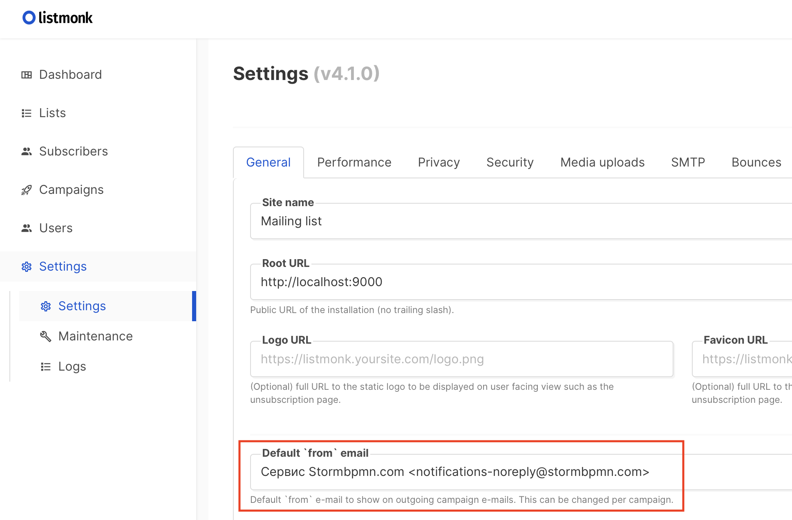
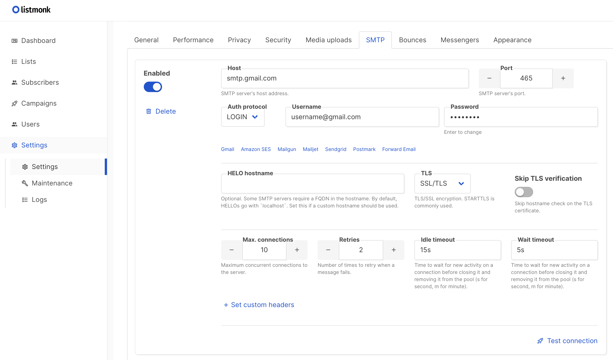
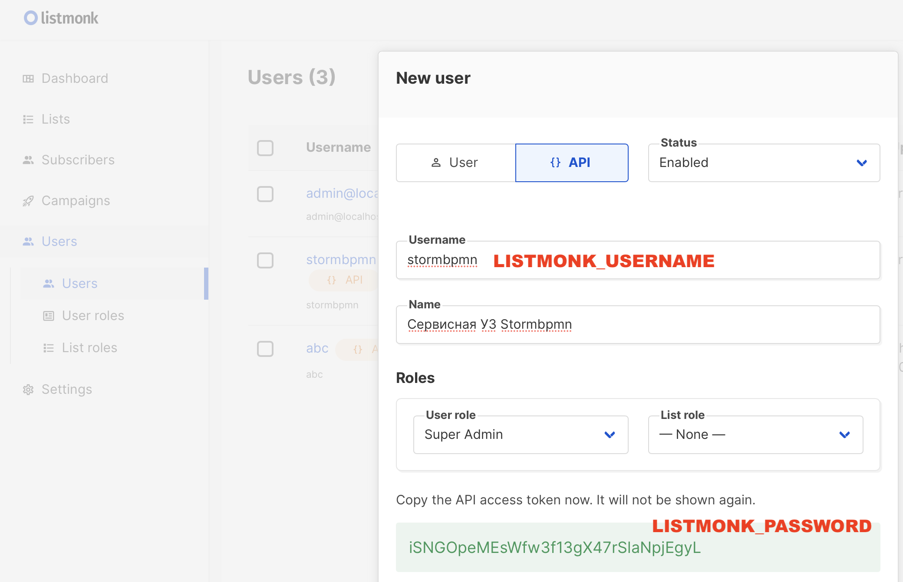
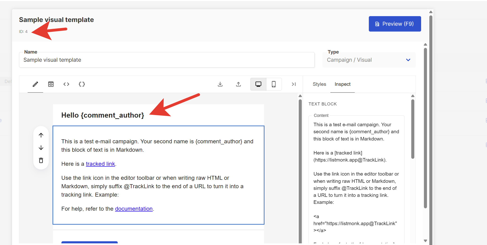
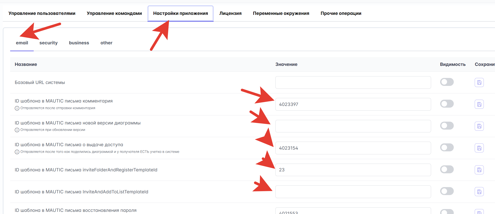

[[toc]]

# External services {#внешние-сервисы}

Deployment of services that StormBPMN depends on: object storage, Redis, PlantUML, document conversion, and email. The basic checklist and load balancer are covered in the [Production deployment overview](./README.md).

## S3 Storage for Files {#s3-хранилище-для-фаилов}

### What is stored in S3: {#что-хранится-в-s3}

-   **Business process images** - schemas and diagrams
-   **User avatars** - profile images
-   **Document templates** - for report generation
-   **Attachments** - files attached to processes

::: tip What to choose if there is no corporate S3
StormBPMN works with any S3-compatible storage that supports path-style addressing.
For self-host, we recommend **[SeaweedFS](#рекомендуемое-решение-seaweedfs)**: a single container,
Apache 2.0 license, keys and buckets are configured via environment variables. The
[quick start script](/en/install/quickstart/QUICKSTART_SCRIPT.md) installs it as well.
:::

::: warning MinIO no longer distributes images
Since autumn 2025, MinIO has stopped publishing community images: `quay.io/minio/minio` and `minio/minio` from
Docker Hub cannot be downloaded, and the client `mc` from `dl.min.io` is also unavailable. An already running MinIO
will continue to work with StormBPMN; it is not necessary to change it. For new installations, use SeaweedFS
or corporate S3.
:::

### Recommended Solution: SeaweedFS {#рекомендуемое-решение-seaweedfs}

#### Startup {#запуск}

```bash
docker run -d \
  --name seaweedfs \
  --restart unless-stopped \
  -p 8333:8333 \
  -v seaweedfs_data:/data \
  -e AWS_ACCESS_KEY_ID=stormbpmn \
  -e AWS_SECRET_ACCESS_KEY=<случайная строка от 32 символов> \
  -e S3_BUCKET=storm-uploads,storm-users,storm-imports \
  chrislusf/seaweedfs:4.52
```

The default image starts `weed mini -dir=/data`: all SeaweedFS components and the S3 API run in a single process on port **8333**. On the first start, the container creates a user with keys from `AWS_ACCESS_KEY_ID`/`AWS_SECRET_ACCESS_KEY` and buckets from `S3_BUCKET`; on subsequent starts, it does not recreate anything.

::: warning Set the keys explicitly
Without `AWS_ACCESS_KEY_ID` and `AWS_SECRET_ACCESS_KEY`, S3 in SeaweedFS works **without authentication**: anyone with network access to port 8333 can read and delete files.
:::

Expose only port `8333` externally. The other ports `weed mini` (master, filer, and admin web interfaces) have no authentication, so do not expose them to users.

Pin the image tag (`chrislusf/seaweedfs:4.52`, not `latest`): this ensures the storage is updated only when you change the tag.

#### StormBPMN Environment Variables {#переменные-окружения-stormbpmn}

```bash
S3_ENDPOINT=http://seaweedfs:8333            # адрес, по которому в S3 ходит сервер Storm
S3_EXTERNAL_ENDPOINT=http://10.0.0.15:8333   # адрес, по которому файлы открывает браузер
S3_ACCESS_KEY=stormbpmn
S3_SECRET_KEY=<тот же секрет, что в AWS_SECRET_ACCESS_KEY>
S3_BUCKET_UPLOADS=storm-uploads
S3_BUCKET_USERS=storm-users
S3_BUCKET_IMPORTS=storm-imports
S3_SINGLE_USERS_BUCKET=true
```

#### Verification {#проверка}

Open **Administration → System Check**: the "File Storage (S3)" card should be green, and the browser check should show no warnings. For details, see
["System Check"](/en/operation/system-check.md#проверка-фаилового-хранилища-из-браузера).

SeaweedFS documentation: [Quick Start with weed mini](https://github.com/seaweedfs/seaweedfs/wiki/Quick-Start-with-weed-mini),
[Amazon S3 API](https://github.com/seaweedfs/seaweedfs/wiki/Amazon-S3-API).

### S3 Environment Variables {#переменные-окружения-s3}

| Variable                 | Description                               | Example Value           |
|----------------------------|----------------------------------------|---------------------------|
| **S3_ENDPOINT**            | Storage URL                          | `http://192.168.0.4:8333` |
| **S3_ACCESS_KEY**          | Access key                           | `stormbpmn`               |
| **S3_SECRET_KEY**          | Secret key                         | `<секрет>`                |
| **S3_BUCKET_UPLOADS**      | Default bucket                     | `storm-uploads`           |
| **S3_BUCKET_USERS**        | Bucket for users                | `storm-users`             |
| **S3_BUCKET_IMPORTS**      | Bucket for imports                     | `storm-imports`           |
| **S3_SINGLE_USERS_BUCKET** | Single bucket mode for users | `true`                    |
| **S3_EXTERNAL_ENDPOINT**   | Address at which the **browser** opens file links (optional) | `https://s3.company.com`  |

Create the `S3_BUCKET_UPLOADS` bucket in advance: the application does not create it when uploading files. The application creates user and import buckets on the first write if the key has permission to create buckets.

::: tip S3_EXTERNAL_ENDPOINT
The Storm server accesses the storage via `S3_ENDPOINT` (usually an internal address), while users are issued temporary (presigned) links to files that their browser opens. If the internal address is not accessible from user computers, specify the external address of the same storage in `S3_EXTERNAL_ENDPOINT`. If the variable is not set, links are constructed using `S3_ENDPOINT`. The [System Check](/en/operation/system-check.md#проверка-фаилового-хранилища-из-браузера) verifies the operation of this address from the browser. After changing `.env`, restart the container.
:::

When using a different S3 storage compatible with AWS SDK v2, you may also need to:
- Set the `S3_REGION` variable to match your storage configuration
- Set the `S3_VIRTUAL_HOST=true` variable for vHosted addressing type (default is `false` for Path-Style)

:::info Single User Bucket
- For a fresh installation, we recommend using `S3_SINGLE_USERS_BUCKET=true`.
- If you already have Storm installed and connected to an S3 storage where each user has their own bucket (of the form `user123`),
you can migrate them to a single bucket (for example, `storm-users`), specify it in the `S3_BUCKET_USERS` variable,
and switch the operating mode to `S3_SINGLE_USERS_BUCKET=true`. In this case, the path to user files will
look like `s3://storm-users/user123/...`
:::

---

---

## Redis: Collaborative Diagram Editing {#redis-совместное-редактирование-диаграмм}

Redis is used for the **real-time collaborative diagram editing** feature. It provides:

-   **Pub/Sub** - message delivery between application instances (cursors, XML changes, presence)
-   **Session storage** - information about current collaborative editing participants

::: tip When is Redis required?
-   **Single StormBPMN instance** — Redis is **not required**. Data is stored in the application memory (InMemory mode)
-   **Multiple instances** (multi-instance / HA) — Redis is **mandatory** for synchronization between nodes
:::

### Installation {#установка}

```bash
# Запуск Redis в Docker
docker run -d \
  -p 6379:6379 \
  --name redis \
  redis:7-alpine
```

For production, it is recommended to set a password:

```bash
docker run -d \
  -p 6379:6379 \
  --name redis \
  redis:7-alpine \
  redis-server --requirepass your-secure-password
```

### Configuring Environment Variables {#настроика-переменных-окружения}

| Variable            | Description                | Example Value    | Required                |
| --------------------- | ----------------------- | ------------------ | -------------------------- |
| **REDIS_ENABLED**     | Enabling Redis         | `true`             | For multi-instance         |
| **REDIS_HOST**        | Redis host              | `192.168.0.7`      | When REDIS_ENABLED=true     |
| **REDIS_PORT**        | Redis port              | `6379`             | When REDIS_ENABLED=true     |
| **REDIS_PASSWORD**    | Redis password            | `your-password`    | If set on the server      |
| **REDIS_DATABASE**    | Redis database number | `0`                | Optional (default 0)  |
| **REDIS_TIMEOUT**     | Connection timeout     | `1000ms`           | Optional                |

### Functionality Check {#проверка-работоспособности}

After configuration, open one diagram in two browser tabs — you should see the avatars of other participants on the canvas and real-time synchronization of changes.

### Load Balancer Configuration for WebSocket {#настроика-балансировщика-для-websocket}

Collaborative editing uses **WebSocket** (STOMP over SockJS) via the path `/ws`. Ensure that the load balancer proxies WebSocket connections. A configuration example is provided in [the section above](README.md#конфигурация-nginx).

::: warning Sticky Sessions
When using multiple nodes behind the load balancer, WebSocket connections must support **sticky sessions** (node affinity) — otherwise, the SockJS fallback may not work correctly.
:::

---

---

## PlantUML server (optional) {#plantuml-сервер-опционально}

Provides UML diagram generation in the application interface.

:::info
If you used the [script](/en/install/quickstart/QUICKSTART_SCRIPT.md) for quick start,
PlantUML is already successfully deployed and connected to the system.
:::

### Installation {#установка-1}

```bash
# Запуск PlantUML сервера
docker run -d \
  -p 8090:8080 \
  --name plantuml \
  plantuml/plantuml-server:jetty
```

### Configuration {#настроика}

| Variable          | Description             | Example value            |
| ------------------- | -------------------- | -------------------------- |
| **PLANTUML_SERVER** | PlantUML server URL | `http://192.168.0.5:8090/` |

---

---

## Document Conversion Service {#сервис-конвертации-документов}

Provides conversion of HTML to PDF and other document formats.

:::info
If you used the [script](/en/install/quickstart/QUICKSTART_SCRIPT.md) for a quick start,
Gotenberg is already successfully deployed and connected to the system.
:::

### Installing Gotenberg {#установка-gotenberg}

```bash
# Запуск Gotenberg
docker run -d \
  -p 3001:3000 \
  --name gotenberg \
  gotenberg/gotenberg:8
```

::: tip You can use our Gotenberg image
If external registries (Docker Hub) are prohibited in your organization, use the Gotenberg mirror in our private registry — this is the official image `gotenberg/gotenberg:8`, **signed with the same Cosign signature** as the main StormBPMN image, and available using the **same** login from the [Enterprise portal](/en/install/portal.md#доступ-к-образам):

```bash
docker run -d \
  -p 3001:3000 \
  --name gotenberg \
  registry.stormbpmn.com/stormbpmn-enterprise/gotenberg:8
```

The signature is verified in the same way as for the main image (see [Changelog → “Image signature verification (Cosign)”](/en/Changelog/README.md)). Transferring the image to the corporate registry — follow the instructions in the [Quick Start](/en/install/quickstart/QUICKSTART_MANUAL.md).
:::

### Configuration {#настроика-1}

| Variable        | Description                | Example Value           |
| ----------------- | ----------------------- | ------------------------- |
| **GOTENBERG_URL** | Conversion service URL | `http://192.168.0.5:3001` |
| **GOTENBERG_WAIT_FOR_EXPRESSION** | Optional. JavaScript expression that Gotenberg waits for on the page before printing to PDF. Do not change: the default value is suitable for Storm pages | `window.overlayReady != undefined && window.overlayReady` |

::: warning The default value is a public demo service
If `GOTENBERG_URL` is not set, `https://demo.gotenberg.dev` is used — a **public demo service on the internet**. User diagrams and documents would be sent to a third-party service when exported to PDF, and it is generally inaccessible from a closed network. In production, deploy a **dedicated Gotenberg container** (see above) and make sure to set `GOTENBERG_URL`. [System Check](/en/operation/system-check.md) treats the demo address as an error.
:::

#### Additional configuration for complex network setups {#дополнительная-настроика-для-сложных-сетевых-конфигурации}

If load balancers or complex SSL configurations are used, you may need to specify the direct container address:

**In the administrative interface:**

-   **gotenbergOverrideBaseUrl** - direct address: `http://corp.storm.internal`

Gotenberg opens Storm pages itself, so this address must be accessible from the Gotenberg container. If [“System Check”](/en/operation/system-check.md) reports that Gotenberg could not open the application page, specify the internal Storm address here.

---

---

## Configuring Email Notifications {#настроика-почтовых-уведомлении}

### Selecting an Email Provider {#выбор-проваидера-почты}

| Option          | When to Use                                                         | Configuration Complexity |
| ---------------- | -------------------------------------------------------------------------- | ------------------- |
| **ListMonk**     | You need to customize email layouts and texts, and maintain a sending log        | ⭐⭐                |
| **Simple SMTP** | Stormbpmn's ready-made emails are sufficient, and sending is done via a corporate SMTP      | ⭐                  |

::: tip Formatted emails in both options
In builds after October 7, 2026, all notifications (comments, approvals, invitations, access requests,
simulations, password recovery, etc.) are sent formatted: a card with a logo, header, button,
and a text version of the email. For SMTP, the layout is built into the application and requires no external resources — the logo
is embedded in the email itself. For ListMonk, the same templates are set up with a single click — see below.
:::

You must specify this value in the administrative panel so that correct URLs are generated in emails. This setting is required for any provider:

| Parameter    | Description                         | Example                          |
| ----------- | -------------------------------- | ------------------------------- |
| **baseUrl** | Base URL for links in emails | `https://stormbpmn.company.com` |

### Option 1: ListMonk (beautiful emails) {#вариант-1-listmonk-красивые-письма}

#### Installing ListMonk {#установка-listmonk}

```bash
# Скачивание конфигурации
 curl -LO https://github.com/knadh/listmonk/raw/master/docker-compose.yml

# Запуск (при необходимости измените порты в docker-compose.yml)
docker compose up -d
```

#### Configuring ListMonk {#настроика-listmonk}

1. **Open the admin panel**: `http://localhost:9000`
2. **Create a super-user** and log in to the system
3. **Configure general settings** (Settings → General):

    - Specify the default email address for sending

    

4. **Configure SMTP** (Settings → SMTP):

    - Specify the corporate SMTP server parameters
    - Test the connection

    

5. **Create an API user**:

    - Users → New → Type: API
    - Role: Super Admin
    - Save the API token

    

#### Environment variables for StormBPMN {#переменные-окружения-для-stormbpmn}

```bash
EMAIL_PROVIDER=listmonk
LISTMONK_BASE_URL=http://localhost:9000/api
LISTMONK_USERNAME=stormbpmn  # имя API пользователя
LISTMONK_PASSWORD=api-token-here  # API токен
```

#### Email templates {#шаблоны-писем}

##### Quick path: the "Configure basic templates in Listmonk" button {#быстрыи-путь-кнопка-«настроить-базовые-шаблоны-в-listmonk»}

In builds after October 7, 2026, you do not need to create templates manually. Open the admin panel
**Application Settings → "📧 Email" tab** and click **"Configure basic templates in Listmonk"**. Stormbpmn:

1. creates a transactional template in ListMonk for each notification type — with names like
   `Storm BPMN · NEW_COMMENT`, using the same layout as plain SMTP emails;
2. records the ID of each template in the corresponding setting (`commentEmailTemplateId`, etc. — see the table below).

You can then edit the templates directly in ListMonk: change texts, colors, logos — Stormbpmn will still
send emails using the IDs from the settings.

Pressing the button again is safe:

- a template that already exists in ListMonk under that name is **not recreated or overwritten** — your
  edits to it are preserved;
- a setting that already contains the ID of a **different** template (you linked the event to your own) is **not changed** —
  such settings are listed in a warning after the click;
- empty settings (and the placeholder `0`) are filled in.

::: warning Application permissions and address
The ListMonk user from `LISTMONK_USERNAME` needs permissions for templates (Super Admin, as in the step above).
The logo in ListMonk emails is loaded from the address `<baseUrl>/email/storm-logo.png` — ensure that `baseUrl`
is specified and accessible to recipients.
:::

If ListMonk refuses (incorrect login, unavailable), the button displays the reason and a list of already configured
events — pressing it again will complete the rest.

##### Manual configuration {#ручная-настроика}

If you manage your own templates, create them in ListMonk based on the topics in the table and record the ID of each template in the Stormbpmn admin panel.

::: warning Substitution syntax
Listmonk uses Go template syntax: variables are accessed via `{{ .Tx.Data.имя }}`, not `{имя}`. For example, `{{ .Tx.Data.diagram_name }}`.
:::



| Notification type                         | Setting in admin panel                  | Possible substitutions                                                                                                       |
| --------------------------------------- | ------------------------------------ | --------------------------------------------------------------------------------------------------------------------------- |
| **New comment**                   | `commentEmailTemplateId`             | `{{ .Tx.Data.comment_author }}`, `{{ .Tx.Data.diagram_name }}`, `{{ .Tx.Data.diagram_url }}`, `{{ .Tx.Data.html_text }}`     |
| **Approval request**              | `approvalTemplateId`                 | `{{ .Tx.Data.invite_author }}`, `{{ .Tx.Data.diagram_name }}`, `{{ .Tx.Data.diagram_url }}`                                 |
| **Password recovery**               | `restorePasswordTemplateId`          | `{{ .Tx.Data.restoreCode }}`                                                                                                |
| **Approval completed**              | `approvalCompletedTemplateId`        | `{{ .Tx.Data.diagram_name }}`, `{{ .Tx.Data.diagram_url }}`                                                                 |
| **User activation**              | `userActivationTemplateId`           | `{{ .Tx.Data.activation_token }}`                                                                                           |
| **Invitation to diagram**             | `secureUpdateTemlateId`              | `{{ .Tx.Data.invite_author }}`, `{{ .Tx.Data.diagram_name }}`, `{{ .Tx.Data.diagram_url }}`                                 |
| **Invitation + registration**           | `inviteDiagramAndRegisterTemplateId` | `{{ .Tx.Data.invite_author }}`, `{{ .Tx.Data.diagram_name }}`, `{{ .Tx.Data.diagram_url }}`, `{{ .Tx.Data.register_url }}`   |
| **Invitation to team**               | `teamInviteTemplateId`               | `{{ .Tx.Data.invite_author }}`, `{{ .Tx.Data.team_name }}`                                                                  |
| **Invitation to team + registration** | `teamInviteAndRegisterTemplateId`    | `{{ .Tx.Data.invite_author }}`, `{{ .Tx.Data.team_name }}`, `{{ .Tx.Data.register_url }}`                                   |
| **Access request to diagram**          | `accessRequestTemplateId`            | `{{ .Tx.Data.requester_name }}`, `{{ .Tx.Data.diagram_name }}`, `{{ .Tx.Data.diagram_url }}`, `{{ .Tx.Data.request_message }}` |
| **Warm-up emails (Storm Master)**     | `retentionEmailTemplateId`           | `{{ .Tx.Data.subject }}`, `{{ .Tx.Data.body }}` — the body is already ready HTML, output via `{{ with .Tx.Data.body }}{{ Safe . }}{{ end }}`. See ["Warm-ups"](/en/ai/retention.md) |

::: tip Typo in the key
The key `secureUpdateTemlateId` is specified **with a typo intentionally** — that is exactly how it is named in the system settings (without `p` in `Temlate`).
:::

#### Specify the template ID in the Stormbpmn admin panel {#укажите-id-шаблон-в-адмнике-stormbpmn}



### Option 2: Simple SMTP {#вариант-2-простои-smtp}

#### Environment Variables {#переменные-окружения}

| Parameter           | Description                                                  | Example                  |
| ------------------ | --------------------------------------------------------- | ----------------------- |
| **EMAIL_PROVIDER** | Enable simple SMTP                                     | `smtp`                  |
| **SMTP_HOST**      | SMTP host                                                 | `smtp.company.com`      |
| **SMTP_PORT**      | SMTP port                                                 | `587`                   |
| **SMTP_USERNAME**  | SMTP user                                         | `stormbpmn@company.com` |
| **SMTP_PASSWORD**  | SMTP password                                               | `secure-password`       |
| **SMTP_FROM**      | Sender email                                         | `stormbpmn@company.com` |
| **SMTP_PROTOCOL**  | SMTP/STARTTLS/SMTPS. STARTTLS - default              | `STARTTLS`              |
| **SMTP_USE_AUTH**  | `false` — do not use authentication, even if `SMTP_USERNAME` is specified. Without `SMTP_USERNAME`, authentication is not used for any value | `false`                 |

Emails sent via simple SMTP are already formatted (card, button, text version), and the logo is embedded in the email — nothing is loaded from the closed environment. You can verify sending using the **"Send test email"** button on the "📧 Email" tab of the admin panel: in case of an error, it displays the actual reason for the SMTP rejection.

#### Environment Variables {#переменные-окружения-1}

```bash
EMAIL_PROVIDER=smtp
SMTP_PROTOCOL=
SMTP_HOST=
SMTP_PORT=
SMTP_USERNAME=
SMTP_PASSWORD=
SMTP_FROM=
SMTP_USE_AUTH=

```

::: tip Restart required
All SMTP settings are applied **only after a restart** of the application.
:::

### Testing Email Notifications {#тестирование-почтовых-уведомлении}

To verify email delivery, leave a comment with the following content:

```
@your.email@company.com test
```

---
