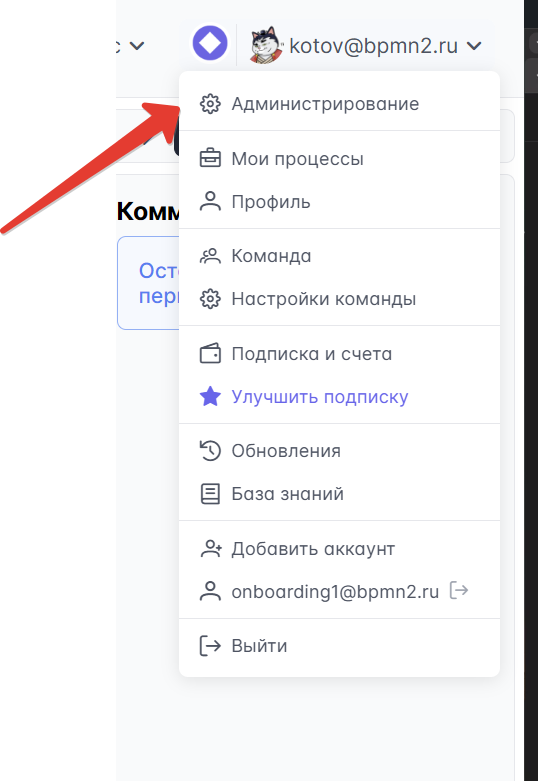

# Manual installation {#ручная-установка}

For the minimal operation of the application, you will need only **2 containers**:

-   Application container
-   Database

## Database Configuration {#настроика-базы-данных}

1. **Deploy PostgreSQL** (version 14 or later, 16–17 recommended):

    - Use a Docker container
    - Or connect to the company's existing infrastructure

2. **Create a schema** (optional):

    - The default schema is `public`
    - Save the schema name for further configuration

3. **Create the database**:

    - Choose an appropriate name
    - Save the database name

4. **Create a user**:

    - Grant full access rights to the database and schema
    - Save the login and password

5. **Define the port**:

    - Identify the database server port (usually 5432)
    - Save the value for the connection

6. **Ensure network availability**:
    - Configure the connection between the database and the application container

::: warning PostgreSQL extensions and encoding are mandatory
The database must be created with **UTF8** encoding, and the following extensions must be available in the PostgreSQL build: **pgvector** (`vector`), **pg_trgm**, **pgcrypto**, **uuid-ossp**, **hstore**.

- `vector`, `uuid-ossp`, `hstore`, `pgcrypto` are created automatically by the application on first launch (if the packages are installed and the database user has the `CREATE EXTENSION` privilege).
- **Create `pg_trgm` manually** — without it, searching for users by part of their name or email will not work.

The standard `postgres:17` image **does not include pgvector**. Use the **`pgvector/pgvector:pg17`** image (the same PostgreSQL + pgvector + standard contrib modules) or install pgvector in your build/DBaaS. If Docker Hub is blocked, pull the image from our registry: `cr.selcloud.ru/stormbpmn-enterprise/pgvector:pg17` (signed with the same Cosign signature, accessible with the same Selectel credentials).

Full set in one command — execute as a superuser **in the application database**:

```sql
CREATE EXTENSION IF NOT EXISTS vector;
CREATE EXTENSION IF NOT EXISTS pg_trgm;
CREATE EXTENSION IF NOT EXISTS pgcrypto;
CREATE EXTENSION IF NOT EXISTS "uuid-ossp";
CREATE EXTENSION IF NOT EXISTS hstore;
```

For details, see the [“PostgreSQL Requirements”](/en/install/README.md) section.
:::

## Configuring the application via environment variables {#настроика-приложения-через-переменные-окружения}

### Getting the image {#получение-образа}

Download the application image from the registry (request the link and authentication parameters from our team).

### Transferring the image to a private registry {#перенос-образа-в-приватныи-репозитории}
In some organizations, the use of external container repositories is prohibited, so the image must be transferred from our repository to the organization's repository.


#### Steps {#шаги}

0. Ensure that:
   - you have administrator privileges
   - the computer has internet access
   - there is network access to the local registry

1. Install Docker Desktop for Windows:
https://docs.docker.com/desktop/setup/install/windows-install/

2. Open cmd or PowerShell.

3. Authenticate to our Docker Registry:
```bash
docker login cr.selcloud.ru
```
(enter the username and password provided earlier)

4. Pull the image:
```bash
docker pull cr.selcloud.ru/stormbpmn-enterprise/stormbpmn_fullstack_enterprise:6.6.1879
```

5. Authenticate to the private registry of KB (for example, Harbor):
```bash
docker login <адрес_вашего_registry>
```
(enter the username and password provided by KB)

6. Retag the image for their registry:
```bash
docker tag cr.selcloud.ru/stormbpmn-enterprise/stormbpmn_fullstack_enterprise:6.6.1879 <адрес_вашего_registry>/<проект>/stormbpmn_fullstack_enterprise:6.6.1879
```

7. Push the image to the private registry:
```bash
docker push <адрес_вашего_registry>/<проект>/stormbpmn_fullstack_enterprise:6.6.1879
```

8. Verify that the image appears in the Harbor interface.

::: tip Gotenberg can also be pulled from our registry
If external registries (Docker Hub) are blocked, it is not necessary to pull `gotenberg/gotenberg:8` from an external source — we mirror the official Gotenberg image to our private registry and **sign it with the same Cosign signature** as the main StormBPMN image. It is available using the **same** credentials `cr.selcloud.ru`:

```bash
docker pull cr.selcloud.ru/stormbpmn-enterprise/gotenberg:8
```

Next, retag and push it to your corporate registry using the same steps 5–8 as for the main image. Signature verification is performed in the same way as for the main image (see [Changelog → “Image signature verification (Cosign)”](/en/Changelog/README.md)).
:::


### Configuring ENV Variables {#настроика-env-переменных}

| Variable                 | Description                         | Example Value                            |
| -------------------------- | -------------------------------- | ------------------------------------------ |
| **JDBC_URL**               | Database connection string | `jdbc:postgresql://192.168.0.6:5432/storm` |
| **JDBC_USERNAME**          | Database username     | `stormuser`                                |
| **JDBC_PASSWORD**          | User password              | `your_secure_password`                     |
| **JAVA_OPTS**              | JVM memory settings         | `"-Xmx8g"`                                 |
| **SPRING_PROFILES_ACTIVE** | Spring Boot profile              | `prod`                                     |
| **JWTSECRET**              | Salt for password encryption      | At least 64 random characters             |
| **TZ**              | Container timezone      |`Europe/Moscow`           |

> **Note on JDBC_URL:**
>
> To connect to a specific schema, use:
> `jdbc:postgresql://localhost:5432/mydatabase?currentSchema=myschema`

### Starting the container {#запуск-контеинера}

1. Start the container with the configured environment variables
2. Upon successful startup, the database migration will be performed automatically
3. Configure the ports for application access: 8080 (legacy interface), 8081 (new interface), and 8082 (API)

::: tip Congratulations!
The minimal installation is ready! You can now access the application through the web interface on the configured port.
:::

## Obtaining the license key {#получение-лицензионного-ключа}

For a new Enterprise installation, use a separate v2 key. The existing `LICENSE_KEY`
is temporarily supported without immediate replacement, but v1 licenses are deprecated and have a known
security limitation.

Use the v2-compatible image agreed upon with the manager. Do not open the installation to regular users before activation: an empty v2 selects the legacy path, and the absence of both keys does not guarantee access blocking.

1. Open `/admin-onboarding` without logging in during the initial installation and copy the **entire activation code without truncation**.
2. Provide the full code to the manager and receive the key for this installation.
3. Add the key to the environment variable **`LICENSE_KEY_V2`**. If `LICENSE_KEY` is set nearby,
   a non-empty `LICENSE_KEY_V2` has exclusive priority; in case of a v2 error, there is no fallback to v1.
4. Restart the container, wait for successful health checks, and verify the license status on
   `/admin-onboarding`. Then, create an administrator according to the instructions below, configure
   users, and verify login and required modules (including DES) with a regular account.

For a test environment, DR site, and each clone, request a separate key.
Agree on AI and DES rights in the key — in v2, they are disabled by default; see the
[section on v2 format](/en/operation/License.md#формат-v2-и-доступ-к-модулям) for details.

::: tip Existing installation
If Storm is already installed and running with `LICENSE_KEY`, the activation code is obtained on the same page
`/admin-onboarding` without logging in and without launching the wizard. The procedure for migrating to v2 is in the section
["Where to get the activation code on an existing installation"](/en/operation/License.md#где-взять-код-активации-на-существующеи-инсталляции).
:::

## Creating an Administrative Account {#создание-административнои-учетнои-записи}

Storm administrator privileges are granted to a **team**, not to an individual user. Each team member with administrative rights automatically gains access to system settings.

Create a separate administrative team — exclusively for those who need to configure and administer Storm. It should contain 1–2 accounts.

### Step-by-step instructions: {#пошаговая-инструкция}

1. After successfully activating the license, open `/admin-onboarding` and start the configuration.
2. On the **"Administrator"** step, specify the email and password for the first administrator. The wizard will create the account and a separate administrative team with full permissions.
3. Save the credentials in a secure storage and complete the remaining wizard steps.

If the administrative team already exists, log in as one of its members. Recreating the first administrator is not allowed. If the v2 is incorrect, restore the license first: creating an administrator on a locked installation is unavailable. Do not assign permissions to all teams via a bulk SQL update.

:::important
Do not use this account for daily work!<br>
Do not add regular employees to the administrative team. This team is intended only for configuring and administering Storm. All other employees must work in a separate working team without administration rights — how to create it is described below.
:::



## Creating a working team for employees {#создание-рабочеи-команды-для-сотрудников}

A separate team is required for employees' daily work. By default, a new team does not have Storm administration rights — no additional actions in the database are required.

| Team | Members | Purpose |
|---|---|---|
| Administrative | System administrators responsible for Storm | Configuration, licenses, system management |
| Working | All other employees | Daily work with diagrams |

To create a working team:
- Log out of the administrative account or open the browser in incognito mode
- Go to **/app/signup** and register a new account
- After registration, the system automatically creates a new team without administration rights
- Invite employees to this team via **Team Settings → Members** or through the administrative interface

::: tip Managing Storm administrator rights
Granting and revoking rights are performed by the system administrator via SQL. When the system has multiple teams, you must specify `WHERE id` — otherwise, the query will affect all teams.

Grant rights:
```sql
UPDATE sm_teams SET full_access = true WHERE id = '<id команды>';
```
Revoke rights:
```sql
UPDATE sm_teams SET full_access = false WHERE id = '<id команды>';
```
:::

## Authorization Configuration {#настроика-авторизации}

To configure the application login system, refer to the [detailed information security guide](/en/configure/security/authorization.md) and select the option that best suits your organization.

---

## Important: The following steps {#важно-следующие-шаги}

:::danger This installation is for testing only!
**Warning!** The minimal installation described above is intended **exclusively for verifying functionality** and familiarizing yourself with the system.

**Do not use this configuration for working with real users!**

### Why this setup is not suitable for production: {#почему-эта-установка-не-подходит-для-продакшена}

-   **No SSL/HTTPS** - data is transmitted in plaintext
-   **Unprotected database** - no backup or fault tolerance
-   **No monitoring** - impossible to track issues and performance
-   **Simplified authentication** - no integration with corporate systems
-   **No notifications** - users will not receive emails about processes
-   **No file storage** - limited capabilities for working with documents

### What happens if production-ready is not configured: {#что-произоидет-если-не-настроить-production-ready}

-   **Users will be dissatisfied** with slow performance and errors
-   **Data loss** during system failures
-   **Security issues** and leakage of confidential information
-   **Inability to scale** as the number of users grows
:::

### Next steps for production: {#следующие-шаги-для-продакшена}

1. **[Production Ready](/en/install/production/)** - configuration for industrial operation
2. **[Security](/en/configure/security/)** - configuration of HTTPS, authentication, and auditing
3. **[System Administration](/en/operation/README.md)** - monitoring performance and availability, protection against data loss

:::info Tip
Plan the transition to a production-ready configuration **before** connecting real users.
Migrating a running system is significantly more complex than the initial setup.
:::
