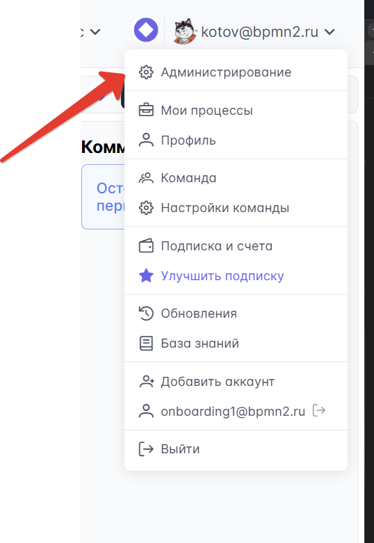

# Manual installation {#ручная-установка}

For the minimal operation of the application, you will need only **2 containers**:

-   Application container
-   Database

## Database Configuration {#настроика-базы-данных}

1. **Deploy PostgreSQL** (version 14 or later, 16–17 recommended):

    - Use a Docker container
    - Or connect to your company's existing infrastructure

2. **Create a schema** (optional):

    - The default schema is `public`
    - Save the schema name for further configuration

3. **Create a database**:

    - Choose an appropriate name
    - Save the database name

4. **Create a user**:

    - Grant full access rights to the database and schema
    - Save the login and password

5. **Define the port**:

    - Identify the database server port (usually 5432)
    - Save the value for the connection

6. **Ensure network availability**:
    - Configure the connection between the database and the application container

::: warning PostgreSQL extensions and encoding are mandatory
The database must be created with **UTF8** encoding, and the following extensions must be available in the PostgreSQL build: **pgvector** (`vector`), **pg_trgm**, **pgcrypto**, **uuid-ossp**, **hstore**.

- `vector`, `uuid-ossp`, `hstore`, `pgcrypto` are created automatically by the application on first launch (if the packages are installed and the database user has the `CREATE EXTENSION` privilege).
- **Create `pg_trgm` manually** — without it, searching for users by part of their name or email will not work.

The standard `postgres:17` image **does not include pgvector**. Use the **`pgvector/pgvector:pg17`** image (the same PostgreSQL + pgvector + standard contrib modules) or install pgvector in your build/DBaaS. If Docker Hub is unavailable — pull the image from our registry: `registry.stormbpmn.com/stormbpmn-enterprise/pgvector:pg17` (signed with the same Cosign signature, accessible with the same login from the [Enterprise portal](/en/install/portal.md#доступ-к-образам)).

The full set in a single command — execute as a superuser **in the application database**:

```sql
CREATE EXTENSION IF NOT EXISTS vector;
CREATE EXTENSION IF NOT EXISTS pg_trgm;
CREATE EXTENSION IF NOT EXISTS pgcrypto;
CREATE EXTENSION IF NOT EXISTS "uuid-ossp";
CREATE EXTENSION IF NOT EXISTS hstore;
```

For details, see the [“PostgreSQL Requirements”](/en/install/README.md) section.
:::

## Configuring the Application via Environment Variables {#настроика-приложения-через-переменные-окружения}

### Getting the image {#получение-образа}

Download the application image from the registry `registry.stormbpmn.com`. The login and secret for it are provided in the **“Image Access”** section of the [Enterprise portal](/en/install/portal.md#доступ-к-образам); if you are not yet registered on the portal, register.

### Transferring the image to a private registry {#перенос-образа-в-приватныи-репозитории}
In some organizations, the use of external container repositories is prohibited. Therefore, you need to move the image from our repository to the organization's repository.

#### Steps {#шаги}

0. Ensure that:
   - you have administrator privileges
   - the computer has internet access
   - there is network access to the local registry

1. Install Docker Desktop for Windows:
https://docs.docker.com/desktop/setup/install/windows-install/

2. Open cmd or PowerShell.

3. Authenticate to our Docker Registry:
```bash
docker login registry.stormbpmn.com -u '<логин из портала>'
```
(enter the robot account secret from the **«Image Access»** section of the [Enterprise portal](/en/install/portal.md#доступ-к-образам); if you are not yet registered on the portal — register)

4. Pull the image:
```bash
docker pull registry.stormbpmn.com/stormbpmn-enterprise/stormbpmn_fullstack_enterprise:6.6.1879
```

5. Authenticate to the private registry of KB (for example, Harbor):
```bash
docker login <адрес_вашего_registry>
```
(enter the username and password provided by KB)

6. Retag the image for their registry:
```bash
docker tag registry.stormbpmn.com/stormbpmn-enterprise/stormbpmn_fullstack_enterprise:6.6.1879 <адрес_вашего_registry>/<проект>/stormbpmn_fullstack_enterprise:6.6.1879
```

7. Push the image to the private registry:
```bash
docker push <адрес_вашего_registry>/<проект>/stormbpmn_fullstack_enterprise:6.6.1879
```

8. Verify that the image appears in the Harbor interface.

::: tip You can also get Gotenberg from our registry
If external registries (Docker Hub) are blocked, you do not need to pull `gotenberg/gotenberg:8` from outside — we mirror the official Gotenberg image to our private registry and **sign it with the same Cosign signature** as the main StormBPMN image. It is available using the **same** login from the Enterprise portal:

```bash
docker pull registry.stormbpmn.com/stormbpmn-enterprise/gotenberg:8
```

Next — retag and push it to your corporate registry using the same steps 5–8 as for the main image. Signature verification is the same as for the main image (see [Changelog → «Image signature verification (Cosign)»](/en/Changelog/README.md)).
:::


### Configuring ENV Variables {#настроика-env-переменных}

| Variable                 | Description                         | Example Value                            |
| -------------------------- | -------------------------------- | ------------------------------------------ |
| **JDBC_URL**               | Database connection string | `jdbc:postgresql://192.168.0.6:5432/storm` |
| **JDBC_USERNAME**          | Database username     | `stormuser`                                |
| **JDBC_PASSWORD**          | User password              | `your_secure_password`                     |
| **JAVA_OPTS**              | JVM memory settings         | `"-Xmx8g"`                                 |
| **SPRING_PROFILES_ACTIVE** | Spring Boot profile              | `prod`                                     |
| **JWTSECRET**              | Salt for password encryption      | At least 64 random characters             |
| **TZ**              | Container time zone      |`Europe/Moscow`           |

> **Note on JDBC_URL:**
>
> To connect to a specific schema, use:
> `jdbc:postgresql://localhost:5432/mydatabase?currentSchema=myschema`

### Starting the container {#запуск-контеинера}

1. Start the container with the configured environment variables
2. Upon a successful start, the database migration will be performed automatically
3. Configure the ports for accessing the application: 8080 (legacy interface), 8081 (new interface), and 8082 (API)

::: tip Congratulations!
The minimal installation is ready! You can now access the application through the web interface on the configured port.
:::

## Obtaining the License Key {#получение-лицензионного-ключа}

For a new Enterprise installation, use a separate v2 key. The existing `LICENSE_KEY`
is temporarily supported without immediate replacement, but v1 licenses are deprecated and have a known
security limitation.

Use an image with v2 support: the current version is listed in the Changelog section. Do not open the
installation to regular users before activation: an empty v2 selects the legacy path, and the absence of both keys
does not guarantee access blocking.

1. Open `/admin-onboarding` without logging in during the first installation and copy **the entire activation code without truncation**.
2. In the [Enterprise portal](/en/install/portal.md#лицензионныи-ключ), register the installation, paste the code in the **«License Keys»** section, and obtain the key for this installation.
3. Add the key to the environment variable **`LICENSE_KEY_V2`**. If `LICENSE_KEY` is set nearby,
   a non-empty `LICENSE_KEY_V2` has exclusive priority; in case of a v2 error, there is no fallback to v1.
4. Restart the container, wait for successful health checks, and verify the license status on
   `/admin-onboarding`. Then, create an administrator according to the instructions below, configure
   users, and verify login and required modules (including DES) with a regular account.

A separate key is required for a test environment, DR site, and each clone.
AI and DES permissions are included in the key from the license agreement — in v2, they are disabled by default; see the
[section on the v2 format](/en/operation/License.md#формат-v2-и-доступ-к-модулям) for details.

::: tip Existing installation
If Storm is already installed and running with `LICENSE_KEY`, the activation code is obtained on the same page
`/admin-onboarding` without logging in and without launching the wizard. The procedure for migrating to v2 is in the section
[«Where to get the activation code on an existing installation»](/en/operation/License.md#где-взять-код-активации-на-существующеи-инсталляции).
:::

## Creating an administrative account {#создание-административнои-учетнои-записи}

Storm administrator privileges are granted to a **team**, not to an individual user. Each team member with administrative rights automatically gains access to system settings.

Create a separate administrative team — only for those who need to configure and administer Storm. It should contain 1–2 accounts.

### Step-by-step instructions: {#пошаговая-инструкция}

1. After successfully activating the license, open `/admin-onboarding` and start the configuration.
2. On the **"Administrator"** step, specify the email and password for the first administrator. The wizard will create the account and a separate administrative team with full permissions.
3. Save the credentials in a secure storage and complete the remaining wizard steps.

If the administrative team already exists, log in as one of its members. Recreating the first administrator is not allowed. If the v2 is incorrect, first restore the license: creating an administrator on a locked installation is unavailable.

:::important
Do not use this account for daily work!<br>
Do not add regular employees to the administrative team. This team is intended solely for configuring and administering Storm. All other employees must work in a separate working team without administrative privileges — how to create it is described below.
:::



## Creating a Working Team for Employees {#создание-рабочеи-команды-для-сотрудников}

For daily operations, employees require a separate team. The new team does not have Storm administration rights; these are granted only by membership in the administrative team created by the master.

| Team | Members | Purpose |
|---|---|---|
| Administrative | System administrators responsible for Storm | Configuration, licenses, system management |
| Working | All other employees | Daily work with diagrams |

All actions are performed in the administrative interface `/app/admin` under an administrator account, without access to the database.

1. **Create an account for the future working team administrator.** Tab **«User Management»** → **«Register»**: email, password, full name, and position. After saving, the **«Account Created»** window will appear with the login address and password — copy them and provide them to the employee. If the employee logs in via SSO (LDAP, Keycloak, etc.), the account will be created upon first login, and this step can be skipped.
2. **Create the team.** Tab **«Team Management»** → **«Create Team»**: name and **«Owner (Team Administrator)** — select the account from step 1.
3. **Add employees.** The owner invites them themselves in **Team Settings → Participants**, or the Storm administrator clicks **«Add User»** in the team row on the **«Team Management»** tab and specifies the email.
4. **If another team administrator is needed**, expand the team row on the **«Team Management»** tab and click **«Make Administrator»** for the required participant. A participant who has not yet accepted the invitation must first accept it.

::: tip Managing Storm Administrator Rights
Storm administrator rights are held by members of the "Enterprise Admin" administrative team, which is created by the initial setup master. These rights cannot be granted to other teams.

- **Grant rights:** Tab **«Team Management»** → **«Add User»** in the administrative team row → employee's email. It is not possible to join this team independently via an invitation link.
- **Revoke rights:** Remove the participant from the administrative team in its **Settings → Participants** or disable their account on the **«User Management»** tab.

Keep 1–2 accounts in the administrative team: its members can see all teams, models, and users in the system.
:::

## Authorization configuration {#настроика-авторизации}

To configure the application login system, refer to the [detailed information security guide](/en/configure/security/authorization.md) and select the option suitable for your organization.

---

## Important: The following steps {#важно-следующие-шаги}

:::danger This installation is for testing only!
**Warning!** The minimal installation described above is intended **exclusively for verifying functionality** and familiarizing yourself with the system.

**Do not use this configuration for working with real users!**

### Why this installation is not suitable for production: {#почему-эта-установка-не-подходит-для-продакшена}

-   **No SSL/HTTPS** - data is transmitted in plaintext
-   **Database is not protected** - no backup or fault tolerance
-   **No monitoring** - impossible to track issues and performance
-   **Simplified authentication** - no integration with corporate systems
-   **No notifications** - users will not receive emails about processes
-   **No file storage** - limited capabilities for working with documents

### What happens if production-ready is not configured: {#что-произоидет-если-не-настроить-production-ready}

-   **Users will be dissatisfied** with slow performance and errors
-   **Data loss** during system failures
-   **Security issues** and leakage of confidential information
-   **Inability to scale** as the number of users grows
:::

### Next steps for production: {#следующие-шаги-для-продакшена}

1. **[Production Ready](/en/install/production/)** - configuration for industrial use
2. **[Security](/en/configure/security/)** - configuration of HTTPS, authorization, and auditing
3. **[System administration](/en/operation/README.md)** - monitoring performance and availability, protection against data loss

:::info Tip
Plan the transition to a production-ready configuration **before** connecting real users.
Migrating a running system is significantly more complex than the initial setup.
:::
