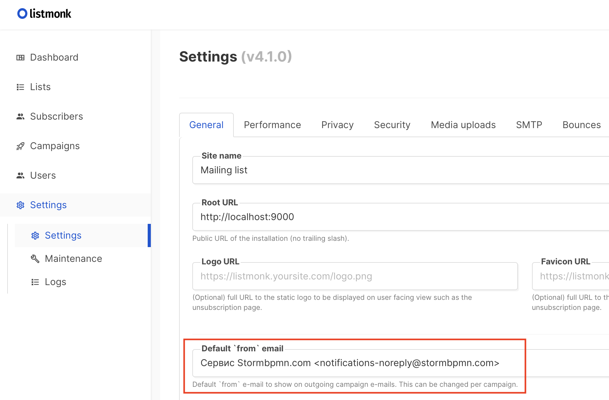
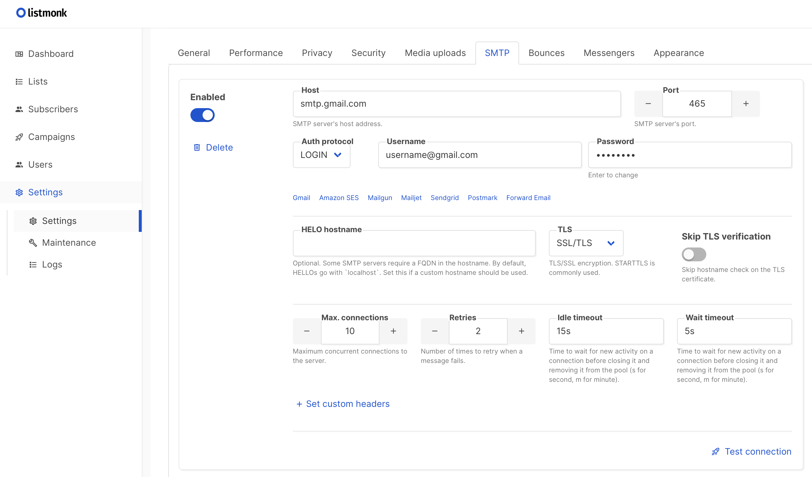
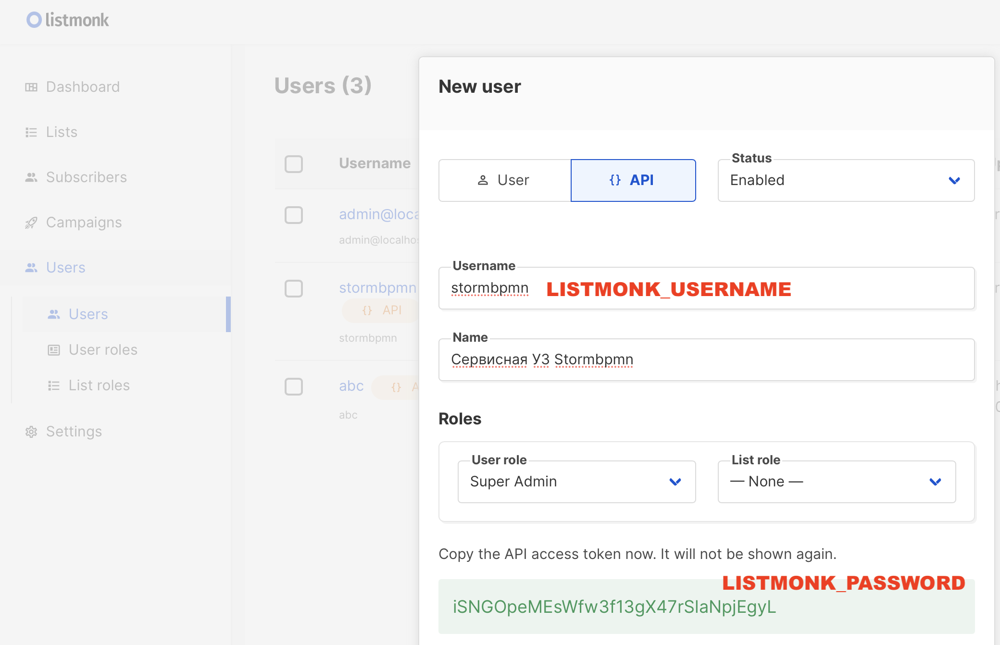
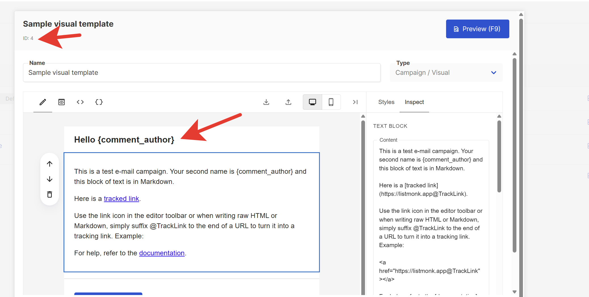
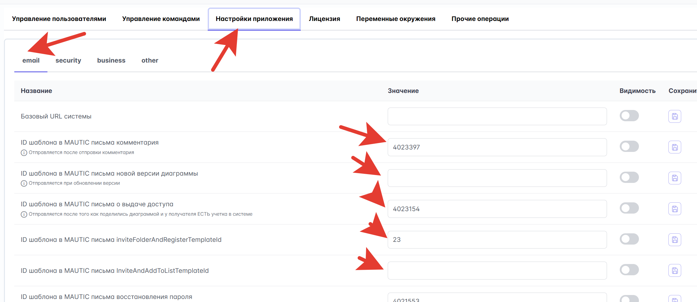

[[toc]]

# Внешние сервисы

Развёртывание сервисов, от которых зависит StormBPMN: объектное хранилище, Redis, PlantUML, конвертация
документов и почта. Базовый чек-лист и балансировщик — в [обзоре Production-установки](./README.md).

## S3-хранилище для файлов

### Что хранится в S3:

-   **Изображения бизнес-процессов** - схемы и диаграммы
-   **Аватары пользователей** - профильные изображения
-   **Шаблоны документов** - для генерации отчетов
-   **Вложения** - файлы, прикрепленные к процессам

::: tip Что выбрать, если нет корпоративного S3
StormBPMN работает с любым S3-совместимым хранилищем, которое поддерживает адресацию path-style.
Для self-host рекомендуем **[SeaweedFS](#рекомендуемое-решение-seaweedfs)**: один контейнер,
лицензия Apache 2.0, ключи и бакеты задаются переменными окружения. Его же ставит
[скрипт быстрого старта](/install/quickstart/QUICKSTART_SCRIPT.md).
:::

::: warning MinIO больше не распространяет образы
С осени 2025 года MinIO не публикует community-образы: `quay.io/minio/minio` и `minio/minio` с
Docker Hub не скачиваются, а клиент `mc` с `dl.min.io` тоже недоступен. Уже работающий MinIO
продолжит работать со StormBPMN, менять его не обязательно. Для новых установок берите SeaweedFS
или корпоративное S3.
:::

### Рекомендуемое решение: SeaweedFS

#### Запуск

```bash
docker run -d \
  --name seaweedfs \
  --restart unless-stopped \
  -p 8333:8333 \
  -v seaweedfs_data:/data \
  -e AWS_ACCESS_KEY_ID=stormbpmn \
  -e AWS_SECRET_ACCESS_KEY=<случайная строка от 32 символов> \
  -e S3_BUCKET=storm-uploads,storm-users,storm-imports \
  chrislusf/seaweedfs:4.52
```

Образ по умолчанию запускает `weed mini -dir=/data`: в одном процессе поднимаются все части
SeaweedFS и S3 API на порту **8333**. При первом старте контейнер создаёт пользователя с ключами
из `AWS_ACCESS_KEY_ID`/`AWS_SECRET_ACCESS_KEY` и бакеты из `S3_BUCKET`; при повторных стартах
ничего не пересоздаёт.

::: warning Задайте ключи обязательно
Без `AWS_ACCESS_KEY_ID` и `AWS_SECRET_ACCESS_KEY` S3 в SeaweedFS работает **без авторизации**:
читать и удалять файлы сможет любой, у кого есть сетевой доступ к порту 8333.
:::

Наружу публикуйте только порт `8333`. Остальные порты `weed mini` (веб-интерфейсы master, filer и
admin) без авторизации, поэтому не открывайте их пользователям.

Тег образа фиксируйте (`chrislusf/seaweedfs:4.52`, а не `latest`): так обновление хранилища
происходит, когда вы сами меняете тег.

#### Переменные окружения StormBPMN

```bash
S3_ENDPOINT=http://seaweedfs:8333            # адрес, по которому в S3 ходит сервер Storm
S3_EXTERNAL_ENDPOINT=http://10.0.0.15:8333   # адрес, по которому файлы открывает браузер
S3_ACCESS_KEY=stormbpmn
S3_SECRET_KEY=<тот же секрет, что в AWS_SECRET_ACCESS_KEY>
S3_BUCKET_UPLOADS=storm-uploads
S3_BUCKET_USERS=storm-users
S3_BUCKET_IMPORTS=storm-imports
S3_SINGLE_USERS_BUCKET=true
```

#### Проверка

Откройте **Администрирование → Проверка системы**: карточка «Файловое хранилище (S3)» должна быть
зелёной, а проверка из браузера — без предупреждения. Подробнее —
[«Проверка системы»](/operation/system-check.md#проверка-фаилового-хранилища-из-браузера).

Документация SeaweedFS: [Quick Start with weed mini](https://github.com/seaweedfs/seaweedfs/wiki/Quick-Start-with-weed-mini),
[Amazon S3 API](https://github.com/seaweedfs/seaweedfs/wiki/Amazon-S3-API).

### Переменные окружения S3

| Переменная                 | Описание                               | Пример значения           |
|----------------------------|----------------------------------------|---------------------------|
| **S3_ENDPOINT**            | URL хранилища                          | `http://192.168.0.4:8333` |
| **S3_ACCESS_KEY**          | Ключ доступа                           | `stormbpmn`               |
| **S3_SECRET_KEY**          | Секретный ключ                         | `<секрет>`                |
| **S3_BUCKET_UPLOADS**      | Бакет по умолчанию                     | `storm-uploads`           |
| **S3_BUCKET_USERS**        | Бакет для пользователей                | `storm-users`             |
| **S3_BUCKET_IMPORTS**      | Бакет для импортов                     | `storm-imports`           |
| **S3_SINGLE_USERS_BUCKET** | Режим единого бакета для пользователей | `true`                    |
| **S3_EXTERNAL_ENDPOINT**   | Адрес, по которому **браузер** открывает ссылки на файлы (необязательно) | `https://s3.company.com`  |

Бакет `S3_BUCKET_UPLOADS` создайте заранее: при загрузке файлов приложение его не создаёт. Бакеты пользователей
и импортов приложение создаёт при первой записи, если у ключа есть право на создание бакетов.

::: tip S3_EXTERNAL_ENDPOINT
Сервер Storm ходит в хранилище по `S3_ENDPOINT` (обычно внутренний адрес), а пользователям выдаются временные (presigned) ссылки на файлы, которые открывает их браузер. Если внутренний адрес недоступен с компьютеров пользователей, задайте в `S3_EXTERNAL_ENDPOINT` внешний адрес того же хранилища. Если переменная не задана, ссылки строятся по `S3_ENDPOINT`. Работу этого адреса из браузера проверяет [«Проверка системы»](/operation/system-check.md#проверка-фаилового-хранилища-из-браузера). После изменения `.env` перезапустите контейнер.
:::

При использовании другого S3-хранилища, совместимого с AWS SDK v2, может также понадобиться:
- Установить переменную `S3_REGION`, соответствующую конфигурации вашего хранилища
- Установить переменную `S3_VIRTUAL_HOST=true` для vHosted типа адресации (по умолчанию `false` для Path-Style)

:::info Единый пользовательский бакет
- Для свежей установки рекомендуем использовать `S3_SINGLE_USERS_BUCKET=true`.
- Если у вас уже установлен Storm и подключен к S3-хранилищу, в котором каждый пользователь имеет свой бакет (вида `user123`),
вы можете смигрировать их в единый бакет (например, `storm-users`), указать его в переменной `S3_BUCKET_USERS`
и переключить режим работы на `S3_SINGLE_USERS_BUCKET=true`. В таком случае путь до пользовательских файлов будет
выглядеть как `s3://storm-users/user123/...`
:::

---

---

## Redis: совместное редактирование диаграмм

Redis используется для функции **совместного редактирования диаграмм** в реальном времени. Он обеспечивает:

-   **Pub/Sub** - доставка сообщений между экземплярами приложения (курсоры, изменения XML, присутствие)
-   **Хранение сессий** - информация о текущих участниках совместного редактирования

::: tip Когда нужен Redis?
-   **Один экземпляр StormBPMN** — Redis **не требуется**. Данные хранятся в памяти приложения (InMemory-режим)
-   **Несколько экземпляров** (multi-instance / HA) — Redis **обязателен** для синхронизации между нодами
:::

### Установка

```bash
# Запуск Redis в Docker
docker run -d \
  -p 6379:6379 \
  --name redis \
  redis:7-alpine
```

Для production рекомендуется задать пароль:

```bash
docker run -d \
  -p 6379:6379 \
  --name redis \
  redis:7-alpine \
  redis-server --requirepass your-secure-password
```

### Настройка переменных окружения

| Переменная            | Описание                | Пример значения    | Обязательно                |
| --------------------- | ----------------------- | ------------------ | -------------------------- |
| **REDIS_ENABLED**     | Включение Redis         | `true`             | Для multi-instance         |
| **REDIS_HOST**        | Хост Redis              | `192.168.0.7`      | При REDIS_ENABLED=true     |
| **REDIS_PORT**        | Порт Redis              | `6379`             | При REDIS_ENABLED=true     |
| **REDIS_PASSWORD**    | Пароль Redis            | `your-password`    | Если задан на сервере      |
| **REDIS_DATABASE**    | Номер базы данных Redis | `0`                | Опционально (по умолч. 0)  |
| **REDIS_TIMEOUT**     | Таймаут подключения     | `1000ms`           | Опционально                |

### Проверка работоспособности

После настройки откройте одну диаграмму в двух вкладках браузера — вы должны видеть аватары других участников на холсте и синхронизацию изменений в реальном времени.

### Настройка балансировщика для WebSocket

Совместное редактирование использует **WebSocket** (STOMP over SockJS) через путь `/ws`. Убедитесь, что балансировщик проксирует WebSocket-соединения. Пример конфигурации приведен в [разделе выше](README.md#конфигурация-nginx).

::: warning Sticky Sessions
При использовании нескольких нод за балансировщиком WebSocket-соединения должны поддерживать **sticky sessions** (привязку к ноде) — иначе SockJS fallback может не работать корректно.
:::

---

---

## PlantUML сервер (опционально)

Обеспечивает генерацию UML-диаграмм в интерфейсе приложения.

:::info
Если вы пользовались [скриптом](/install/quickstart/QUICKSTART_SCRIPT.md) для быстрого старта,
то PlantUML уже успешно развернут и подключен к системе.
:::

### Установка

```bash
# Запуск PlantUML сервера
docker run -d \
  -p 8090:8080 \
  --name plantuml \
  plantuml/plantuml-server:jetty
```

### Настройка

| Переменная          | Описание             | Пример значения            |
| ------------------- | -------------------- | -------------------------- |
| **PLANTUML_SERVER** | URL сервера PlantUML | `http://192.168.0.5:8090/` |

---

---

## Сервис конвертации документов

Обеспечивает конвертацию HTML в PDF и другие форматы документов.

:::info
Если вы пользовались [скриптом](/install/quickstart/QUICKSTART_SCRIPT.md) для быстрого старта,
то Gotenberg уже успешно развернут и подключен к системе.
:::

### Установка Gotenberg

```bash
# Запуск Gotenberg
docker run -d \
  -p 3001:3000 \
  --name gotenberg \
  gotenberg/gotenberg:8
```

::: tip Можно использовать наш образ Gotenberg
Если в организации запрещены внешние реестры (Docker Hub), используйте зеркало Gotenberg в нашем приватном реестре — это официальный образ `gotenberg/gotenberg:8`, **подписанный той же подписью Cosign**, что и основной образ StormBPMN, и доступный по **тому же** логину из [портала Enterprise](/install/portal.md#доступ-к-образам):

```bash
docker run -d \
  -p 3001:3000 \
  --name gotenberg \
  registry.stormbpmn.com/stormbpmn-enterprise/gotenberg:8
```

Подпись проверяется так же, как у основного образа (см. [Changelog → «Проверка подписи образа (Cosign)»](/Changelog/README.md)). Перенос образа в корпоративный реестр — по инструкции из [Быстрого старта](/install/quickstart/QUICKSTART_MANUAL.md).
:::

### Настройка

| Переменная        | Описание                | Пример значения           |
| ----------------- | ----------------------- | ------------------------- |
| **GOTENBERG_URL** | URL сервиса конвертации | `http://192.168.0.5:3001` |
| **GOTENBERG_WAIT_FOR_EXPRESSION** | Необязательно. JavaScript-выражение, которого Gotenberg ждёт на странице перед печатью в PDF. Менять не нужно: значение по умолчанию подходит для страниц Storm | `window.overlayReady != undefined && window.overlayReady` |

::: warning Значение по умолчанию — публичный демо-сервис
Если `GOTENBERG_URL` не задан, используется `https://demo.gotenberg.dev` — **публичный демо-сервис в интернете**. Схемы и документы пользователей при выгрузке в PDF уходили бы стороннему сервису, а из закрытой сети он вообще недоступен. В production разверните **собственный контейнер Gotenberg** (см. выше) и обязательно задайте `GOTENBERG_URL`. [Проверка системы](/operation/system-check.md) считает демо-адрес ошибкой.
:::

#### Дополнительная настройка для сложных сетевых конфигураций

Если используются балансировщики или сложная SSL конфигурация, может потребоваться указать прямой адрес контейнера:

**В административном интерфейсе:**

-   **gotenbergOverrideBaseUrl** - прямой адрес: `http://corp.storm.internal`

Gotenberg открывает страницы Storm сам, поэтому этот адрес должен быть доступен из контейнера Gotenberg. Если [«Проверка системы»](/operation/system-check.md) сообщает, что Gotenberg не смог открыть страницу приложения, укажите здесь внутренний адрес Storm.

---

---

## Настройка почтовых уведомлений

### Выбор провайдера почты

| Вариант          | Когда использовать                                                         | Сложность настройки |
| ---------------- | -------------------------------------------------------------------------- | ------------------- |
| **ListMonk**     | Нужно менять вёрстку и тексты писем под себя, вести журнал отправок        | ⭐⭐                |
| **Простой SMTP** | Достаточно готовых писем Stormbpmn, отправка через корпоративный SMTP      | ⭐                  |

::: tip Свёрстанные письма в обоих вариантах
В сборках после 7 октября 2026 все уведомления (комментарии, согласования, приглашения, запросы доступа,
симуляции, восстановление пароля и др.) приходят свёрстанными: карточка с логотипом, заголовком, кнопкой
и текстовой версией письма. Для SMTP вёрстка встроена в приложение и внешних ресурсов не требует — логотип
вложен в само письмо. Для ListMonk такие же шаблоны заводятся одной кнопкой — см. ниже.
:::

Обязательно укажите это значение в административной панели, чтобы в письмах формировались правильные URL. Эту настройку необхожимо указать для любых провайдеров:

| Параметр    | Описание                         | Пример                          |
| ----------- | -------------------------------- | ------------------------------- |
| **baseUrl** | Базовый URL для ссылок в письмах | `https://stormbpmn.company.com` |

### Вариант 1: ListMonk (красивые письма)

#### Установка ListMonk

```bash
# Скачивание конфигурации
 curl -LO https://github.com/knadh/listmonk/raw/master/docker-compose.yml

# Запуск (при необходимости измените порты в docker-compose.yml)
docker compose up -d
```

#### Настройка ListMonk

1. **Откройте панель администратора**: `http://localhost:9000`
2. **Создайте супер-пользователя** и войдите в систему
3. **Настройте общие параметры** (Settings → General):

    - Укажите email по умолчанию для отправки

    

4. **Настройте SMTP** (Settings → SMTP):

    - Указать параметры корпоративного SMTP сервера
    - Протестировать соединение

    

5. **Создайте API пользователя**:

    - Users → New → Тип: API
    - Роль: Super Admin
    - Сохраните API токен

    

#### Переменные окружения для StormBPMN

```bash
EMAIL_PROVIDER=listmonk
LISTMONK_BASE_URL=http://localhost:9000/api
LISTMONK_USERNAME=stormbpmn  # имя API пользователя
LISTMONK_PASSWORD=api-token-here  # API токен
```

#### Шаблоны писем

##### Быстрый путь: кнопка «Настроить базовые шаблоны в Listmonk»

В сборках после 7 октября 2026 шаблоны не нужно создавать вручную. Откройте в админ-панели
**Настройки приложения → вкладка «📧 Электронная почта»** и нажмите **«Настроить базовые шаблоны в Listmonk»**. Stormbpmn:

1. создаёт в ListMonk транзакционный шаблон на каждый тип уведомления — с именами вида
   `Storm BPMN · NEW_COMMENT`, в той же вёрстке, что и письма простого SMTP;
2. записывает ID каждого шаблона в соответствующую настройку (`commentEmailTemplateId` и т.д. — таблица ниже).

Дальше шаблоны можно править прямо в ListMonk: меняйте тексты, цвета, логотип — Stormbpmn по-прежнему
отправляет письма по ID из настроек.

Повторное нажатие безопасно:

- шаблон, который уже есть в ListMonk под таким именем, **не пересоздаётся и не перезаписывается** — ваши
  правки в нём сохраняются;
- настройка, в которой уже стоит ID **другого** шаблона (вы привязали повод к своему), **не меняется** —
  такие настройки перечисляются в предупреждении после нажатия;
- пустые настройки (и заглушка `0`) заполняются.

::: warning Права и адрес приложения
Пользователю ListMonk из `LISTMONK_USERNAME` нужны права на шаблоны (Super Admin, как в шаге выше).
Логотип в письмах ListMonk подгружается по адресу `<baseUrl>/email/storm-logo.png` — проверьте, что `baseUrl`
указан и открывается у получателей.
:::

Если ListMonk отказал (неверный логин, недоступен), кнопка показывает причину и список уже настроенных
поводов — повторное нажатие доделает остальные.

##### Ручная настройка

Если вы ведёте свои шаблоны, создайте их в ListMonk по темам из таблицы и зафиксируйте ID каждого шаблона в админке Stormbpmn.

::: warning Синтаксис подстановок
Listmonk использует синтаксис Go-шаблонов: переменные доступны через `{{ .Tx.Data.имя }}`, а не `{имя}`. Например, `{{ .Tx.Data.diagram_name }}`.
:::



| Тип уведомления                         | Настройка в админке                  | Возможные подстановки                                                                                                       |
| --------------------------------------- | ------------------------------------ | --------------------------------------------------------------------------------------------------------------------------- |
| **Новый комментарий**                   | `commentEmailTemplateId`             | `{{ .Tx.Data.comment_author }}`, `{{ .Tx.Data.diagram_name }}`, `{{ .Tx.Data.diagram_url }}`, `{{ .Tx.Data.html_text }}`     |
| **Запрос на согласование**              | `approvalTemplateId`                 | `{{ .Tx.Data.invite_author }}`, `{{ .Tx.Data.diagram_name }}`, `{{ .Tx.Data.diagram_url }}`                                 |
| **Восстановление пароля**               | `restorePasswordTemplateId`          | `{{ .Tx.Data.restoreCode }}`                                                                                                |
| **Согласование завершено**              | `approvalCompletedTemplateId`        | `{{ .Tx.Data.diagram_name }}`, `{{ .Tx.Data.diagram_url }}`                                                                 |
| **Активация пользователя**              | `userActivationTemplateId`           | `{{ .Tx.Data.activation_token }}`                                                                                           |
| **Приглашение к диаграмме**             | `secureUpdateTemlateId`              | `{{ .Tx.Data.invite_author }}`, `{{ .Tx.Data.diagram_name }}`, `{{ .Tx.Data.diagram_url }}`                                 |
| **Приглашение + регистрация**           | `inviteDiagramAndRegisterTemplateId` | `{{ .Tx.Data.invite_author }}`, `{{ .Tx.Data.diagram_name }}`, `{{ .Tx.Data.diagram_url }}`, `{{ .Tx.Data.register_url }}`   |
| **Приглашение в команду**               | `teamInviteTemplateId`               | `{{ .Tx.Data.invite_author }}`, `{{ .Tx.Data.team_name }}`                                                                  |
| **Приглашение в команду + регистрация** | `teamInviteAndRegisterTemplateId`    | `{{ .Tx.Data.invite_author }}`, `{{ .Tx.Data.team_name }}`, `{{ .Tx.Data.register_url }}`                                   |
| **Запрос доступа к диаграмме**          | `accessRequestTemplateId`            | `{{ .Tx.Data.requester_name }}`, `{{ .Tx.Data.diagram_name }}`, `{{ .Tx.Data.diagram_url }}`, `{{ .Tx.Data.request_message }}` |
| **Письма прогревов (Мастер Шторм)**     | `retentionEmailTemplateId`           | `{{ .Tx.Data.subject }}`, `{{ .Tx.Data.body }}` — тело уже готовым HTML, выводите через `{{ with .Tx.Data.body }}{{ Safe . }}{{ end }}`. См. [«Прогревы»](/ai/retention.md) |

::: tip Опечатка в ключе
Ключ `secureUpdateTemlateId` указан **с опечаткой намеренно** — именно так он называется в настройках системы (без `p` в `Temlate`).
:::

#### Укажите ID шаблон в адмнике Stormbpmn



### Вариант 2: Простой SMTP

#### Переменные окружения

| Параметр           | Описание                                                  | Пример                  |
| ------------------ | --------------------------------------------------------- | ----------------------- |
| **EMAIL_PROVIDER** | Включить простой SMTP                                     | `smtp`                  |
| **SMTP_HOST**      | SMTP хост                                                 | `smtp.company.com`      |
| **SMTP_PORT**      | SMTP порт                                                 | `587`                   |
| **SMTP_USERNAME**  | SMTP пользователь                                         | `stormbpmn@company.com` |
| **SMTP_PASSWORD**  | SMTP пароль                                               | `secure-password`       |
| **SMTP_FROM**      | Email отправителя                                         | `stormbpmn@company.com` |
| **SMTP_PROTOCOL**  | SMTP/STARTTLS/SMTPS. STARTTLS - по-умолчанию              | `STARTTLS`              |
| **SMTP_USE_AUTH**  | `false` — не использовать авторизацию, даже если задан `SMTP_USERNAME`. Без `SMTP_USERNAME` авторизация не используется при любом значении | `false`                 |

Письма при простом SMTP уже свёрстаны (карточка, кнопка, текстовая версия), логотип вложен в письмо — из
закрытого контура ничего не загружается. Проверить отправку можно кнопкой **«Отправить тестовое письмо»** на
вкладке «📧 Электронная почта» админ-панели: при ошибке она показывает настоящую причину отказа SMTP.

#### Переменные окружения

```bash
EMAIL_PROVIDER=smtp
SMTP_PROTOCOL=
SMTP_HOST=
SMTP_PORT=
SMTP_USERNAME=
SMTP_PASSWORD=
SMTP_FROM=
SMTP_USE_AUTH=

```

::: tip Требуется перезагрузка
Все настройки SMTP применяются **только после перезагрузки** приложения.
:::

### Тестирование почтовых уведомлений

Для проверки отправки писем оставьте комментарий с содержимым:

```
@your.email@company.com test
```

---
